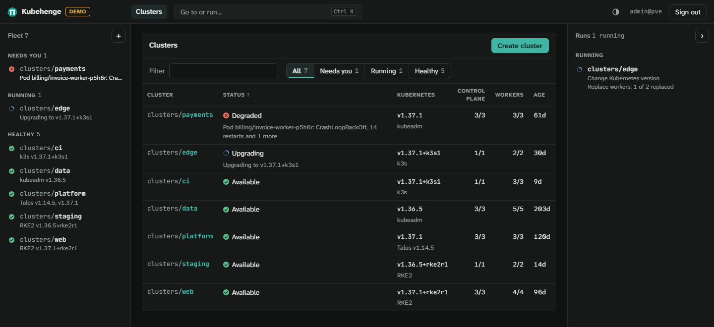
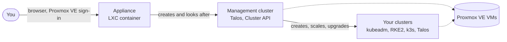

<!-- markdownlint-disable-next-line MD033 -- Markdown can neither size an image nor mark it decorative. -->
#  Kubehenge

Kubernetes for Proxmox VE.

[](docs/changelog.md)
[](https://github.com/kubehenge/kubehenge/actions/workflows/ci.yml?query=branch%3Amain)
[](https://github.com/kubehenge/kubehenge/actions/workflows/e2e.yml?query=event%3Aschedule)
[](https://github.com/kubehenge/kubehenge/actions/workflows/codeql.yml?query=branch%3Amain)
[](https://scorecard.dev/viewer/?uri=github.com/kubehenge/kubehenge)
[](docs/releasing.md#how-it-is-built-and-signed)
[](docs/releasing.md#what-is-attested)
[](docs/releasing.md#what-is-attested)
[](docs/install.md)
[](go.mod)
[](LICENSE)
[](https://kubehenge.dev)

**[kubehenge.dev](https://kubehenge.dev)** · [Install](docs/install.md) · [Clusters](docs/clusters.md) · [Changelog](docs/changelog.md) · [Roadmap](docs/roadmap.md)

> [!WARNING]
> **Alpha. Do not use it in production.** Any release may change Kubehenge completely, its settings, interface and ClusterClasses included. Nothing is guaranteed yet to keep working from one release to the next.



Kubehenge creates and runs Kubernetes clusters on Proxmox VE. You manage them from a web interface that signs in with your Proxmox VE users, LDAP, Active Directory and OpenID Connect realms included.

VMware's vSphere Kubernetes Service is built on Cluster API. Kubehenge is the Proxmox VE equivalent, built the same way.

## What it does

- **Create, scale, upgrade and delete clusters** on Proxmox VE, from the interface or with `kubectl apply`. Upgrades replace nodes one at a time, as do health checks for nodes not ready for five minutes.
- **A distribution per cluster:** kubeadm (upstream Kubernetes), RKE2, k3s or Talos Linux, with the distribution's own CNI, Cilium or Calico.
- **Proxmox VE built in:** the Proxmox CSI plugin for volumes, its cloud controller manager and a control-plane virtual IP.
- **Clusters kept apart.** Each cluster gets its own Proxmox VE pool, user and API token, with rights on its own VMs and volumes only.
- **Upgrades without a shell.** Clusters upgrade Kubernetes inside a window you set. Kubehenge upgrades itself to signed releases only, from a button or automatically.
- **Told when something breaks.** A failed run, a management cluster problem or a cluster's health item reaches a webhook, ntfy or email. Activity lists who did what for 90 days.

## What runs where



| Distribution | CNI | Node OS |
| --- | --- | --- |
| kubeadm | Cilium, Calico | AlmaLinux 10, Rocky Linux 10 |
| RKE2 | canal, Calico, Cilium | AlmaLinux 10, Rocky Linux 10 |
| k3s | flannel, Cilium, Calico | AlmaLinux 10, Rocky Linux 10 |
| Talos | flannel, Cilium, Calico | Talos Linux |

Kubehenge needs Proxmox VE 9. The end-to-end tests run each distribution with each CNI and node OS in the table ([testing.md](docs/testing.md)).

## Add-ons and sign-in

- **Add-ons per cluster:**
  - Rancher, with every Kubehenge cluster registered in it, and Headlamp.
  - CIS hardening, pod security with Kyverno, Istio, a Cilium Cluster Mesh and a load balancer.
  - Monitoring and logs.
  - Certificates from an ACME server or the cluster's own CA.
  - GitOps with Argo CD or Flux.
  - Backups with Velero to an S3 store, restored from the interface.
- **Cluster sign-in.** Each cluster can trust your OpenID Connect providers, set once for every cluster or per cluster. Tokens and certificates keep working beside them.
- **One Headlamp for every cluster.** The appliance's Headlamp opens every cluster you may see. Where the administrator switches it on, anyone who may download a cluster's admin kubeconfig is signed in to it as cluster-admin.

## Getting started

Kubehenge installs as a small LXC container. On a Proxmox VE 9 node, as root:

```sh
curl -fsSLO https://github.com/kubehenge/kubehenge/releases/latest/download/install.sh
sh install.sh
```

The script checks everything it downloads against checksums it carries, creates the appliance container and prints its address. Sign in there with your Proxmox VE account. Set up the management cluster on the setup page it shows on first sign-in. The appliance looks after it from then on. Infrastructure-as-code users can create it with the same Terraform/OpenTofu module instead.

Build the VM templates clusters are cloned from (**Administration**, **Templates**), then create clusters. Step by step: [docs/install.md](docs/install.md).

## Documentation

| | |
| --- | --- |
| [Installing](docs/install.md) | requirements, the appliance, the management cluster |
| [Clusters](docs/clusters.md) | creating, scaling, upgrading and deleting clusters, add-ons, permissions |
| [Upgrading](docs/upgrading.md) | the appliance, the management cluster and the clusters |
| [Uninstalling](docs/uninstalling.md) | removing clusters, the management cluster and the appliance |
| [Troubleshooting](docs/troubleshooting.md) | logs and the common failures |
| [Architecture](docs/architecture.md) | how it is built, and why |
| [VM templates](docs/templates.md) | the templates clusters are cloned from |
| [Testing](docs/testing.md) | the test tiers and what counts as supported |
| [Roadmap](docs/roadmap.md) | what comes next |
| [Releasing](docs/releasing.md) | how releases are built, signed and checked |
| [Changelog](docs/changelog.md) | what each release changed |

Contributions are welcome: [CONTRIBUTING.md](.github/CONTRIBUTING.md). Security reports go privately through [SECURITY.md](.github/SECURITY.md).

## Licence

[Apache-2.0](LICENSE).

Kubehenge is an independent project and is not affiliated with or endorsed by Proxmox Server Solutions GmbH. Proxmox is a registered trademark of Proxmox Server Solutions GmbH.
