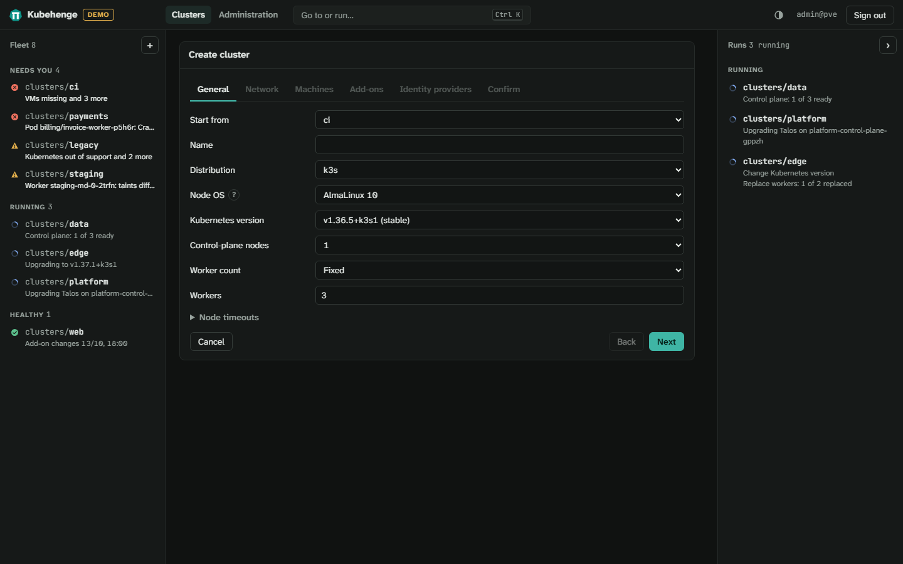
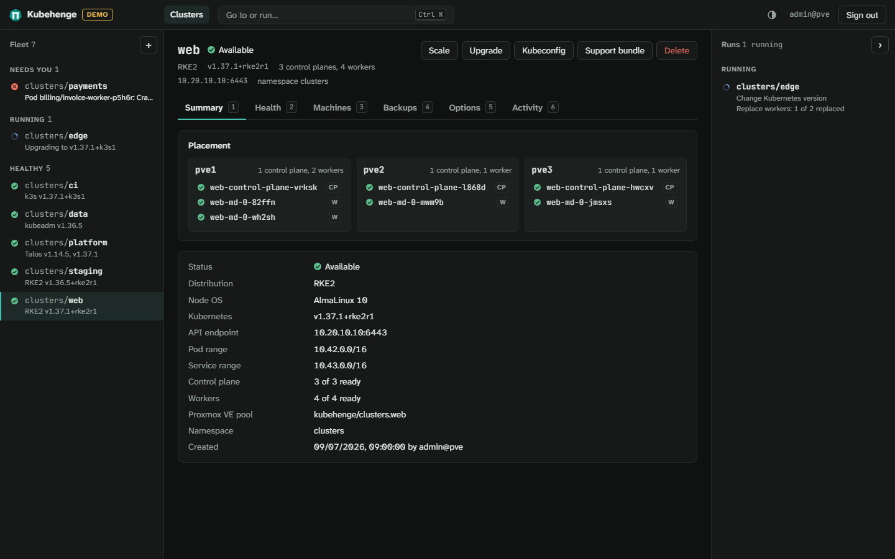
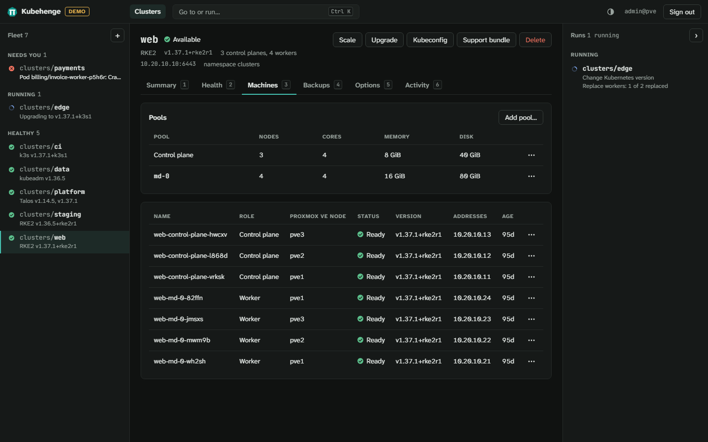
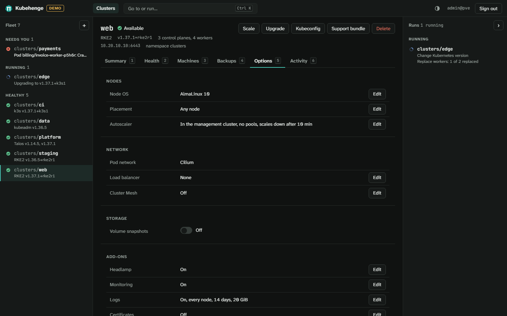
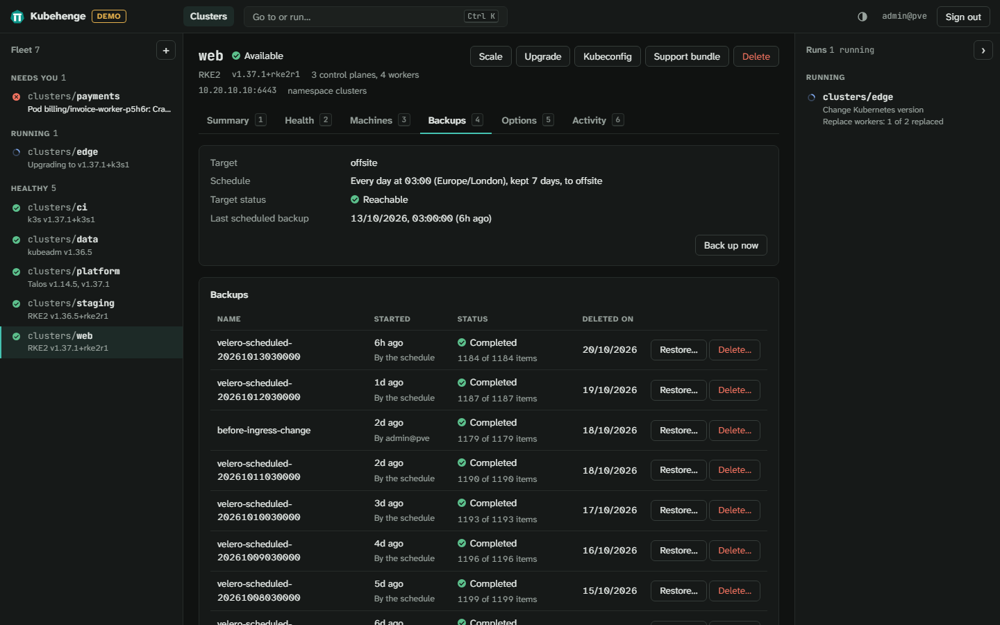

# Clusters

Every cluster Kubehenge creates is a Cluster API Cluster built from one of Kubehenge's ClusterClasses: kubeadm, RKE2, k3s or Talos. Its VMs live in a Proxmox VE pool of their own under the workload pool, `<workload pool>/<namespace>.<name>`. A cluster `prod` created in the interface lands in `kubehenge/clusters.prod`.

Before the first cluster, the VM templates for its distribution have to exist ([install.md](install.md#create-the-vm-templates)).

## What every cluster gets

- **The Proxmox VE cloud controller manager** labels each new node. Its region is the Proxmox VE cluster's name (outside a cluster, the node's), its zone the node.
- **The Proxmox CSI plugin**, with a default StorageClass `proxmox`: ext4 volumes on the cluster's storage, deleted when released. With `discard` and `ssd`, thin storage takes back deleted data.
- **A control-plane virtual IP**, held by kube-vip (on Talos, by Talos) and moved when its node fails.
- **A CNI**, [chosen at creation](#pod-network).
- **Traefik**, the ingress controller, on ports 80 and 443 of every node. A host name pointing at the API address or any node reaches it.
  - RKE2 and k3s bring their own. Kubehenge installs it into kubeadm and Talos clusters, in `kube-system`.
- **The Gateway API**, with Traefik's Gateway `traefik-gateway` ([below](#routes-through-the-gateway-api)).
- **Its own Proxmox VE user and API token**, limited to its own pool. The cloud controller manager and the CSI controller use it ([architecture.md](architecture.md#each-clusters-own-corner-of-proxmox-ve)).

### Health checks

A node that stays not ready for five minutes, or does not join within twenty, is replaced. Workers go one at a time.

- `kubectl annotate machine <name> cluster.x-k8s.io/remediate-machine=` has a machine replaced the same way.
- A control-plane machine is replaced only while etcd keeps its majority.
- A machine whose Proxmox VE node is offline or in HA maintenance waits for it, 30 minutes by default. So does one on unavailable storage ([troubleshooting.md](troubleshooting.md#machines-whose-replacement-waits-for-a-host)).

### Control-plane taint

Once a worker has joined, the control-plane nodes carry `node-role.kubernetes.io/control-plane:NoSchedule` in every distribution.

- A cluster scaled to no workers has the taint taken off, and its control planes run the workloads.
- A worker that fails leaves the taint in place.
- Pods that started on a control plane before the first worker joined stay there until next scheduled.

## Create a cluster in the interface

**Create cluster** on the cluster list opens a wizard of six steps: General, Network, Machines, Add-ons, Identity providers and Confirm.



A field shows what is wrong with it once it has been changed, or when **Next** is pressed with something missing. **Next** then moves to the first such field. A step in the bar above opens only once the steps before it are complete. **Cancel** asks before it discards what was entered.

Choosing another distribution brings its defaults only into what you have not set yet.

Without `VM.Allocate` on the workload pool, **Create cluster** is off and says so. Before the first cluster, the list shows which distributions have a VM template, with **Build one** for administrators where none has. It also shows whether you may create clusters.

### General

| Field | What it is |
| --- | --- |
| Start from | Once there is a cluster: the cluster to copy settings from, by default the newest that works, or **Defaults**. It copies the distribution, node OS, node counts and sizes, bridge, VLAN, MTU, queues, prefix length, gateway, DNS servers, load balancer, pod network and storage. It also copies placement, Proxmox VE HA, HA group labels, Headlamp, monitoring, logs, Pod Security, CIS hardening, Istio, Rancher registration and identity providers. Everything else starts at its default. Choosing another cluster keeps the name, the namespace, and the Kubernetes version while the distribution stays. |
| Namespace | Only where an administrator has named [more namespaces for clusters](#more-namespaces-for-clusters): the namespace in the management cluster the cluster goes to, `clusters` unless another is chosen. |
| Name | Lowercase letters, digits and dashes, starting with a letter and ending with a letter or digit, at most 40 characters. It also names the cluster's Proxmox VE pool and VMs. |
| Distribution | kubeadm, RKE2, k3s or Talos: one per ClusterClass in the management cluster. A distribution without a VM template in the template pool says so. Its clusters cannot be created until an administrator builds one ([templates.md](templates.md)). Where cluster creators may have missing templates built, **Build template** does it from the wizard. |
| Node OS | For kubeadm, RKE2 and k3s: the operating system of the nodes, AlmaLinux 10 unless another is chosen ([templates.md](templates.md#node-oses)). One not released yet is shown but cannot be chosen. One without a template on the distribution says so. For RKE2, each node OS is also offered in [FIPS mode](templates.md#fips-mode). A Talos cluster's nodes run Talos, so there is none to choose. |
| Talos release | For Talos only: the release the nodes run, among those the template pool has a template of, the newest chosen first. The newest release of each minor version the Talos Image Factory builds is listed too, marked as having no template yet. Where cluster creators may have missing templates built, one of those can be asked for here. Later releases are an upgrade away ([below](#talos-upgrades)). |
| Kubernetes version | For RKE2 and k3s: the newest release of each of the four newest minor versions. They come from the distribution's release channels as far as this Kubehenge release pins them ([architecture.md](architecture.md#release-pins-for-rke2-and-k3s)). The stable one is chosen first. A release it does not pin is refused, from kubectl too. A cluster on an older minor version can still be upgraded from it. For kubeadm: the newest version of each minor version a VM template has been built for on the chosen node OS, the newest chosen first. Where cluster creators may have missing templates built, **Kubernetes version to build** asks for another version's template. It is offered here once built, after about twenty minutes. For Talos: Kubernetes' newest release of each minor version the chosen Talos release runs, its default chosen first. Versions are in the distribution's own form: `v1.36.5` for kubeadm and Talos, `v1.36.5+rke2r1` for RKE2, `v1.36.5+k3s1` for k3s. When the list cannot be read, type the version in. |
| Control-plane nodes | 1, 3, 5 or 7. Three or more keep the cluster running when one fails. |
| Workers | 0 to 100. With none, the control-plane nodes run the workloads too. **Autoscaled**, instead of **Worker count**, has the cluster autoscaler keep the workers between **Fewest workers** (0 to 100) and **Most workers** (1 to 100) ([below](#autoscaling)). |

### Network

| Field | What it is |
| --- | --- |
| Bridge | The bridge the cluster's VMs attach to, one of those chosen for clusters when the management cluster was set up. Bridges you may not use (no `SDN.Use`) are shown but disabled. The wizard chooses the only one left, or else the first a node reaches its gateway through. That node's network on the bridge fills in the prefix length, gateway and DNS servers, and the example API and node addresses. When the management cluster names no bridges and Proxmox VE lists none to you (no `Sys.Audit` on the nodes), type the name in. |
| VLAN tag | Optional, 1 to 4094. With a tag, the wizard fills in nothing from the bridge's untagged network. A VNet of a VLAN zone tags its traffic already, so Kubehenge refuses a tag on it. |
| MTU | Optional, 1280 to 65520, [below](#interface-mtu-and-queues). |
| Queues | Optional, 1 to 64. The queues of the VMs' virtio interface, which spread its traffic over several vCPUs. Unset, it has one. |
| Firewall security groups | Optional. Proxmox VE security groups that turn on the firewall of every node's interface, [below](#firewall). |
| Address families | IPv4, IPv6, or both for dual-stack, the first one primary. Fixed for the cluster's life, [below](#ipv6-and-dual-stack). |
| API address | The control plane's virtual IP: an unused address in the nodes' network of the primary family, outside the node addresses. |
| Node addresses | Where the nodes take their addresses from: ranges (`192.0.2.21-192.0.2.29`), networks or single addresses inside the gateway's network, one per line or separated by commas. The wizard asks for at least one address more than there are nodes, for the extra node an upgrade or a replacement adds. It counts an autoscaled pool at its most. Leave more for scaling up. |
| Prefix length | Of the nodes' network. |
| Gateway | The nodes' default gateway. |
| IPv4 and IPv6 fields | With both families, the three fields above come once per family and name it, such as "IPv6 gateway". IPv6 ranges look like `2001:db8::21-2001:db8::29`. |
| DNS servers | Addresses of the cluster's families, one per line or separated by commas. A dual-stack cluster needs one of each family. |
| Time servers | Up to 8 NTP host names or IP addresses, separated by commas. Empty keeps the node image's public servers. The nodes reach them on UDP 123, and a node that cannot sync is reported on the health page ([troubleshooting](troubleshooting.md#a-nodes-clock-is-off)). |
| Registry mirrors | Per registry, up to 4 mirror addresses and an optional authority, [below](#sites-with-limited-access). |
| Trusted CAs | PEM certificates the nodes trust besides their OS's own, [below](#sites-with-limited-access). |
| Load balancer | What gives Services of type `LoadBalancer` their addresses, [below](#load-balancer). |
| Load-balancer addresses | With a load balancer: the addresses it hands out, as ranges, networks or single addresses. |
| Announce with | With MetalLB: layer 2 (ARP) or BGP, [below](#bgp). |
| Cluster AS number, Routers, Router ID | With BGP: the cluster's AS number, each router's address and AS number, and the router id. |
| Use a BGP password | With BGP: one TCP-MD5 password for every router. |
| Pod network | The CNI, [below](#pod-network). |
| Pod range, Service range | Optional, under **Pod and service ranges**. |

#### Interface MTU and queues

Set the MTU where the network carries frames other than 1500 bytes: 1450 on a VXLAN or SDN underlay, 9000 with jumbo frames.

Kubehenge sets it on the VM's Proxmox VE interface and on the node's own, on every distribution. Cilium, Calico and Flannel read the node's MTU and subtract their own overhead.

- **Bounds.** 1280 to 65520.
- **The bridge.** The interface cannot exceed the bridge's MTU on the nodes the cluster may use. A bridge that lists none has 1500.
- **When it is checked.** On creation and on every network change. Where a bridge cannot be read, only the bounds apply.
- **Unset.** On Proxmox VE 9 the VM's interface inherits the bridge's MTU. A VM running since Proxmox VE 8 has 1500 until it restarts.
- **Differing sizes.** The Health page lists a cluster whose VMs have different MTUs on different nodes. Large packets can be lost between them.

#### Filled-in addresses

Where a node reports the bridge's network, the wizard fills in the API address and the node addresses. It takes a free run from the network's 20th address on, clear of:

- the gateway, the node and every other cluster's addresses on the bridge
- any address where a host answers the management cluster's ping, or its connection on port 22, 80, 443, 6443, 8006 or 50000

Addresses you type are probed the same way and marked **In use** where a host answers. A host that answers no probe looks free, so the probe is only advice. The controller refuses only addresses another cluster holds.

The interface's pod pings without privileges through the `net.ipv4.ping_group_range` sysctl. Without it, only the connections are tried.

#### Pod and service ranges

Pod and service ranges must stay clear of each other and of the nodes' network (the gateway with the prefix length). Otherwise traffic for the nodes would be routed into the cluster.

Kubehenge sets both ranges on every cluster it creates. It takes those you give, and refuses them if they overlap. Otherwise it takes the distribution's own, when they are clear of the nodes' network (`10.244.0.0/16` and `10.96.0.0/12` for kubeadm and Talos, `10.42.0.0/16` and `10.43.0.0/16` for RKE2 and k3s). Otherwise it takes the first of a few private ranges that are clear.

#### Firewall

Name Proxmox VE security groups to turn on the firewall of every node's interface. Without groups it stays off.

- **Before.** The datacenter firewall is on (Datacenter, Firewall, Options). Each group exists under Datacenter, Firewall, Security Group, or the controller refuses it.
- **Names.** Up to 16 groups of 2 to 18 letters, digits, `-` and `_`. The first is a letter.
- **When.** Each VM's firewall is written before it first starts. Changing the groups replaces every node, one at a time.

##### What the firewall accepts

- **Without a group.** All traffic from the cluster's API address, node addresses and pod ranges. That covers etcd, the kubelet and the pod network on any port.
- **From the management side.** All traffic from the management cluster's nodes and the appliance. The appliance's interface and Headlamp reach the API server directly.
- **Only through the groups.** Everything else inbound: `kubectl` and `talosctl` from your machines, ingress, NodePorts, load-balancer addresses, SSH and Cluster Mesh peers.

A new address of the nodes, the management cluster or the appliance goes into each running VM's `kubehenge` IPSet. No node is replaced. When the appliance gets a new address by DHCP, the clusters accept it within a minute.

#### IPv6 and dual-stack

A cluster has IPv4, IPv6, or both. IPv6 and dual-stack are unsupported on every distribution and CNI until an end-to-end test passes with them.

- **The primary family** comes first. The API address, the Services' first range and each node's first address are of it.
- **Pod and service ranges** come one per family, in the same order. An IPv6 pod range is a /48 to /63, a Service range a /112 to /120.
- **Default IPv6 ranges** are `fd5e:4b1c:9a20::/56` for pods and `fd5e:4b1c:9a21::/112` for Services. On a clash with the nodes' network, the next clear range is taken.
- **Node addresses** come from each family's range, the primary first.
- **Load balancers** hand out addresses of the cluster's families. A dual-stack Service needs a range of each.
- **Fixed.** The families cannot change once the cluster exists.
- **Cluster Mesh** links clusters whose nodes reach each other over the same family: IPv4 where both have it, else IPv6.

##### IPv6-only networks

Much of what the nodes and add-ons download has no IPv6 address (GitHub among them). An IPv6-only network needs NAT64 with DNS64, or mirrors. The management cluster can pull through [registry mirrors and chart mirrors](install.md#mirroring-the-charts). RKE2 and k3s nodes fetch their release from GitHub as they boot, unless the management cluster sets a [release mirror](install.md#mirroring-the-releases).

#### Load balancer

Without one, kubeadm and RKE2 clusters give Services of type `LoadBalancer` no address. On k3s, servicelb answers for each on every node's address, on any port but 80 and 443 (the ingress controller's).

With one, each such Service takes its own address from the load-balancer addresses. One node at a time answers for it. When that node fails, another takes over. Choose:

- **MetalLB** (recommended), in the `metallb-system` namespace. It announces in layer 2 (ARP) or over BGP.
- **kube-vip**, in `kube-system`. Its cloud provider hands out the addresses, announced in layer 2 only.

##### Load-balancer addresses

In layer 2, the addresses must be unused and on the nodes' network. Kubehenge refuses the node addresses, the API address, the gateway and the network's own and broadcast addresses (on IPv6, its first). It also refuses another cluster's addresses on the same bridge and VLAN, on creation and on every change.

On k3s, a load balancer switches servicelb off. The load balancer can be switched or given other addresses later ([below](#change-settings)). Services outside the new range then take new addresses. A switch from MetalLB to kube-vip gives every Service a new address.

##### Layer 2 and switches that inspect ARP

Layer 2 needs the switch to accept the nodes' gratuitous ARP for the load-balancer addresses and for the API address. For IPv6 addresses, that is their unsolicited neighbour advertisements. A switch with dynamic ARP inspection or port security drops it. The Service then shows an `EXTERNAL-IP` that nobody answers for. Allow the addresses on the switch, or use BGP.

##### BGP

The `bgp` mode announces the load-balancer addresses and the API address to your routers instead of answering ARP. The addresses may then lie in a routed range outside the nodes' network. The gateway, the node addresses, the API address and other clusters' addresses are still refused.

- **Cluster AS number** and **Routers**: the cluster's AS number, and each router's address (of the cluster's families) and AS number. AS numbers run from 1 to 4294967295.
- **Router ID:** a dotted 32-bit id such as `10.0.0.1`. Left empty, each node gives its own IPv4 address.
- **Router ID on IPv6 only:** required. Every node gives the same id, which the routers have to accept from several peers.
- **Not supported:** ports other than 179.

Switching between the modes removes the old mode's advertisement and peers.

##### What announces what

- **Services:** MetalLB announces them from the workers through frr-k8s. A cluster needs at least one worker while the load balancer is on.
- **The API address:** kube-vip on the leading control plane announces it, on kubeadm, RKE2 and k3s. Talos has no BGP option for its virtual IP.
- **The routers** must accept a session from every node's own address with the cluster's AS number. Control planes peer for the API address, workers for the Services.
- **Separate sessions:** MetalLB's peers skip the control planes, since most routers refuse two sessions from one address.

##### BGP password

*Use a BGP password* sets one TCP-MD5 password for all routers, without spaces, colons or commas. The cluster waits until you enter it.

The password lives in the cluster's `bgp` credential. A Secret beside the cluster (for kube-vip) and one in the workload cluster (for MetalLB) copy it.

#### Pod network

The CNI is chosen now and fixed for the cluster's life. Switching a running cluster's pod network would leave the old one's interfaces, routes and addresses on every node.

| Distribution | Choices | Default |
| --- | --- | --- |
| kubeadm | Cilium, Calico | none: one has to be chosen |
| RKE2 | canal, Calico, Cilium | canal |
| k3s | flannel, Cilium, Calico | flannel |
| Talos | flannel, Cilium, Calico | flannel |

A node OS in [FIPS mode](templates.md#fips-mode) runs on canal alone, the only CNI RKE2 builds for FIPS mode.

RKE2 installs its choice itself. For kubeadm, and for k3s and Talos given Cilium or Calico, Kubehenge's controller installs it. Then k3s's flannel and network policy controller are switched off, and Talos's flannel is left out.

### Machines

| Field | What it is |
| --- | --- |
| Storage | For the nodes' disks and the cluster's persistent volumes: one of those chosen for clusters when the management cluster was set up. Only storages you may allocate space on are listed, with their free space, and whether they are shared. A single one is chosen already. Shared storage lets the cluster's VMs start on any node. |
| Control plane, Workers | Cores, memory in MiB (in steps of 8) and disk in GiB. |
| Placement | The Proxmox VE nodes the cluster's VMs may run on: **Any node**, **HA rule nodes**, or **Chosen nodes**. |
| Proxmox VE HA | Shown when the management cluster has Proxmox VE HA and the storage is shared. On by default. |
| Newest CSI plugin release | Shown when the management cluster lets clusters choose it. Off by default. See [Persistent volumes](#persistent-volumes). |
| HA group labels | Shown unless the management cluster switched them off for every cluster ([install-settings.md](install-settings.md#ha-group-labels)). On by default. See below. |
| Volume snapshots | Shown when the storage is local to each node. Off by default. See [Volume snapshots](#volume-snapshots). |

Placement and the four options below it change later under **Options**.

#### Placement

Each new VM goes to an online node it may use, the one running the fewest of the cluster's VMs of its kind. Three control planes on three nodes run one to a node.

**Any node** means every node of the Proxmox VE cluster, nodes added later included. A node that goes down is left out within about 15 seconds, until it is online again. While every node chosen is down, no new VM is placed elsewhere.

##### HA rule nodes

**HA rule nodes** lists Proxmox VE's enabled HA node-affinity rules (Datacenter, HA, Affinity Rules) with the nodes each allows. For a rule that keeps resources off its nodes, that is every other node. Choosing a rule copies its nodes into the cluster once. A later change of the rule does not move the cluster. The cluster's VMs do not become HA resources.

Reading the rules takes `Sys.Audit` on `/`. Without it the choice says so, and the nodes can still be chosen one by one. An administrator can have the rules offered to cluster creators ([install-settings.md](install-settings.md#ha-rule-placements)). Then everyone who may create or change a cluster sees each rule's name and nodes, up to 30 seconds old, without its comment or strictness.

The rules Kubehenge keeps for its own clusters' Proxmox VE HA are not offered.

#### Nodes left out of the placement

A node is left out while it lacks the cluster's storage, template, bridge or VNet, or has less free memory than the cluster's largest machine.

- **Free memory** is what Proxmox VE reports as unused now, as when it starts a VM. Memory of stopped VMs is not held back.
- **Rejoining** takes a tenth more free memory than the machine needs.
- **A node back online** counts with the memory it reports itself, not the figures from before it went down.
- **New clusters:** the create wizard warns, without blocking, when no node it may use has the free memory.
- **No room anywhere:** the placement stays as it was. The cluster's `NodesLackMemory` condition names the memory needed and the best node's free memory.
- **Bridge or VNet:** a bridge on none of the nodes the cluster may use is refused on creation or change. A VNet counts as present where its zone is applied.

#### Proxmox VE HA

**Proxmox VE HA** keeps the control-plane VMs on separate nodes while they run, which placement alone cannot do. Once a control-plane machine has joined, Kubehenge's controller makes its VM an HA resource (Datacenter, HA, Resources), commented `Kubehenge cluster <pool>`. It also adds an HA rule that keeps the cluster's VMs apart (Datacenter, HA, Affinity Rules). With more control planes than nodes, it keeps as many apart as there are nodes. When the cluster may use only some nodes, a second rule keeps them to those.

It takes effect only where the administrator switched it on for the management cluster ([install.md](install.md#the-settings)) and the disks are on shared storage. Unticking **Proxmox VE HA**, or deleting a control-plane machine, takes its VM out of HA first. The controller undoes changes made by hand to the rules or resources.

##### Failover and quorum

Proxmox VE's HA manager migrates VMs that share a node apart. It restarts the VM of a failed node on another one. A node running an HA resource arms Proxmox VE's watchdog and restarts itself when it loses quorum. On a Proxmox VE cluster without a reliable quorum, leave HA off.

Workers are not HA resources. The health check replaces a worker lost with its node.

#### HA group labels

**Add HA group labels** has the cloud controller manager label each node with its Proxmox VE node's HA groups (or HA node-affinity rules). The label is `group.topology.proxmox.sinextra.dev/<group or rule>`, with an empty value. Reading the groups takes `Sys.Audit` on `/`. While the option is on, Kubehenge's controller adds the cluster's user to a group holding it there, unpropagated.

The token can then read the Proxmox VE cluster's own configuration (firewall rules, backup jobs, HA, corosync) but change nothing. It reads no more of the guests, storages or nodes than before. Switching the option takes no privilege beyond changing the cluster.

Unticked, the nodes go without the labels. The cloud controller manager then logs a permission error for each node every few minutes. Ticked again, the nodes get them within a few minutes. Switching it off does not remove them. When the controller cannot grant `Sys.Audit`, `kubectl describe cluster` shows a `SysAuditRefused` event saying why.

#### Sizes

A control plane defaults to 2 cores, 4096 MiB and a 30 GiB disk. A kubeadm one defaults to 4800 MiB, which it needs with Calico. A worker defaults to 2 cores, 6144 MiB and a 40 GiB disk. That fits every add-on except Rancher, logs, backups and GitOps, with about 2 GiB to spare.

Disks are at least 20 GiB. A control-plane node needs at least 2 cores and 4096 MiB, the first row of the k3s and RKE2 server sizing guides. For kubeadm, which documents no sizes, RKE2's guide applies. A worker needs at least 1024 MiB on k3s and Talos, 2048 MiB on kubeadm, and 2 cores and 4096 MiB on RKE2.

Once the cluster exists, only **Resize** ([Pools](#pools)) changes its sizes. With kubectl a change of size rolls the nodes. A disk only grows.

##### Control planes for many workers

Kubehenge refuses control planes smaller than the guides ask for, on creation and whenever the workers or machines change. RKE2 and kubeadm need 4 cores and 8192 MiB from 226 workers. They need 8 cores and 16384 MiB from 451 and 16 cores and 32768 MiB from 1,301. For k3s the same sizes start at 351, 901 and 1,801 workers.

##### Clusters without workers

A cluster without workers runs its workloads on its control planes. Each then needs a worker's least on top. On k3s that is 3 cores and 5120 MiB, on kubeadm 3 cores and 6144 MiB, and on RKE2 4 cores and 8192 MiB. The interface raises the control planes to that when the workers are set to none, while the cluster is created.

##### Room for add-ons

The add-ons' pods run on the workers, or on the control planes of a cluster without workers. Each such node needs the larger of its distribution's least and its own needs plus its share of the pods' memory and CPU.

Each add-on also grows every control plane's API server, workers or not. The API server's Go memory limit is 40% of its control plane's memory. On k3s it is half, for the server's whole process.

A pod is scheduled only onto a node with its requested CPU and memory not yet requested. A pod on every node counts once per node. A node needs room for both what the pods use and what they request.

Kubehenge refuses a cluster short of that room on creation and when an add-on or the nodes change. The interface raises the machines as add-ons are chosen. Its Add-ons step shows the totals.

| Add-on | Pods' memory | Pods' requested memory | Each control plane, kubeadm, RKE2 and Talos | Each control plane, k3s | Pods' CPU |
| --- | --- | --- | --- | --- | --- |
| Headlamp | 64 MiB | 64 MiB | 8 MiB | none | 10 millicores |
| Monitoring | 1536 MiB | 752 MiB | 32 MiB | 616 MiB | 300 millicores |
| Logs | 512 MiB | 464 MiB | 56 MiB | none | 75 millicores |
| Backups | 384 MiB | 192 MiB | 184 MiB | 24 MiB | 70 millicores |
| Kyverno | 640 MiB | 448 MiB | 552 MiB | 520 MiB | 500 millicores |
| Istio | 488 MiB | 484 MiB | 288 MiB | 504 MiB | 400 millicores |
| Cilium Cluster Mesh | 128 MiB | 128 MiB | none | none | 30 millicores |
| Load balancer | 128 MiB | 128 MiB | none | none | 60 millicores |
| GitOps with Argo CD | 512 MiB | 352 MiB | 432 MiB | 360 MiB | 90 millicores |
| GitOps with Flux | 384 MiB | 320 MiB | none | none | 50 millicores |
| cert-manager, with monitoring, Rancher or certificates | 192 MiB | 160 MiB | 48 MiB | none | 30 millicores |
| Rancher | 2048 MiB | 640 MiB | 512 MiB | 512 MiB | 120 millicores |
| Rancher's agent, in every cluster that registers | 512 MiB | 192 MiB | none | none | 30 millicores |

##### Memory per node

A worker counts 448 MiB for itself on k3s and 704 MiB on kubeadm, RKE2 and Talos. A control plane counts 1848 MiB on k3s, 2392 MiB on Talos, 3120 MiB on RKE2 and 3376 MiB on kubeadm before any add-on. With every add-on but Rancher it needs 3872 MiB on k3s, 3992 MiB on Talos, 4720 MiB on RKE2 and 4976 MiB on kubeadm.

A CNI other than the class's default adds to each control plane, once the cluster has an add-on.

| Distribution | Cilium | Calico |
| --- | --- | --- |
| k3s | 1160 MiB | 1808 MiB |
| kubeadm | default | 1424 MiB |
| RKE2 | 504 MiB | 144 MiB |
| Talos | 520 MiB | 384 MiB |

With every add-on but Rancher, a k3s control plane needs 5032 MiB with Cilium and 5680 MiB with Calico.

##### What the default machines hold

A single k3s worker with every add-on but Rancher and GitOps needs 5032 MiB. It needs 4648 MiB without backups, 4520 MiB without logs, or 4136 MiB without either. GitOps with Argo CD adds 512 MiB to each.

On k3s the default machines hold every add-on but Rancher, logs, backups and GitOps, with the default CNI. On kubeadm (with Cilium), RKE2 and Talos they hold the same without Kyverno. A second worker makes room for logs and backups too.

##### Requested memory per node

A worker counts what the kernel and the kubelet keep back plus what its own pods request. That is 528 MiB on kubeadm, 664 MiB on k3s, 960 MiB on Talos and 1032 MiB on RKE2. Talos keeps 384 MiB back for the system. On kubeadm and Talos the workers together count 140 MiB more for CoreDNS. Without workers, a control plane counts 1128 MiB on k3s, 1232 MiB on kubeadm, 2328 MiB on Talos and 3128 MiB on RKE2.

A Talos worker of 2216 MiB holds Istio, the load balancer, Rancher's agent and Flux by what their pods use. Their requests need a worker of 2224 MiB.

##### CPU per node

A worker counts what its distribution, CNI and Kubehenge's pods request. That is 150 millicores on kubeadm, 350 on k3s, 390 on Talos and 775 on RKE2. Without workers, a control plane counts 1080 millicores on kubeadm, 430 on k3s, 910 on Talos and 1605 on RKE2.

Talos keeps 50 back. Its flannel asks for 200 with its network policy controller. On RKE2, kube-proxy asks for 250 and canal for 260. On kubeadm and Talos the workers together count 200 more for CoreDNS's two replicas.

Every add-on but Rancher takes 1595 millicores with Argo CD, or 1555 with Flux. That fits on one default 2-core worker on kubeadm and k3s. Talos and RKE2 need a third core for it, or a second worker.

On a single-core worker, the least kubeadm, k3s and Talos allow, Kyverno and Istio do not fit together. Nor does either fit with every other add-on.

#### etcd storage

Every change to the cluster waits for etcd to sync its write-ahead log to the control planes' disk. etcd's documentation asks for a 99th percentile of that sync under 10 ms. Above it, heartbeats and API requests time out.

- Put the control planes on local SSD or NVMe storage. It syncs in well under 5 ms.
- Ceph and NFS are often slower, since each write crosses the network first.
- Their latency swings with the load of every other VM. Ceph on SSD or NVMe can keep up, unlike spinning disks.

##### The etcd disk slow warning

Every 5 minutes Kubehenge reads each etcd member's sync times. On Talos it reads them from port 2379 of each control-plane node, with a certificate of the cluster's etcd CA. The management cluster's controller must reach that port.

When a member's 99th percentile is above 25 ms, the cluster's Health shows **etcd disk slow**. `kubectl describe cluster` shows the `EtcdDiskSlow` condition. The figure covers the member's whole life. It clears slowly once the disk is fast again. A member with under 100 syncs is not judged.

### Add-ons

Each add-on the class offers is a card with the memory its pods take by the class's figures. It opens on its settings once chosen. Under the cards is the least memory and cores each node that carries them needs.

**Certificates** come from cert-manager for the cluster's Ingresses and routes. They are issued by Let's Encrypt or another ACME server, or by a CA of the cluster's own ([below](#certificates)).

#### Headlamp

Headlamp is a web interface inside the cluster, with an optional host name served through the cluster's ingress controller. Without one, reach it with `kubectl -n headlamp port-forward svc/headlamp 8080:80`. It has no rights of its own. Everyone signs in with their own token or through OpenID Connect.

**Read-only without sign-in** (off by default) binds its service account to Kubernetes' built-in `view` ClusterRole for every request:

- Anyone who reaches it sees the workloads, Services, ConfigMaps, events and pod logs of every namespace.
- They also see custom resources whose roles add themselves to `view`.
- It shows no Secrets and no nodes. It changes nothing, whatever token it is given.

Every cluster can also be opened in the appliance's shared Headlamp, without this add-on ([below](#open-a-cluster-in-headlamp)).

#### Monitoring

Prometheus, Alertmanager and Grafana, with kube-prometheus-stack's dashboards and alerts for every node and control-plane component. It installs cert-manager too. It takes about 1.5 GiB of the workers' memory ([Machines](#machines)) and a 20 GiB volume.

- Each component is scraped over verified, authenticated TLS ([architecture.md](architecture.md#add-ons)).
- Grafana's `admin` password is in the `kube-prometheus-stack-grafana` Secret of the `monitoring` namespace.
- With a host name, Grafana is served at it through the ingress controller. Without one, reach it with `kubectl -n monitoring port-forward svc/kube-prometheus-stack-grafana 3000:80`.
- Prometheus reads every ServiceMonitor, PodMonitor, Probe, ScrapeConfig and PrometheusRule in the cluster, whatever its labels. Charts need no `release` label.
- Alerts go nowhere until you name a receiver ([Monitoring alerts and remote write](#monitoring-alerts-and-remote-write)).
- The chart's own job in `monitoring` applies the Prometheus Operator's CRDs again on every chart upgrade.

#### Logs

Loki keeps the cluster's logs on a volume of its own. Grafana Alloy collects them. Monitoring's Grafana reads them ([architecture.md](architecture.md#add-ons)). Logs need monitoring, which cannot be switched off while they are on.

Logs are kept for 7 days in a 10 GiB volume unless set otherwise. Loki deletes by age, not by size. Size the volume, which only grows, for the days kept.

The collector is chosen with them:

- **On every node** (recommended): Alloy runs on every node in the `logging-node` namespace, exempt from pod security. It reads every container's log from the host read-only, short-lived pods' too, the node's journal and, on the control planes, the API server's audit log.
- **Through the Kubernetes API**: one lighter Alloy in `logging` reads the pods' logs through the API server, with no access to the host. It misses the journal, the audit log and pods that end before it reads them.

##### Log outputs

**Log outputs** send every log to up to 4 more destinations beside Loki, which stays on because Grafana reads it. Each output has a **name** (lower-case, at most 20 characters), a **kind**, an **endpoint** and the streams it takes. None ticked sends all four: `containers`, `events`, `nodes` and `audit` (the API server's audit log, which the node collector reads).

- **Syslog** sends RFC 5424 messages to `tls://host:port`, `tcp://host:port` (clear text) or `udp://host:port`, without authentication. The message is the log line, with the `node` label as host name and the `job` label as application name.
- **OTLP over HTTP** sends to the receiver's base URL, such as `https://otlp.example.com:4318`. Alloy adds `/v1/logs`.
- **Loki** sends to another Loki-compatible endpoint, such as Grafana Cloud. The endpoint is the whole push URL, which ends in `/loki/api/v1/push`.

There is no plain `http` kind. Splunk and Elastic take OTLP, syslog or Loki-compatible input. Syslog uses an Alloy component at public-preview stability. Kubehenge starts that Alloy with `--stability.level=public-preview`.

##### Log output credentials

Authentication is `none`, `basic` (user name and password) or `bearer` (a token). OTLP and Loki take it over `https://` only. A private CA's certificates go into **CA certificate**. The endpoint holds no user, query or fragment.

Credentials are stored for the cluster under the purpose `log-<name>`, in **Edit logs** under **Options**. They hold `username` and `password`, or `token`. With kubectl, store a Secret of type `kubehenge.dev/user-credential` named `<cluster>.log-<name>`. Label it `kubehenge.dev/user-credential: log-<name>` and `kubehenge.dev/credential-cluster: <cluster>`.

Kubehenge copies the credential into the Secret `kubehenge-log-outputs` in the namespaces of the cluster's Alloys. Alloy reads it from a file, so a changed credential needs no restart. Switching off logs, or the last output with a credential, deletes that Secret.

#### Backups

Velero backs up every namespace but Kubernetes' own and the add-ons', with the data in its pods' volumes. It writes to one of the S3 stores an administrator set ([install-settings.md](install-settings.md#backup-targets)). The cluster writes under a folder of its own, encrypted with keys of its own ([Back up and restore](#back-up-and-restore)). Backups run daily at 02:00 by default, each kept for 7 days.

Choose the target, the schedule, its time zone, how long each backup is kept and the access key Velero signs in with. Storing that key needs `Sys.Modify` on the workload pool. Without it, backups wait until someone holding that stores one. The key an administrator stored for every cluster never goes into a cluster. Without any target, the choice is off and says so.

#### etcd snapshot settings

[etcd snapshots](#etcd-snapshots) are on by default wherever an administrator set a backup target, and absent without one. Choose the target, the schedule, its time zone (the browser's to start with) and how many snapshots are kept. On RKE2 and k3s, also choose [the distribution's own upload](#the-distributions-own-upload).

They use the backups' access key, entered once for both. Without `Sys.Modify` on the workload pool to store it, they wait as backups do. With backups on, the snapshots go to the backups' target, since one access key reaches one store. A cluster started from another takes that cluster's snapshot settings, or the default where it never set any.

#### Pod security

Pods are held to a [Pod Security Standard](https://kubernetes.io/docs/concepts/security/pod-security-standards/), `baseline` or `restricted`. Kubernetes' Pod Security Admission, Kyverno or both enforce it, each at a level of its own.

- Pod Security Admission sets the level of every namespace that labels none of its own, `baseline` unless another is chosen. It warns about and audits pods short of `restricted` at every level.
- Kyverno holds every namespace to its level whatever the labels say. It reports what falls short.
- `kube-system` and the namespaces of add-ons that need the host are exempt from Pod Security Admission. They are exempt from Kyverno only where the cluster runs that add-on ([architecture.md](architecture.md#add-ons)).
- Who may create and label namespaces decides who may run privileged pods. A namespace's labels set its own level.
- A workload that needs more gets its namespace labelled, and with Kyverno a PolicyException in the `kyverno` namespace.

#### CIS hardening

CIS hardening applies the CIS Kubernetes Benchmark beyond the baseline every cluster gets ([architecture.md](architecture.md#add-ons)). It can be switched on after creation, never off again. From the command line: `kubehenge cluster update NAME --cis`.

- Switching it on replaces the control plane and the workers, one node at a time.
- **Options** lists the running pods the `restricted` level would refuse, before you save. They keep running until their node is replaced.
- Pod Security Admission enforces `restricted` outside the exempt namespaces.
- Every container that asks for no seccomp profile runs under the container runtime's default.
- Exec, attach and port-forward sessions end after five idle minutes.
- RKE2 runs its own CIS profile. Pods in `kube-system`, `kube-public` and `default` then take connections only from their own namespace.

#### Istio

Istio runs in ambient mode. Label a namespace `istio.io/dataplane-mode=ambient` and its pods talk over mutual TLS with their workload identities, without sidecars ([architecture.md](architecture.md#add-ons)).

Under a NetworkPolicy that denies by default, allow ztunnel's port 15008/TCP between the enrolled pods. Allow 169.254.7.127/32 too, where the kubelet's probes come from.

#### Cluster Mesh

**Join a Cluster Mesh** links a cluster that runs Cilium with other Cilium clusters of the namespace.

- Two clusters are linked while both are in the mesh and list each other. A peer listed before it exists is linked once it does.
- Their pods then reach each other's, by address and through Cilium's global services. Each cluster reads the other's pod names, labels and identities ([architecture.md](architecture.md#add-ons)).
- Peers reach the cluster on port 32379/TCP of its API address, which has to be open between them.
- A cluster that runs Cilium has a name of at most 32 characters. It gets a pod range no other Kubehenge cluster uses, clear of the nodes' network.

#### Add-ons' proxy

**Proxy** (Management proxy, Own proxy or No proxy) is the proxy for the add-ons that reach beyond the cluster. Those are cert-manager (ACME and DNS providers), Velero (server and node agents), Argo CD, Flux's controllers, Headlamp and Rancher.

- The management side's proxy ([install.md](install.md#behind-a-proxy)) and its exceptions are the default.
- Add-on settings are plain text, so a proxy address holding a user name or password is not passed on. Give the cluster its own address without credentials.
- The cluster's pod and service ranges, `localhost`, `127.0.0.1`, `.svc` and `.cluster.local` bypass the proxy. Add an internal S3 store, Git server or identity provider under Exceptions.
- The add-ons' pods do not trust a proxy that re-signs TLS. Kubehenge does not add its authority to them.

#### GitOps

Argo CD (recommended) or Flux keeps the cluster in step with a directory of a Git repository. It applies what the directory holds and removes what goes from it ([architecture.md](architecture.md#add-ons)). Choosing the repository needs `Sys.Modify` on the workload pool, since the engine applies it with cluster-wide rights.

##### Reading the repository

Give the repository's URL, branch or ref and directory, and how it is read:

- As it is, for a public repository over HTTPS.
- With a certificate authority (PEM) for an HTTPS server the usual authorities do not sign. Argo CD trusts it in `argocd-tls-certs-cm`, Flux as `ca.crt` of the pull Secret Kubehenge writes or of your own.
- With a deploy key over SSH (recommended for a private repository). Kubehenge makes the key once the cluster is saved and shows it under **Options**, to add as a read-only deploy key.
- With a user name and read-only token over HTTPS, stored under **Options** once the cluster exists.
- With a Secret of your own.

Over SSH, give the server's host keys as `known_hosts` lines, from the forge's published keys or `ssh-keygen -F <host>`. Kubehenge never reads them from the network. It shows their fingerprints beside the deploy key.

##### Argo CD and Flux interfaces

Argo CD signs in through the cluster's first identity provider, its local admin disabled. The provider's groups listed as admins administer it. Nobody else has any rights in it. With a host name it is served through the ingress controller. Without one, reach it with `kubectl -n argocd port-forward svc/argocd-server 8080:80`.

Flux's web interface is off by default. Switched on, it shows every Flux object and the workloads they deployed at its host name. Those signed in can reconcile, suspend and resume them, with their RBAC rights. It signs in with a client secret.

The Flux Operator installs Flux. It is licensed under AGPL-3.0, and Kubehenge runs it unmodified.

#### Rancher

**Rancher** installs Rancher into this cluster, with cert-manager. Every other cluster then registers with it on its own (**Register with Rancher**, on by default). Rancher's upgrades of registered RKE2 and k3s clusters are switched off, since Kubehenge upgrades them.

- It needs a host name that resolves to this cluster's ingress controller (such as its API address), for people and for every registered cluster.
- Installing it needs `Sys.Modify` on the workload pool, since Rancher receives the admin kubeconfig of every cluster that registers. Without it the choice is off and says so.
- Its first admin password is generated into the `bootstrap-secret` Secret in `cattle-system`.
- Only one cluster may run Rancher. The interface refuses a second.
- A second set with kubectl gets no Rancher. A `RancherRefused` event says why.
- For Rancher to stay up while a node is lost, give its cluster three control planes.

##### Rancher's sizes

Every node of Rancher's cluster needs at least 4 vCPUs, the least Rancher's documentation sizes it for. Kubehenge refuses fewer, at creation and when the machines change. The interface raises the cores to 4 when Rancher is chosen. Memory follows the number of clusters and nodes Rancher manages. Rancher's documentation gives:

- 16 GB per node for up to about 150 clusters and 1,500 nodes.
- 32 GB with 8 vCPUs for up to 300 and 3,000.
- 64 GB with 16 vCPUs for up to 1,000 and 10,000.

##### Rancher's Kubernetes versions

Kubehenge keeps Rancher's cluster within the Kubernetes versions Rancher's release runs on. It does not build it at a version outside them. The Cluster is then created without VMs, and its conditions say why. It does not install Rancher into an existing cluster outside them. It holds back upgrades beyond them.

#### Automatic upgrades

**Upgrade automatically** is off, patch releases, or patch and minor releases, inside a window. The window is every day from 02:00 for four hours in your browser's time zone. The cluster's **Options** change it later ([upgrading.md](upgrading.md#automatically-inside-a-window)).

The nodes of a kubeadm, RKE2 or k3s cluster move to new builds of their VM template in the same window whatever this says ([below](#node-image-refresh)).

### Identity providers

The OpenID Connect providers whose ID tokens the cluster's API server accepts, besides certificates and ServiceAccount tokens, which always work. The list starts with the providers set for every cluster on the Administration page. Keeping or dropping them needs no further privilege. Adding or changing one needs `Sys.Modify` on the workload pool, and without it the providers can only be removed. See [Signing in with OpenID Connect](#signing-in-with-openid-connect).

### Confirm

Checks the cluster before it exists. The API server runs every webhook and admission policy on it without creating it (`POST /api/clusters?dryRun=All`, as `kubectl create --dry-run=server` would). As advice, the most memory and disk its VMs take are weighed against what its storage and the nodes it may use have free.

Below are every setting by name and the Cluster as the API server would store it, as YAML. **Copy as YAML** copies it for `kubectl apply` or a Git repository. Credentials typed into the wizard are not in it, and are stored once the cluster exists. **Create** is offered once the API server accepts the cluster. It creates the cluster and opens its page.

Kubehenge's controller first gives the cluster its Proxmox VE pool, user, token and the VM that will own its persistent volumes. Only then does Cluster API clone the VMs. The cluster shows **Provisioning** until it is available.

## Finding your way

The fleet list and the Runs panel are on every page. Search and keys reach the rest.

### The fleet list

Every page shows the fleet down its left side, grouped by where each cluster stands, with why in a few words.

- **Needs you:** something failed and waits for someone. The line names the worst of it.
  - A failed Talos upgrade or machine, or a cluster Cluster API reports failed.
  - A cluster not available an hour after creation, one Kubehenge's controller fails on, or one whose machines are stuck ([below](#the-cluster-page)).
  - A cluster whose [health page](#the-cluster-page) finds an API server that does not answer, a node not ready or a pod that keeps crashing.
- **Running:** a change is under way (a creation, upgrade, rollout, scale or deletion), or an add-on is still installing.
- **Healthy:** nothing is going on and its health page finds nothing. The line under the name says what it runs.

The health pages are read for the whole fleet at most every 30 seconds.

### Runs

Down the right side of a wide window, **Runs** follows work that goes on by itself once started. That is the changes under **Running**, each cluster's etcd snapshots, etcd restores, backups and restores, each with how far it has come. Those who may set up the management cluster also see its applies, the template builds and refreshes, and the appliance's upgrades.

A failed run stays for a day with its first error. A successful one stays for an hour. A change or creation whose machines are stuck moves under **Stalled**, with the worst its machines report. It moves back under **Running** once one is ready.

**Runs** folds away with **›**. In a narrower window, **Running** in the top bar shows it.

### A run's page

Each run opens a page of its own. It shows what the run does, on which cluster, who started it and how long it has taken. It pins the first error at the top and lists its steps, each done, under way or waiting. Every run links to the page it is started from.

A failed run has **Try again**, which starts it again as it was started. A restore keeps its choices and a template build its own. An upgrade goes to its release. An etcd restore uses its snapshot.

Where the run took the state passphrase or a typed name, Try again asks for it again. A new backup or restore opens the cluster's backups, where it shows first.

### What a run shows

A change [applied here](#staged-changes) is a run too, kept for a day in place of the cluster's line under **Running**. Its first step is the API server accepting it. Then come the machines it changes:

- A replacement counts the control-plane machines or the workers, as the new ones are ready and the old ones gone.
- An addition or removal counts the machines it adds or removes.

The cluster then settles, available with its topology updated.

An etcd snapshot, an etcd restore and a change show the events the controller and Cluster API reported since they began. The management cluster keeps events a day. An etcd restore and an appliance upgrade show their steps.

Applies and template builds show the end of their log. A finished backup or restore shows the end of Velero's log of it, to those who may download the cluster's kubeconfig.

### Go to or run

**Go to or run…** in the top bar, or `Ctrl K` (`⌘ K` on a Mac), finds any cluster, view, page or action you may start. A few letters are enough. `db opt` finds the options of `db` and `db upg` opens its upgrade. The actions are Scale, Upgrade, Delete and a cluster's kubeconfig or talosconfig.

Each action is an address too: the cluster's page with `?do=scale`, `upgrade`, `delete`, `kubeconfig` or `talosconfig`. Opening it starts the action once and removes `?do=` from the address.

Outside fields, keys work too, and `?` lists them. Those that leave the page or change its layout are two keys pressed one after the other, so a stray key does neither:

| Keys | Does |
| --- | --- |
| `/` | the same as `Ctrl K` |
| `G` `C` | the clusters |
| `G` `N` | a new cluster |
| `G` `A` | Administration, for those who may open it |
| `[`, `]` | the cluster before or after the open one, in the fleet's order, on the same view |
| `1` to `6` | the open cluster's Summary, Health, Machines, Backups, Options and Activity |
| `T` `R` | shows or folds away the running work |

## The cluster page



The buttons beside the cluster's name act on the whole cluster: **Scale**, **Upgrade**, **Kubeconfig**, **Support bundle**, **Headlamp** and **Delete**. Once the cluster is available, **Kubeconfig** appears for those with `Sys.Modify` on its pool and **Headlamp** for clusters in the interface's namespaces. **Support bundle** appears for those with `Sys.Modify` on its pool. It downloads the same bundle as `kubehenge diagnose` ([troubleshooting.md](troubleshooting.md#a-clusters-support-bundle)). Without `VM.Allocate` on its pool, or while it is being deleted, the others are disabled and the page says why.

The tabs under the name switch between its views.

### Summary

The Summary shows, in order:

- The machines laid out by the Proxmox VE node their VMs run on, control planes first, each with its state.
  - Other nodes you may see follow empty, as places for new machines. Machines on nodes you may not see come last.
  - It carries the Machines view's warning when one node runs more than one control-plane VM.
- The status, distribution, Kubernetes version, API endpoint, and pod and service ranges.
- The ready control-plane nodes and workers, with autoscaled pools as `md-0: 2 of 0 to 5, autoscaled`.
- The Proxmox VE pool, namespace, creator and creation date, and the last automatic upgrade.
- For kubeadm, RKE2 and k3s, the VM template build the nodes run, their next build and their last ([Node image refresh](#node-image-refresh)).
- For Talos, the release the nodes run, the one new machines boot first when it differs, and the node being upgraded ([Talos upgrades](#talos-upgrades)).

### Health

Health says whether the cluster is healthy, changing, degraded or unreachable. It has tiles for the control plane (and etcd, on kubeadm), workers, node pressure, unwell pods, add-ons and machine health checks. Below them comes what needs attention, most serious first, each linking to its details.

- A cluster on a Kubernetes minor older than the oldest offered for new clusters shows **Kubernetes out of support**, also as the condition `KubernetesOutOfSupport`.
- A cluster paused for 7 days or more shows **Paused since** with the date.

### Nodes and pods

Under the attention list, Health shows:

- The nodes with ready, pressure, cordons, taints and what their pods ask for. As far as you may see the VMs, also each VM's CPU (last hour) and memory.
- Unwell pods: crash loops, images that do not pull, pods that cannot be scheduled, containers killed for memory.
- Waiting volume claims, the add-ons' Helm releases, the worker pools, and the conditions of the control plane and the health checks.
- The last hour's warnings from inside the cluster and from Cluster API, then the cluster's own conditions.

### Pod logs

Those with `Sys.Modify` on the cluster's pool get **Logs** on each unwell pod. It shows the last 60 lines of a container, from its last run when it has not run since. With the shared Headlamp running, each pod links to its page there. The page reads inside the interface's namespaces only. For other clusters it shows what Cluster API knows.

### Machines view

Machines lists each node's role, status, phase, version, addresses and age. It also shows the Proxmox VE node its VM runs on, as far as you may see the cluster's VMs.

When one Proxmox VE node runs more than one control-plane VM, the page warns and says what losing that node would cost. Migrating one of them to a node of its own in Proxmox VE fixes it.

| Action | Privilege on the cluster's pool | What it does |
| --- | --- | --- |
| **Replace** | `VM.Allocate` | Sets the annotation `cluster.x-k8s.io/remediate-machine`. While the replacement waits, as for a control plane that cannot lose a member, the machine says why. |
| **Keep** | `VM.Allocate` | Takes the annotation back before the replacement starts. |
| **Delete** | `VM.Allocate` | Workers only. Drains the machine, deletes its VM and disks and shrinks its pool by one. As with kubectl, it marks the machine with `cluster.x-k8s.io/delete-machine=` and lowers the pool's `replicas` in the Cluster, so Cluster API deletes that machine first. An autoscaled pool's workers are the autoscaler's to delete. |
| **Cordon**, **Uncordon** | `VM.Allocate` | Keeps new pods off the node or lets them on again, as `kubectl cordon` and `kubectl uncordon` do. The node shows as cordoned. |
| **Reboot** | `VM.PowerMgmt` | Has Proxmox VE shut the VM down and start it again. |
| **Console** | `VM.Console` | Opens the VM's console in Proxmox VE's web interface, signed in there as it asks. |
| **Boot log** | `Sys.Modify` | Shows what the node logged as it booted, read by the controller, for a node that never joined ([troubleshooting.md](troubleshooting.md#a-nodes-boot-log)). |

### Other views

- **Backups:** the cluster's backups and restores, with **Back up now** and **Restore…** ([Back up and restore](#back-up-and-restore)).
- **Options:** every setting that can change once the cluster exists, each listed with what changing it does [below](#change-settings).
  - Each has **Edit** (**Upgrade** for the Talos release, **Uninstall** for Rancher on the cluster that runs it). It is disabled for those who may not change the cluster.
  - The pod network and CIS hardening are fixed, so they have none.
- **Activity:** who did what to the cluster, newest first ([install.md](install.md#activity)). Below it are the management cluster's events of its objects over the last day.

### Status

The status reads **Provisioning**, **Available**, **Upgrading**, **Reconciling** (while a change rolls out), **Deleting** or **Failed**. A cluster deleted while its page is open says so.

While Health finds something, every other view shows the most serious finding under the tabs. It adds how many more there are and the way to Health, and does the same when the cluster does not answer.

When a read of the cluster's health or the fleet fails, the interface keeps the last reading greyed out and marked **Stale** until one succeeds. When it cannot read the clusters at all, the list counts down to its next try. **Try now** tries at once. Administrators also get the way to the management cluster's page in Administration, which works without it.

### What the controller reports

Above the views, the page shows what Kubehenge's controller reports on the Cluster, as kubectl shows it too ([troubleshooting.md](troubleshooting.md#cluster-api-objects)):

- **Controller error**, the error the controller last met there, until a reconcile succeeds (the condition `KubehengeReady`).
  - An example is a Proxmox VE task that failed, shown with the end of its log.
- **Machines stuck for 20 minutes**, when a machine is not ready and none has become ready for 20 minutes.
  - That is the time the machine health check gives a node to join.
  - It shows the worst the cluster's Machines and ProxmoxMachines report, such as `VM template not found` (the condition `MachinesStalled`).
  - Cluster API keeps trying meanwhile. The line goes once a machine is ready.

### Staged changes

A cluster's settings change in two steps. **Save** in a dialog, or a switch under **Options**, stages the change. The API server checks it together with the changes staged before it. A refusal shows its reason in the dialog.

Nothing changes in the cluster until the changes are applied. A bar above the views counts what is staged.

**Options** shows each staged value under the one in force, and a dialog opened again starts from it. **Review plan** lists each setting as it is and as it would be. It also says what the change does to the machines. It replaces none, adds or removes some, or replaces the control-plane machines, the workers or every machine, one at a time.

**Apply** makes the changes together. **Discard** drops them. Scaling, upgrades and every setting under **Options** are staged this way. Deleting the cluster, backups, restores and snapshots run at once.

## Scale

**Scale** sets the control-plane nodes: 1, 3, 5 or 7. The number is odd, so etcd keeps a majority when one fails. For each worker pool it sets either its workers (0 to 100) or, under **Scaling**, **Autoscaled** between its fewest and most workers ([below](#autoscaling)).

## Pools

**Machines** lists the control plane and each worker pool with its nodes, cores, memory and disk. A new cluster starts with one pool, `md-0`.



- **Add pool** adds a worker pool with its own name, workers and size.
- **Resize** gives the control plane, or one pool, its own size and replaces those nodes one at a time. The other pools keep the cluster's.
- **Delete** drains and deletes a pool's workers and their disks.

A pool's name starts with a letter and takes lowercase letters, digits and dashes. With the cluster's name it takes at most 44 characters, so that host names stay within one DNS label.

Each change is staged with the others. The API server holds it to the class's least size and to the room the add-ons need.

### Node timeouts

**Timeouts…** sets how long a removed machine waits for its node's drain, its volumes' detach and the node's removal. It applies to the control plane or to one pool. An empty field takes the class's, shown beside it. 0 waits for ever.

A new cluster sets them under **Node timeouts** in **General**. [upgrading.md](upgrading.md#what-holds-an-upgrade-back) says what each does.

### Labels and taints

**Labels and taints** on a pool, or in the **Machines** step of a new cluster for every pool, are what its nodes register with. A replaced node comes back with them. One put on a node by hand does not.

- A label is `key=value`, at most 50 per pool.
- A taint is `key=value:effect` with the effect `NoSchedule`, `PreferNoSchedule` or `NoExecute`, at most 20 per pool.
- A key appears once per pool.
- The kubelet refuses labels in `kubernetes.io` and `k8s.io`, except `kubelet.kubernetes.io/`, `node.kubernetes.io/` and a few standard keys such as `kubernetes.io/os`. The class refuses the rest with that reason.
- Changing them replaces the pool's nodes, one at a time. The dialog says so before it saves.
- Control planes take none. Kubehenge keeps their taint itself.

#### How they reach the nodes

- Cluster API copies only labels of `node.cluster.x-k8s.io` and two Kubernetes domains from a pool to its nodes. A plain label such as `team=a` therefore goes through the kubelet, or on Talos through the node configuration.
- Autoscaled pools tell the autoscaler their labels and taints, so a pool at zero still takes the pods that select it.
- The Health page notes a worker whose taints differ from its pool's setting. It names the pool, so a taint put on by hand shows before a replacement removes it.

#### Setting them

- With kubectl, set `workerNodes` on the Cluster, or a pool's own value in its `variables.overrides`.
- With the command line, `kubehenge cluster update NAME --label team=a --taint dedicated=db:NoSchedule` sets the cluster's. `kubehenge cluster pool set NAME POOL` with the same flags sets a pool's, and `--inherit` drops the pool's own.

## Autoscaling

An autoscaled pool is sized by the [cluster autoscaler](https://github.com/kubernetes/autoscaler/tree/master/cluster-autoscaler) through Cluster API. It adds a worker while pods wait for room it would give them, up to the pool's most. It removes a worker unneeded for 10 minutes, down to its fewest. Kubehenge's controller runs one autoscaler per cluster while any of its pools is autoscaled. It removes the autoscaler with everything it was given once none is.

### Switching on and off

- **Switching on** in the Scale dialog sets the pool's fewest and most. The autoscaler then chooses the number of workers between them.
- **Switching off** fixes the pool at the workers it runs at that moment, unless you type another number. Nothing is added or removed by switching.

### Scaling from none

A pool with 0 as its fewest empties while nothing waits.

- The autoscaler reads what a new worker would hold from the pool's machines: the cores and 90% of their memory and disk.
- It also reads the pool's node labels (`node.cluster.x-k8s.io/…`), so a pod's node selector can bring a worker up from none.
- A pod that asks for more than 90% of a worker's memory is never given one.
- Control planes stay kept for the control plane while a pool may grow, even while every pool is at none. A cluster whose pools may all go down to none therefore runs no workloads at those times.

### What a cluster must hold

- **Add-ons** need a worker that stays.
  - With any add-on that uses memory, at least one autoscaled pool keeps a fewest of 1 or more. The add-ons' memory is shared out over the pools' fewest.
  - The interface says so on the fewest. Kubehenge refuses the cluster otherwise.
  - Rancher's agent alone does not count, since it runs only once there is a Rancher to register with.
- **Addresses:** the node addresses must hold every pool at its most, the control planes and one more for a rollout.
  - The Scale dialog shows the room left on the most.
  - Kubehenge refuses a change that leaves fewer addresses than that, unless the cluster was already short by as much.

### Room on Proxmox VE

The Scale dialog warns when a pool's remaining workers need more memory than the allowed Proxmox VE nodes have free. It is only advice, since memory frees and fills as other VMs come and go.

- A worker that finds no room waits. The cluster's events show `AutoscalerNoRoom` with the Proxmox VE provider's reason.
- After 30 minutes the autoscaler gives the machine up and tries again.
- Shared storage suits autoscaled pools best, as it lets a new worker start on whichever allowed node has the room.

### Expander and timing

Both are under **Options**, **Edit** beside Autoscaler.

- The expander sets which pool grows when several could take the waiting pods. The choices are the one left with the least unused room (the default), the one that takes the most pods, or any.
- The timing sets how long after adding a worker before any is removed, and how long a worker stays unneeded before it goes. Each is 10 minutes by default.

### Which release

A cluster runs the cluster autoscaler release of its Kubernetes minor version, since each carries that minor's scheduler. A minor without a release yet runs the newest earlier one. A cluster older than every release runs the oldest. They are, by Kubernetes minor:

| Kubernetes | Cluster autoscaler |
| --- | --- |
| 1.33 and older | 1.33.6 |
| 1.34 | 1.34.5 |
| 1.35 | 1.35.2 |
| 1.36 and newer | 1.36.1 |

### Where it runs

By default each cluster's autoscaler runs in the management cluster, in the `kubehenge-autoscaler` namespace. It reaches its cluster with a token of its own there. The cluster holds no credential of the management cluster. Each autoscaler asks for 64 MiB of memory, with a limit of 512 MiB.

Setting **Runs** to **Cluster's control planes** (under **Options**, **Edit** beside Autoscaler) moves it into the cluster. That spares the management cluster the memory. The management cluster's API must then be reachable from the cluster's nodes.

Without the management cluster's address, set by its module, the autoscaler stays out with an `AutoscalerNotPlaced` event.

### What running it in the cluster grants

This choice puts a management cluster token inside the cluster. That token reads the MachineDeployments, MachineSets and Machines of every cluster in the namespace, which an admission policy cannot narrow. The policy still lets it scale only this cluster's pools and mark only its machines.

Anyone with the cluster's admin rights can read the token. The choice therefore needs `VM.Audit` on the workload pool, which sees every cluster's VMs anyway.

## Upgrade

**Upgrade** offers the newer releases of the cluster's minor version and of the next one. The interface refuses any other move, since Kubernetes upgrades one minor version at a time and never back. Cluster API replaces the control-plane nodes one by one first, then the workers. A kubeadm cluster needs the template of the new version first.

The newest version the cluster may move to is chosen already. Under it the dialog checks before you upgrade:

- the API server's dry run of the change and what it replaces (a refusal disables **Upgrade**)
- whether the node addresses leave one spare for the extra node a rollout adds
- the deprecated APIs in use that the target version removes ([upgrading.md](upgrading.md#by-hand))
- the fail-closed webhooks with a thin backend
- how many problems the cluster's Health page lists

The two checks of the cluster's insides warn and do not disable **Upgrade**.

### Automatic upgrades and add-on charts

Automatic upgrades inside an upgrade window are set under **Options**, **Edit** beside Automatic upgrades. Both are described in [upgrading.md](upgrading.md#workload-clusters).

A new Kubehenge release also moves the charts of the cluster's add-ons. In a cluster with an upgrade window, those changes wait for it. The dialog and the cluster's page list each one with its chart and the version it moves from and to. **Apply now** applies them at once, as `kubehenge cluster apply-addon-changes NAME` does ([upgrading.md](upgrading.md#add-on-changes)).

### Control-plane rolls

A cluster with one control plane runs on two etcd members while its control plane is replaced. Its API stops if either does. The plan of such a change warns of it, as kubectl does.

If the new machine is not ready after 20 minutes, the cluster's page says the roll stalled. It says why and whether the API still answers. It offers **Recover…**, which keeps one control-plane machine and replaces the others ([troubleshooting.md](troubleshooting.md#one-control-plane-its-roll-stalled)).

## Sites with limited access

A network that reaches few hosts needs four settings. Each works on every distribution and node OS.

| Setting | Variable | What the nodes get |
| --- | --- | --- |
| Time servers | `network.ntp` | NTP servers, with the hypervisor's clock as the fallback. |
| Proxy | `egressProxy` | The proxy for the container runtime, the installers of RKE2 and k3s, and the distribution's service. The add-ons use it too. |
| Registry mirrors | `registryMirrors` | Mirrors that images are pulled from before the registry itself. |
| Trusted CAs | `trustedCAs` | Authorities in the node OS's trust store, which the container runtime and the distribution read. |

Where each lands on a node:

| | Proxy | Registry mirrors | Trusted CAs |
| --- | --- | --- | --- |
| Talos | `machine.env` | `RegistryMirrorConfig`, and a `RegistryTLSConfig` for each mirror host with an authority | `TrustedRootsConfig` |
| kubeadm | An environment file for the `containerd` service | `/etc/containerd/certs.d/<registry>/hosts.toml` | The trust store |
| RKE2 | `/etc/default/rke2-server` and `rke2-agent` | `/etc/rancher/rke2/registries.yaml` | The trust store |
| k3s | `/etc/default/k3s` and `k3s-agent` | `/etc/rancher/k3s/registries.yaml` | The trust store |

The trust store is `update-ca-trust` on the EL family (AlmaLinux and Rocky Linux). A node OS from the SUSE or Debian family uses `update-ca-certificates`.

A change replaces every node, one at a time, as a change of the node customisation does. Each setting is read when a node boots, so nothing reloads in place.

### Proxy and mirrors

- The proxy has no credentials in its address. `httpsUrl` names another proxy for `https://` addresses.
- `noProxy` always gains the cluster's pod, service and node networks, its API address, `localhost`, `.svc` and `.cluster.local`.
- Mirrors are tried in order, then the registry itself. `*` stands for every registry.
- A path in a mirror address has to end in `/v2`. The container runtime uses it as given.
- Pods pull through the mirrors, since the container runtime does. They do not take the node's proxy.

### Authorities

- An authority is PEM and holds certificates only.
- Kubehenge refuses a private key, text around the certificates, and a certificate that has expired or is not yet valid.
- One mirror host has one authority, also where two registries share the host.

### RKE2 and k3s installs

- RKE2 and k3s nodes download their release's files and install script as they boot, through the proxy.
- They come from GitHub: `github.com`, `api.github.com`, `raw.githubusercontent.com` and the hosts its downloads redirect to.
- A release mirror replaces GitHub for every cluster of the management cluster ([install.md](install.md#mirroring-the-releases)). Nodes reach it through the proxy unless its host is in `noProxy`.
- A node checks every file against the release's pins, then installs from those files with no further download.

### A cluster's own release mirror

A cluster at another site can name a mirror near it in `releaseMirror` (Release mirror under Options), which replaces the management cluster's for its nodes. It takes `url` and, for an `https://` mirror the usual authorities do not sign, `caBundle`, which the node uses for that download alone. The pins stay the management cluster's, so every file is checked against them whichever mirror served it ([install.md](install.md#mirroring-the-releases)). A change replaces the nodes one at a time, as the other site settings do. Running nodes keep the release they installed.

## Node customisation

The `nodeCustomisation` variable adds files, boot commands, arguments and audit settings to a cluster's nodes. Edits to the generated bootstrap objects are reverted by Cluster API, so this is the way to make them last. Kubehenge's own settings come first and stay: the variable cannot set a path or argument that Kubehenge sets ([troubleshooting.md](troubleshooting.md#node-customisation-is-refused)).

| Field | What it adds |
| --- | --- |
| `files` | Up to 10 files. `path`, `permissions` (`0400`, `0440`, `0444`, `0600`, `0640`, `0644` by default, `0700`, `0750` or `0755`), and either `content` or `secret` (`name`, `key`). `roles` is `controlPlane`, `worker` or both (default). |
| `commands` | Up to 10 commands (`run`, `roles`) that run in order before the distribution starts. |
| `kubeletArgs` | Kubelet arguments (`name` without dashes, `value`) for every node. |
| `apiServerArgs`, `controllerManagerArgs`, `schedulerArgs` | The same for the control-plane components. |
| `auditPolicy` | `configMap`, a ConfigMap in the cluster's namespace whose key `policy.yaml` replaces Kubehenge's audit policy. Or `policy`, the policy itself. |
| `auditWebhook` | `secret` and `key` (default `kubeconfig`): a Secret in the cluster's namespace that holds the webhook's kubeconfig. The API server sends its audit events there. |

Secrets and the ConfigMap sit in the cluster's namespace and have to exist when the cluster is saved. No secret value goes into the variable. Put a certificate or key in a Secret and name it in `secret`. Kubehenge copies a ConfigMap policy into the Secret `<cluster>-audit-policy` for the nodes to read.

### Changed Secrets and ConfigMaps

A change replaces nodes instead of editing them in place. Nodes are immutable images, and the API server reads these files only at start.

Kubehenge's controller keeps a digest of every Secret and ConfigMap the variable names, per role, in `nodeCustomisationRevision`, which only it sets. A changed source replaces only the nodes that read it, one at a time. The audit webhook's Secret and the audit policy reach control planes. A file reaches the roles in its `roles`, and worker pools roll together.

An event on the Cluster, shown in **Activity**, names the source and the roles. For example: "the audit webhook's Secret siem changed: control planes are replaced one at a time."

A name that points at nothing leaves the nodes as they are. Health says which Secret or ConfigMap is missing. A Secret that Talos cannot read is not accepted there.

### Per distribution

Each distribution takes what it can carry. Anything else is refused when the cluster is saved.

| | kubeadm | RKE2 and k3s | Talos |
| --- | --- | --- | --- |
| `files` | `files` | `files` | `machine.files`, under `/var` and `/etc/cri/conf.d` only, content inline |
| `commands` | `preKubeadmCommands` | `preRKE2Commands`, `preK3sCommands` | refused, Talos has no shell |
| Arguments | `extraArgs`, `kubeletExtraArgs` | a configuration drop-in (`kube-apiserver-arg+` and the like) | `extraArgs` of the Kube configuration documents |
| `auditPolicy` | a file at the policy's path | the same | `policy` only |
| `auditWebhook` | a file and `audit-webhook-config-file` | the same | refused, Talos reads no Secret |

### Examples

As `spec.topology.variables` of a Cluster:

```yaml
# kubeadm: audit events to a SIEM, an auditd rule, a boot command.
- name: nodeCustomisation
  value:
    auditWebhook: {secret: siem-webhook}
    files:
      - {path: /etc/audit/rules.d/50-company.rules, content: "-w /etc/kubernetes/ -p wa", roles: [controlPlane]}
    commands: [{run: augenrules --load, roles: [controlPlane]}]
    apiServerArgs: [{name: audit-log-maxage, value: "90"}]
```

```yaml
# RKE2 or k3s: a company CA on every node, and a kubelet argument.
- name: nodeCustomisation
  value:
    files: [{path: /etc/pki/ca-trust/source/anchors/company.crt, secret: {name: company-ca, key: ca.crt}}]
    commands: [{run: update-ca-trust}]
    kubeletArgs: [{name: event-qps, value: "50"}]
```

```yaml
# Talos: its own audit policy and a file the machine keeps.
- name: nodeCustomisation
  value:
    auditPolicy:
      policy: {apiVersion: audit.k8s.io/v1, kind: Policy, rules: [{level: Metadata}]}
    files: [{path: /var/company/syslog.conf, content: "target=siem.example.org"}]
```

### In the interface and the CLI

The **Advanced** section of the create wizard and the node customisation row under **Options** hold the same fields. With the command line:

```sh
kubehenge cluster update prod \
  --node-file /etc/audit/rules.d/50-company.rules=./company.rules,roles=control-plane \
  --node-command control-plane:'augenrules --load' \
  --kubelet-arg event-qps=50 --apiserver-arg request-timeout=30s \
  --audit-policy-configmap company-audit --audit-webhook-secret siem-webhook/kubeconfig
```

Changing the variable replaces every node it reaches, one at a time. The plan says so, and adds a warning when the variable names a Secret or ConfigMap. A change to `files`, the arguments or the audit settings reaches both roles unless its `roles` limit it.

## Node image refresh

The nodes of kubeadm, RKE2 and k3s clusters are clones of a VM template of their node OS. The management cluster builds the template again every week with the node OS's updates ([templates.md](templates.md#the-weekly-build)).

An administrator switches the weekly build on or off, and sets its day and time, under **Administration**, **Templates**. It is on by default.

Once a new build is a day old, each cluster's nodes are replaced with clones of it, one at a time as in an upgrade. That happens inside the cluster's upgrade window, while the cluster is healthy and nothing else rolls out. It happens whether automatic Kubernetes upgrades are on or not.

The day gives a broken build time to be noticed. Deleting the build stops clusters that have not moved yet. Scaling up or replacing a failed node in between clones the build the other nodes run.

### Switching it off for a cluster

**Options**, **Edit** beside Automatic upgrades, switches it off for the cluster (**Update node images**). That leaves the nodes on their build until it is switched on again. With it on and Kubernetes upgrades off, the window still applies. Talos nodes take their updates by upgrading Talos instead ([below](#talos-upgrades)).

## Talos upgrades

A Talos cluster's nodes are upgraded in place rather than replaced. **Options**, **Upgrade Talos** beside the Talos release, offers the newer releases of the cluster's minor version. It also offers the newest of the next one, which runs the cluster's Kubernetes version. With kubectl, set `talosVersion`.

Talos upgrades a minor version at a time and never back. The interface and the cluster's checks refuse anything else. Kubehenge's controller upgrades one node at a time, control planes first. Talos installs the release to its other partition. The node is drained, rebooted and taken back into service once it is Ready on it.

### Draining a node

Before a node is drained, the upgrade waits until each StatefulSet with a ready pod on that node has all its replicas ready. That keeps a quorum service from losing a second member while the first is still coming back. A StatefulSet broken on other nodes holds no drain. The cluster's page says what it waits for, under **Upgrade held by**.

The drain then waits for the node's pods to leave, however long a PodDisruptionBudget holds them. The node's drain timeout bounds both waits: the control plane's for a control-plane node, the pool's for a worker ([Timeouts…](#node-timeouts)). The default is 60 minutes. 0 waits for ever.

When the drain timeout runs out, the node is rebooted with the pods that are left, with a `TalosDrain` warning event. A machine that Cluster API removes does the same at its own drain timeout.

### When a node does not come back

A node that does not come back Ready stops the upgrade there. So does a node that comes back on its old release because Talos rolled back. The cluster's **Summary** says which node and why.

The controller upgrades no other node until **Try again** (which needs `VM.Allocate` on the cluster's pool). The annotation `kubehenge.dev/talos-upgrade-failed` removed with kubectl does the same.

### New machines and patch releases

New machines, from scaling up or a repair, clone the template of the release the cluster was created on, or upgraded Kubernetes on last. They are upgraded to the cluster's release once they join. A Talos upgrade therefore replaces no machine. A Kubernetes upgrade moves new machines to the cluster's release once its template is in the pool.

**Apply Talos patch releases** is on by default (`upgrades.nodeImages`, under Automatic upgrades). With it on, the controller moves the cluster to the newest patch release of its minor version inside the upgrade window. The cluster must be healthy and nothing else may roll out. A new minor version is always chosen by hand.

## Change settings

**Options** lists every setting that can change once the cluster exists, grouped into Nodes, Network, Storage, Add-ons, Security and Maintenance. Some show only where the cluster or the management cluster offers them.



A setting that is only on or off has a switch in its row. These are Proxmox VE HA, HA group labels, the CSI plugin's newest release, volume snapshots and Istio. The switch says what switching it on brings, or why it cannot be. The rest have **Edit**.

| Group | Setting | Shown | Changing it |
| --- | --- | --- | --- |
| Nodes | Node OS | kubeadm, RKE2 and k3s | Replaces every node with a clone of the new node OS's template, one at a time as in an upgrade. That template has to be built first ([templates.md](templates.md#node-oses)). A node OS not released yet, or without a template, cannot be chosen. Moving an RKE2 cluster to FIPS mode, or out of it, works the same way. It needs canal. |
| Nodes | Talos release | Talos | **Upgrade** upgrades the nodes in place ([Talos upgrades](#talos-upgrades)). |
| Nodes | Placement | always | Applies to the VMs created after it, by scaling up, an upgrade or a replacement. Those running stay where they are. Nodes the cluster has that you cannot see are listed too, and may be kept ([Machines](#machines)). |
| Nodes | Proxmox VE HA | where the management cluster has Proxmox VE HA and the storage is shared | Takes the control-plane VMs into HA or out of it ([Machines](#machines)). |
| Nodes | HA group labels | unless the management cluster switched them off for every cluster, or while they are on | [Machines](#machines). |
| Nodes | Autoscaler | always | Its expander, its timing and where it runs ([Autoscaling](#autoscaling)). |
| Network | Pod network | always | Fixed for the cluster's life ([Pod network](#pod-network)). |
| Network | Load balancer | always | See the list below. |
| Network | Cluster Mesh | on a cluster that runs Cilium | See the list below. |
| Network | Firewall security groups | always | Replaces every node, one at a time. No groups turns the firewall off ([Firewall](#firewall)). |
| Storage | CSI plugin | where the management cluster lets clusters choose its newest release, or while the cluster runs it | [Persistent volumes](#persistent-volumes). |
| Storage | Volume snapshots | where the management cluster lets clusters take them, or while they are on | [Volume snapshots](#volume-snapshots). |
| Add-ons | Headlamp, Monitoring, Logs, Certificates, Istio, Rancher, GitOps | always | See the list below. |
| Security | CIS hardening | always | Off to on only, which replaces every node ([Add-ons](#add-ons)). |
| Security | Pod security, Identity providers | always | See the list below. |
| Security | Namespace labels | always | Put on the namespaces the add-ons install into ([Add-ons and your policies](#add-ons-and-your-policies)). |
| Maintenance | Backups | where an administrator set a backup target, or while they are on | See the list below. |
| Maintenance | etcd snapshots | where an administrator set a backup target, or while they are on | [etcd snapshots](#etcd-snapshots). |
| Maintenance | Automatic upgrades | always | The Kubernetes upgrades, their window and the move to new node images ([upgrading.md](upgrading.md#automatically-inside-a-window), [Node image refresh](#node-image-refresh)). |

The sections below cover the add-ons and sign-in.

### Headlamp, logs and Istio

- **Headlamp:** switch it on or off, set or clear its host name, and switch read-only access for everyone on or off. Switching it off uninstalls it.
- **Logs:** switch them on or off, choose the collector, change the days kept or grow the volume. Add, change or remove log outputs with their credentials.
  - Switching the collector replaces one Alloy with the other. Switching logs off uninstalls Loki and Alloy but keeps Loki's volume.
- **Istio:** switch it on or off.
  - Switching it off takes every namespace and pod out of the mesh first, then uninstalls it. Its CRDs and their resources stay.

### Monitoring settings

- **Monitoring:** switch it on or off, set or clear Grafana's host name, and choose where alerts and samples go ([Monitoring alerts and remote write](#monitoring-alerts-and-remote-write)). The credentials are stored in the dialog at once, the rest with **Save**.
  - Switching it off uninstalls it with its metrics proxies and certificates. It also uninstalls cert-manager, unless Rancher or the certificates add-on runs in the cluster.
  - The volumes and CRDs stay, as the dialog notes ([What stays](#what-stays-after-an-add-on-is-switched-off)). With logs on, the dialog switches them off too.

### Backup settings

- **Backups:** switch them on or off, choose the target, and change the schedule, its time zone and how long each backup is kept.
  - You can store, replace or remove the cluster's own access key, which needs `Sys.Modify` on the cluster's pool.
  - A new target or schedule applies from the next backup. Backups made already stay where they are and keep the time they were given.
  - Switching backups off uninstalls Velero. The backups stay in the store, and the cluster's keys beside it.

### Certificate settings

- **Certificates:** switch them on or off, change the issuer, the domain or the DNS provider, and store, replace or remove the DNS provider's credential.
  - A new issuer issues every certificate of the old one again. No change of them replaces a node.
  - Switching them off removes the issuer, the default certificate and the credential's copy from the cluster. It removes cert-manager too, unless monitoring or Rancher runs there.
  - The cluster's CA is kept for when they are switched on again.

### Pod security and identity providers

- **Pod security:** choose the level Pod Security Admission and Kyverno each enforce.
  - On a cluster hardened to the CIS benchmark, Pod Security Admission's stays `restricted`.
  - A new Pod Security Admission level replaces the control-plane nodes one at a time. Switching Kyverno off uninstalls its policies, then Kyverno.
- **Identity providers:** change them.
  - Saving replaces the control-plane nodes one at a time, as any change of the API server's configuration does.
  - Adding or changing a provider needs `Sys.Modify` on the cluster's pool, unless the cluster's list or those set for every cluster already hold it.
  - Without it the dialog shows the providers read-only. Any of them can be removed.

### Cluster Mesh, load balancer and proxy

- **Cluster Mesh**, on a cluster that runs Cilium: join or leave, and choose the peers.
  - Each listed peer shows whether it is linked, and why not. A peer you cannot see shows only that it is not linked, or does not exist.
  - Peers come and go without restarting anything. Joining or leaving upgrades Cilium and restarts its agents.
- **Load balancer:** choose MetalLB, kube-vip or none, change its addresses, and switch MetalLB between layer 2 and BGP.
  - Switching uninstalls the one before. Switched off, the cluster keeps the addresses for when it is switched on again.
- **Proxy:** use the management side's proxy, an own one or none. The add-ons that reach beyond the cluster restart with the new settings.

### GitOps settings

- **GitOps:** switch it on or off. Choose the engine, the repository, its certificate authority, how it is read and how the web interface signs in.
  - The dialog shows the deploy key, with a button to copy it, and the fingerprints of the server's host keys. It also stores a token or client secret.
  - Switching it off, or to the other engine, removes the engine and leaves what it deployed running. The engine chosen starts syncing once the other has gone.
  - Pointing it at a repository needs `Sys.Modify` on the cluster's pool. Switching it off does not.

### Rancher settings

- **Rancher:** register with the Rancher Kubehenge installed, or leave it.
  - Leaving removes Rancher's agent from the cluster, except where `default` is held to `restricted` ([troubleshooting.md](troubleshooting.md#rancher)). Whether a cluster runs Rancher itself is chosen at creation.
  - On the cluster that runs it, **Uninstall** beside Rancher under Options uninstalls Rancher after asking for the cluster's name.
  - Every registered cluster is first taken out of Rancher, which cleans up inside each. Rancher's own settings, users and projects are lost.
  - While it waits on that, the cluster shows a `RemovingRancher` event. Everything else about the cluster is still applied.

## Download a kubeconfig

**Kubeconfig** downloads `<name>.kubeconfig`, the cluster's admin kubeconfig as Cluster API keeps it, once the cluster is available. It needs `Sys.Modify` on the cluster's pool, and every download is logged with the user who made it.

On a Talos cluster, **Talosconfig** beside it downloads `<name>.talosconfig`. It is the credential for the nodes' Talos API (`talosctl`) as the Talos bootstrap provider keeps it. It needs the same privilege and is logged the same way.

## Open a cluster in Headlamp

The appliance runs one Headlamp for the clusters of the interface's namespaces, on port 8443 of the appliance, behind the interface's sign-in. **Headlamp** in the top bar opens it. **Headlamp** on a cluster's page opens that cluster (`https://<appliance>:8443/kubehenge/open/<namespace>.<name>`, which leads on to `/c/<namespace>.<name>`, such as `/c/clusters.web`). It lists only the clusters you may see, checked against `VM.Audit` on each cluster's pool.

### Signing in to Headlamp

Headlamp itself holds no credentials. Sign in to each cluster with your own token, such as a ServiceAccount token made with `kubectl create token`. Or sign in through the cluster's first OpenID Connect provider. That is the first of its own list or, for a cluster that sets none, the first of the providers every cluster trusts.

For that sign-in, the provider must accept `https://<appliance>:8443/oidc-callback` as a redirect URL. Headlamp is a public client with PKCE and stores no client secret.

### Signed in as cluster-admin

Where the administrator switched on the [Headlamp sign-in](install-settings.md#headlamp-sign-in), a cluster opens already signed in as cluster-admin for whoever holds `Sys.Modify` on its pool. That is the privilege the admin kubeconfig takes. The token is made for your session and lasts an hour at most, or until the session ends. It stays in the appliance, never in the browser. A token of your own, or a sign-in through the identity provider, takes its place while Headlamp keeps it.

### Audit trail and log out

In the cluster's audit log, what you do appears as the ServiceAccount `kube-system/kubehenge-headlamp`. The appliance's log names you beside the token's ID, which the audit log records with each request. Losing `Sys.Modify` ends the sign-in within 30 seconds. Switching the setting off ends every token made.

**Log out** in Headlamp signs you out of that cluster. The appliance drops your session's token. Headlamp then asks for a token or a sign-in of your own, until you open the cluster again with **Headlamp** on its page here.

### Helm catalogue and Prometheus charts

Where the administrator switched on the [Headlamp actions](install-settings.md#headlamp-actions), Headlamp also offers the Helm app catalogue and the Prometheus charts it ships with. The app catalogue lists a cluster's Helm releases and installs, upgrades, rolls back and uninstalls them. It acts with your own credentials in the cluster, or the sign-in's.

The app catalogue installs charts only from the Helm repositories set for the appliance. Only those who may set up the appliance add or remove them.

The Prometheus plugin charts a cluster's metrics from a Prometheus running in it, such as the monitoring add-on's. It reads them through the cluster's API with your credentials. Node drain is offered either way, with your own credentials.

### What the shared Headlamp leaves out

The shared Headlamp does not offer what a shared server must not:

- port forwards (Headlamp offers them in its desktop app alone, where a forward listens on your own machine)
- its external proxy
- plugin changes
- adding clusters or kubeconfigs
- setting a token for others
- its WebSocket multiplexer and its own metrics

## Signing in with OpenID Connect

A cluster's `oidc` setting lists up to eight OpenID Connect providers whose ID tokens its API server accepts. Each has:

| Field | Default | What it is |
| --- | --- | --- |
| Issuer URL | required | The provider's issuer, exactly as its tokens name it, with `https://`. |
| Client ID | required | The client sign-in tools use. A token's audience must name it. Register it with the provider as a public client with PKCE. |
| User name claim | `email` | The claim the user name comes from. |
| User name prefix | `oidc:` | Put before every user name, so none passes for a user of another kind. It may not start with `system:`. |
| Groups claim | `groups` | The claim the groups come from. |
| Groups prefix | `oidc:` | Put before every group. It may not start with `system:`. |
| Scopes | `email`, `profile` | Asked for by sign-in tools besides `openid`. |
| CA certificate | none | PEM, when a public CA does not sign the provider's certificate. |

A token gives no rights by itself. Bind the prefixed names with RBAC in the cluster, for example:

```sh
kubectl create clusterrolebinding platform-admins --clusterrole=cluster-admin --group=oidc:platform-admins
```

Headlamp signs in with the first provider. kubectl does so through an OpenID Connect credential plugin, such as kubelogin, set to the provider's issuer and client ID.

**Providers for every cluster** are set on the Administration page (**Edit settings** in the Management cluster section, Identity providers), or as `cluster_oidc` with Terraform/OpenTofu. Every new cluster trusts them unless it sets its own list, and a change applies to clusters created afterwards. Whoever runs a provider can issue a token for any name. So adding any other provider needs `Sys.Modify` on the pool, as the admin kubeconfig does. A cluster may keep or drop these with no further privilege.

## Routes through the Gateway API

Every cluster has the Gateway API's standard channel: GatewayClass, Gateway, HTTPRoute, GRPCRoute, TLSRoute, TCPRoute, UDPRoute, ReferenceGrant, BackendTLSPolicy and ListenerSet. Traefik serves the GatewayClass `traefik`. Its Gateway `traefik-gateway` in `kube-system` has one listener, `web`, for HTTP on port 80 of every node and of the API address. It reports that as its address. Any namespace may attach routes to it, as any namespace may claim a host name with an Ingress:

```yaml
apiVersion: gateway.networking.k8s.io/v1
kind: HTTPRoute
metadata:
  name: web
  namespace: shop
spec:
  parentRefs:
    - name: traefik-gateway
      namespace: kube-system
      sectionName: web
  hostnames: [shop.example.org]
  rules:
    - backendRefs:
        - name: web
          port: 80
```

### HTTPS and Gateways of your own

With [certificates](#certificates) from DNS-01 or the cluster's CA, the Gateway also has a listener `websecure`, for HTTPS on port 443. It serves the default certificate and takes routes from every namespace. `sectionName: websecure` puts a route there.

A Gateway of your own with the class `traefik` works too. Its listeners use Traefik's ports, 8000 for HTTP and 8443 for HTTPS. The nodes' ports 80 and 443 lead to them. Istio's waypoints, its layer 7 proxies, are Gateways of the class `istio-waypoint`. Istiod serves them once the Istio add-on is on.

### The CRDs

Kubehenge applies its release of the CRDs where they are missing, or older and no longer shipped by the distribution. It never puts an older release over a newer one. Where the distribution's release has its own Gateway API chart (RKE2's `rke2-gateway-api-crd`, k3s's `gateway-api-crd`), the Gateway API is that chart's alone, at its release ([architecture.md](architecture.md#networking)).

### The CRD admission policy

The Gateway API's admission policy (`safe-upgrades.gateway.networking.k8s.io`) refuses experimental CRDs of the group over standard ones. It also refuses CRDs from releases before its own. It comes with whoever holds the CRDs:

- **kubeadm and Talos:** Kubehenge applies its release's policy beside its CRDs.
- **RKE2 and k3s:** only the distribution's Gateway API chart brings one. A distribution upgrade can always install its release of the CRDs.
- **CRDs a Helm release of your own ships:** that release brings the policy or leaves it out.

The annotation `kubehenge.dev/gateway-api` on the Cluster names the oldest release among the CRDs once every one is in place.

## Certificates

The certificates add-on (`certificates: {enabled: true, …}`) installs cert-manager and a ClusterIssuer `kubehenge-ingress`, which signs or orders every certificate the cluster asks for.

### The four issuers

- **`acme-dns01`** (the default): an ACME server proves the names through a TXT record that cert-manager sets with the DNS provider's API.
  - Works for clusters no one reaches from the internet, and for wildcards. Needs a `domain` and a DNS provider.
- **`acme-http01`**: the ACME server fetches a token over HTTP on port 80 of the name, which cert-manager serves through Traefik's Gateway.
  - Needs every name to resolve publicly to the cluster and port 80 open. It can prove no wildcard, so it gives no default certificate.
- **`ca`**: a CA of the cluster's own, valid for ten years and constrained to `domain` ([below](#the-cluster-ca-issuer)).
- **`external`**: an issuer you run in the cluster, such as Vault's, ADCS's or a ClusterIssuer that exists already ([below](#an-issuer-you-run)).

### The cluster CA issuer

Kubehenge's controller makes the CA. It signs names in the domain and nothing else, no other name and no address.

- Clients trust it once: **Download CA certificate** under the cluster's **Options**, **CA certificate** on its page, or the `<cluster>-ingress-ca` Secret beside the Cluster (`tls.crt`).
- A new domain makes a new CA. Add-on host names have to lie in the domain, or name a `tlsSecret`.

### Default and per-name certificates

With `acme-dns01`, `ca` and `external` (when it has a `domain`), the certificate `kubehenge-ingress` in `kube-system` covers `domain` and `*.domain`. Traefik serves it for every Ingress and route that names no certificate of its own. It also serves the Gateway's `websecure` listener.

A name further down, or any name with `acme-http01`, gets its own certificate. The add-ons' Ingresses (Headlamp's, Grafana's, Argo CD's and Flux's web interface) ask for one themselves. An Ingress of yours asks with either annotation:

```yaml
metadata:
  annotations:
    kubernetes.io/tls-acme: "true"   # or cert-manager.io/cluster-issuer: kubehenge-ingress
spec:
  tls:
    - hosts: [shop.apps.lab.example.org]
      secretName: shop-tls
```

A Gateway of your own asks for its listeners' certificates with `cert-manager.io/cluster-issuer: kubehenge-ingress` on the Gateway.

### The ACME server

The ACME server is Let's Encrypt's. With `acme.staging` it is its staging directory (certificates no browser trusts, for trying things out). With `acme.server` it is any other. `acme.caBundle` is the CA of a server whose own certificate the usual CAs do not sign. `acme.email` receives the server's notices.

### External account binding

Some ACME servers accept only accounts tied to one their operator made: a step-ca with an EAB provisioner, Sectigo, DigiCert, ZeroSSL and Google Trust Services. Without the binding, registration fails with `externalAccountRequired`. Let's Encrypt needs none.

- **`acme.externalAccountBinding.keyID`**: the key ID the server gave you.
- **The HMAC key** is the cluster's own credential, typed in when creating the cluster or under **Options**. The interface keeps it in the Secret `<cluster>.acme-eab` beside the Cluster and never shows it again.
- Kubehenge's controller copies it into the `cert-manager` namespace of the workload cluster (`kubehenge-acme-eab`), and the ClusterIssuer's `externalAccountBinding.keySecretRef` points there.
- Cert-manager signs with HS256, the only algorithm ACME defines for it, so there is nothing to set.
- A cluster without the key gets a `NoACMEEABCredential` event and no issuer, since a registration without it would fail.

### An issuer you run

With `issuer: external`, Kubehenge makes no issuer. It points every certificate it asks for at yours: the default certificate, the add-ons' Ingresses and cert-manager's default for Ingresses that name none. It also leaves out the ACME account, the DNS-01 credential and the cluster's CA.

| Variable | Meaning |
| --- | --- |
| `issuerName` | Required. The issuer, a DNS name such as `vault`. It cannot be `kubehenge-ingress`. |
| `issuerKind` | Optional, `ClusterIssuer` by default. Another kind (such as `AdcsIssuer`) needs its `issuerGroup`. An `Issuer` serves one namespace, so it is refused. |
| `issuerGroup` | Optional, `cert-manager.io` by default. |
| `domain` | Optional. With it, a default certificate for `domain` and `*.domain` is asked of your issuer, which has to be able to sign a wildcard. |

`acme` and `dns01` cannot go with it. The issuer has to exist in the workload cluster, made by you or by your own GitOps. Certificates wait until it is `Ready`.

### DNS providers

| `dns01.provider` | Settings | The credential |
| --- | --- | --- |
| `cloudflare` | | an API token with Zone:DNS:Edit and Zone:Zone:Read on the zone |
| `route53` | `route53.region`, `route53.accessKeyID`, optional `route53.hostedZoneID` | the secret access key |
| `digitalocean` | | an API token with write access to the domain |
| `azuredns` | `azureDNS.subscriptionID`, `resourceGroupName`, `tenantID`, `clientID`, optional `hostedZoneName`, `environment` | the service principal's client secret |
| `clouddns` | `cloudDNS.project`, optional `hostedZoneName` | the service account's JSON key |
| `rfc2136` | `rfc2136.nameserver` (host:port), `tsigKeyName`, `tsigAlgorithm` (default `HMACSHA256`) | the TSIG secret, base64 as BIND writes it |
| `acmedns` | `acmeDNS.host` | the account JSON `acme-dns register` gives, by domain |
| `akamai` | `akamai.serviceConsumerDomain` | client token, client secret and access token, in an existing Secret only |

The credential comes from one of three places, the first that applies:

1. **`dns01.existingSecret`**: a Secret you create in the workload cluster's `cert-manager` namespace, with the credential under the key `token` (Akamai's under `clientToken`, `clientSecret` and `accessToken`).
   - Kubehenge never sees it.
2. **`dns01.sharedCredential: true`**: the DNS-01 credential an administrator stored for every cluster under **Administration**, **Certificates**.
   - Taking it needs `Sys.Modify` ([Who may do what](#who-may-do-what)).
3. **The cluster's own**, typed in when creating the cluster or under **Options**.
   - The interface keeps it in the Secret `<cluster>.dns01` beside the Cluster and never shows it again.

Kubehenge's controller copies the stored credential into the `cert-manager` namespace of the workload cluster (`kubehenge-dns01`). The copy follows any change of the stored credential. A cluster without a credential gets a `NoDNS01Credential` event. Its certificates wait.

With split-horizon DNS, the domain answers differently inside the network than outside. `dns01.nameservers` then names the servers (host:port) cert-manager checks the challenge's record with, such as the domain's authoritative servers.

## Monitoring alerts and remote write

The monitoring add-on's Alertmanager routes every alert but the always-firing Watchdog to the receivers you name. Three settings of the `monitoring` variable send data elsewhere:

| Setting | What it does | The credential |
| --- | --- | --- |
| `alertReceivers` | Alertmanager's own receivers, each type once. `email` takes `smarthost` (host:port), `from`, `to` and optionally `username` and `requireTLS` (default true). `webhook`, `slack` and `teams` take no other setting but `slack`'s optional `channel`. | `alerts-email`: `password`, needed only with `username`. `alerts-webhook`: `url`, and `token` if the endpoint wants a bearer token. `alerts-slack` and `alerts-teams`: `url`. |
| `remoteWrite` | Sends every sample Prometheus takes to `url`. `auth` is `none` (default), `basic` (with `username`) or `bearer`. | `remote-write`: `secret`, the password or the token. |
| `externalAlertmanagers` | Sends Prometheus's alerts to the Alertmanagers at `urls`, besides the cluster's own. `auth` and `username` as for `remoteWrite`. | `external-alertmanager`: `secret`. |

`slack` takes the services that read Slack's webhook format. `teams` takes Microsoft Teams Workflows webhooks, through Alertmanager's `msteamsv2` receiver.

### Credentials for alerts and remote write

An address holds no user name or password. The variable is plain text, so every secret is a stored credential, like the [DNS-01 one](#dns-providers):

- Type it under the cluster's **Options**, **Monitoring**, or when creating the cluster. The interface keeps it in the Secret `<cluster>.<purpose>` beside the Cluster and never shows it again.
- With kubectl, create that Secret yourself ([With kubectl](#with-kubectl)) with the type `kubehenge.dev/user-credential` and the labels `kubehenge.dev/user-credential=<purpose>` and `kubehenge.dev/credential-cluster=<cluster>`.
- Kubehenge's controller copies the values into the Secrets `kubehenge-alertmanager` and `kubehenge-prometheus` of the `monitoring` namespace.
- Storing, replacing or removing a credential needs `Sys.Modify` on the cluster's pool ([Who may do what](#who-may-do-what)).

A receiver, remote write target or Alertmanager whose credential is not stored yet is left out. The cluster gets a `MonitoringWaiting` event, and the entry is added as soon as the credential is stored.

## What stays after an add-on is switched off

Switching an add-on off uninstalls its Helm release. Helm keeps volumes, CRDs and namespaces, so these stay until you delete them:

| Add-on | What stays | Remove it with |
| --- | --- | --- |
| Monitoring | The volumes of Prometheus (20 GiB) and Alertmanager (1 GiB) in the `monitoring` namespace. They count against the storage until deleted, and switching monitoring on again reuses their data. | `kubectl -n monitoring delete pvc --all` |
| Monitoring | The Prometheus Operator's CRDs (`prometheuses`, `alertmanagers`, `servicemonitors` and the rest of `monitoring.coreos.com`). | `kubectl get crd -o name \| grep monitoring.coreos.com \| xargs kubectl delete`, which deletes every monitor and rule of the cluster too. |
| Monitoring | The `monitoring` namespace. Kubehenge removes the Secrets of the stored credentials from it. | `kubectl delete namespace monitoring` |
| Logs | Loki's volume (`logs.sizeGiB`) in the `logging` namespace. | `kubectl -n logging delete pvc --all` |
| Headlamp | Nothing but the `headlamp` namespace, which the chart creates. | `kubectl delete namespace headlamp` |

The interface says which volumes stay when you switch monitoring off. Delete the volumes after the add-on is gone.

## Persistent volumes

The default StorageClass `proxmox` puts volumes on the cluster's storage. They belong to a VM named `<name>-<hash>-volumes`, tagged `kubehenge` and `volumes`, in the cluster's pool. The VM is never started and exists so that only this cluster's token may attach them. Kubehenge protects it, so Proxmox VE refuses to delete it by hand. A released volume is deleted through that VM.

Kubernetes does not let a StorageClass change its parameters. Where the default class `proxmox` has other parameters than the cluster's storage asks for, the controller deletes it and the CSI plugin's release creates it again. Volumes keep working. Only volumes created after that get `discard` and `ssd`.

### Volumes on node-local storage

On storage local to each node, a volume lives on one node. A pod can use it only on a worker running on that node.

The Proxmox VE provider places a replacement worker in an upgrade, a node image refresh or a health-check repair. It does not look at volumes, and Kubehenge cannot steer it. When no worker is left on a volume's node, its pod stays Pending with `volume node affinity conflict`.

- **Shared storage** has no such limit.
- **Workers on every node with volumes:** choose the nodes under **Placement** so that each has a worker.
- **Moving a volume:** the CSI plugin's `pvecsictl migrate --config <file> -n <namespace> <pvc> <node>` moves the disk and rewrites its node affinity. It stops the pod using the volume.
- **Root access:** the tool needs `root@pam` credentials, so Kubehenge never runs it.

### The CSI plugin's newest release

By default a cluster runs the last release of the Proxmox VE CSI plugin that needs no more than `Datastore.AllocateSpace` on the cluster's storage. Its newer releases read the storage's configuration and need `Datastore.Allocate` there. That lets the cluster's token delete any volume on that storage and change the storage's definition.

Where the administrator lets clusters choose it ([install-settings.md](install-settings.md#csi-plugin)), a cluster can run the newest release instead. Choose it with **Newest CSI plugin release**, or the `csi` variable's `datastoreAllocate`. Its token then gets `Datastore.Allocate` on the cluster's storage. It loses it again when switched off.

### Where the newest release is refused

The newest release needs a storage of the cluster's own. Kubehenge refuses it on:

- a storage the management cluster uses (its disks, its Talos image and the cloud-init images, and those the template builds download and upload to)
- a storage that VM templates have disks on
- a storage another cluster uses

It also refuses another cluster on a storage a cluster holds it on. Switching it on takes your own `Datastore.Allocate` on the storage.

A refusal can come up after the cluster switched it on, such as a template built on its storage later. The cluster then goes back to the earlier release. `kubectl describe cluster` shows a `DatastoreAllocateRefused` event saying why.

### A worker moved to another Proxmox VE node

The cloud controller manager sets a node's `topology.kubernetes.io/zone` label to its VM's Proxmox VE node once, when the node starts. On storage local to each node, new volumes are created in that zone.

When a VM moves, the controller follows within about 15 seconds:

1. It sets the node's zone label to the VM's new Proxmox VE node.
2. It restarts the CSI plugin's node pod on that node, so that the plugin reports the new zone to the kubelet.
3. It records a `NodeZoneUpdated` event on the Cluster. A failure records `NodeZoneNotUpdated` and is retried at the next look.

Volumes made before the move stay on the old node's storage.

The same look renames a VM back to its machine's name when someone renames it in Proxmox VE, and records `VMRenamedBack`. A refused rename records `VMRenameFailed` and is retried.

## Back up and restore

A cluster with backups on runs Velero, which backs up on the cluster's schedule to its target, under `<prefix>/<namespace>.<name>/velero` in the target's bucket. Each backup holds the cluster's resources and the files of every volume its pods mount, emptyDir volumes aside. It covers every namespace but `kube-system`, `kube-public`, `kube-node-lease`, Velero's and the add-ons'. Kubehenge installs those again itself. `kube-system` holds the cluster's Proxmox VE token, which no backup carries.



### Encryption and keys

What lands in the store is encrypted with keys of the cluster's own. They are made when backups are first switched on and kept beside the Cluster, in the Secret `<name>-backup-keys`. The store encrypts the resources with the cluster's SSE-C key. Kopia, which Velero reads the volumes with, encrypts their data with the cluster's repository password.

Neither key is in the store. Whoever can read the bucket sees the names of the backups and namespaces and nothing of what they hold. That holds even with the access key every cluster shares among them.

The Secret outlives the cluster. A cluster created again under the same name and variables, backing up to the same target, can restore what the one before backed up. Deleting the Secret leaves those backups unreadable for good.

### The Backups view

The **Backups** view says whether Velero reaches the target and when it last backed up. It lists every backup with its state, who started it or whether the schedule did, and when it started and runs out. It also shows how many items each holds and what went wrong. Seeing it needs `VM.Audit` on the cluster's pool.

| Action | Privilege on the cluster's pool | What it does |
| --- | --- | --- |
| **Back up now** | `VM.Allocate` | Makes a backup at once, as the schedule would. |
| **Restore…** | `Sys.Modify` | Brings back the whole backup or part of it ([below](#restoring-a-backup)). A restore writes whatever the backup holds, Secrets and roles among it, so it needs the privilege the admin kubeconfig does. |
| **Results** | `VM.Audit` | Beside a finished restore. Lists Velero's errors and warnings for it, up to 500 of each, the cluster-wide ones and those of each namespace. Kubehenge reads them from the target with the cluster's SSE-C key. |
| **Delete** | `VM.Allocate` | Beside a finished backup. Has Velero delete it before it runs out, from the target too, with the volume data no other backup shares. The backup's name has to be typed to confirm it, which the server checks too. The backup shows as deleting until Velero is done, and why Velero did not delete it, if it did not. |

### Restoring a backup

**Restore…**, beside a finished backup, brings back the whole backup or part of it. The restores show what each brings back and how far it has come.

- Choose the namespaces named, or every one but those left out.
- Under **Kinds of resources**, choose only some kinds or all but some, by their plural names as kubectl lists them (`deployments`, `certificates.cert-manager.io`).
- Choose the volumes' data, or not.
  - Without it the restore leaves the pods out. Their Deployments and StatefulSets start them again on new, empty volumes.
- What the cluster still has is left as it is.
  - A deleted namespace comes back whole. An object that still exists keeps its current state.

### Velero's accounts and commands

The view reaches Velero through two accounts of Kubehenge's in the cluster's `velero` namespace. One reads the backups and starts one, a deletion or a download of a restore's results. The other starts a restore. Neither reads a Secret or anything outside Velero's own resources.

The interface creates Velero's own objects: a `Backup`, a `Restore` or a `DeleteBackupRequest`. So these work as anywhere else with kubectl:

- `velero backup create`
- `velero restore create --from-backup <backup>`, with `--include-namespaces`, `--exclude-resources` and `--restore-volumes=false`
- `velero restore describe --details`
- `velero backup delete`

Velero runs as `cluster-admin`, which backing up and restoring every resource needs. Its privileged backup pods read every pod's volumes as root from the host, so the `velero` namespace is exempt from pod security.

### Failed and overdue backups

When backups are on, the cluster's health page and the fleet's **Needs you** list report a failed or partly failed last backup. They also say so if no backup has completed while the schedule came round twice. That counts from the last backup that did complete, or from when backups were switched on.

Each links to the Backups view. Kubehenge reads this from Velero's own schedule and backups. It therefore holds for a schedule changed with kubectl too.

### The cluster's spec

After every change, the appliance writes the cluster to `<prefix>/clusters/<namespace>.<name>/cluster.yaml` in the management etcd's backup target. The file holds the Cluster and the Secrets a rebuilt cluster needs. Their values are sealed with age to a recovery key that only the appliance holds. The target never sees one in plain text.

The **Backups** tab downloads it, as does `kubehenge cluster export <name>`. Both say whether the Secrets are included. Without a target the download still works.

#### Creating a cluster again from its spec

`kubehenge cluster create --from <file>` creates the cluster again with the wizard's checks. It opens the sealed Secrets with the appliance's key and makes them first. The controller then finds the old keys. A Secret that already exists is left as it is.

A Secret it cannot open stops the command, which names it. `--without-secrets` goes on without it.

#### Recovery keys

The appliance export carries the key and opens every stored Secret. Keep it like a password vault. A new appliance reads every stored spec from it.

Once the key exists, the fleet shows an export-due warning. A lost appliance without an export locks every stored Secret for good.

Extra age public keys (`age1...`) go in the backup settings or `etcd-backups set-up --spec-recipient`. Each spec is sealed to the appliance key and to each of them. An offline recipient removes the dependence on the appliance. `create --from <file> --identity <identity file>` opens the Secrets on your machine.

#### Which Secrets are kept

The spec collects these by name, whatever labels they carry:

| Secret | Why it is kept |
| --- | --- |
| `<name>.backup`, `<name>.dns01`, `<name>.gitops`, `<name>.oidc-client` | The credentials typed into the interface exist nowhere else. |
| `<name>-gitops` | It holds the deploy key registered at the repository host. |
| `<name>-backup-keys` | It decrypts the cluster's backups in the target. |
| `<name>-encryption` | It decrypts the Secrets in a restored etcd (kubeadm). |
| `<name>-ingress-ca` | It is the root that clients already trust. |
| kubeadm: `<name>-ca`, `-etcd`, `-proxy`, `-sa` | A restored etcd keeps the old certificates and service account tokens, so the new control plane has to reuse these. |
| RKE2: `<name>-ca`, `-cca`, `-etcd`, `-peer-etcd`, `-token` | The same, and the token also encrypts RKE2's bootstrap data in etcd. |
| k3s: `<name>-ca`, `-cca`, `-etcd`, `-token` | The same. `-etcd` exists with embedded etcd only. |
| Talos: `<name>-talos`, `-ca` | The bundle holds the Kubernetes, etcd and Talos CAs and the service account key. |

The providers use a Secret that exists when the control plane is created. `create --from` restores these before the Cluster.

Anything labelled `kubehenge.dev/cluster-name: <name>`, ConfigMaps included, is kept too.

The controller makes the rest again. These are left out:

- The kubeconfig and talosconfig, which the providers sign again from the authorities above.
- The Proxmox VE identities' tokens, and the autoscaler's and cluster mesh's copies.

Credentials the appliance keeps for every cluster belong to the appliance and come back with the management etcd. A Secret named by `existingSecret` lives in the workload cluster.

### Restore into another cluster

A cluster reads the backups of others of its namespace that back up to the same target. The `backups` variable's `readFrom` names them, or **Restore from other clusters** in the Backups dialog ticks them. Its Velero then lists their backups beside its own, in a read-only location named `cluster-<name>` for each.

The Backups view shows them in a table of their own, to restore into the cluster. The source cluster's Backups view offers its own backups to restore into each cluster that reads them. Deleting a backup stays with the cluster that made it.

#### What reading another cluster's backups grants

Kubehenge gives the reading cluster's Velero the source's SSE-C key. Whoever runs the reading cluster can therefore read everything the source's backups hold. Naming a cluster needs `Sys.Modify` on the source's pool, as downloading its admin kubeconfig does. Restoring one of its backups needs `Sys.Modify` on the reading cluster's pool and `VM.Audit` on the source's.

Kubehenge refuses a source that is not backed up to the same target, or whose keys it does not have. A deleted cluster can still be named in `readFrom` with kubectl while its Secret `<name>-backup-keys` is there.

#### Volume data across clusters

Kopia's repository password is one for each cluster's Velero. A cluster restores the volumes' data of another's backups only when the two share it.

A cluster whose backups are first switched on while it already reads another's takes the password of the first cluster named. A cluster created to take over from another can therefore restore it whole. For any other source, the view says the volumes' data cannot be read. Only the resources are restored, without the pods.

### Volume snapshots

With **Take volume snapshots** (the `csi` variable's `volumeSnapshots`), the cluster's CSI plugin takes VolumeSnapshots of its volumes. It restores them into new volumes and clones volumes (a PersistentVolumeClaim whose `dataSource` is another claim).

> [!WARNING]
> A snapshot copies the volume while its pods may still write to it, so the copy can mix old and new data. Stop the workload or pause its writes first, for example with a database's own backup mode.

#### How copies are made

Proxmox VE's own volume copy is for `root@pam` alone. A small proxy beside the plugin, `kubehenge-csi-proxy`, therefore makes each copy with the cluster's own token. It imports the volume into a new disk of one of the cluster's holder VMs and keeps it there as an unused disk. The proxy records, in the cluster, the name the plugin knows each copy by.

#### What the proxy may do

It copies the cluster's own volumes onto the cluster's own storage and does nothing else.

- It copies only volumes of the cluster's volume owner VM and holder VMs, as the plugin names them.
- It copies them into names the plugin gives the cluster's volumes, and only when no volume of that name is there. It makes one copy at a time, each logged.
- The cluster's token holds `VM.Clone` on its own pool for it. That lets it copy disks of the cluster's own VMs and clone no VM.
- Its records are ConfigMaps in the namespace `kubehenge-volume-copies`, which only the plugin's controller may change.

#### Where it is offered

It is offered on storage local to each node of a type the plugin copies on: ZFS, LVM, LVM-thin, directory or btrfs.

- Kubehenge refuses it on shared storage and on any other type. It also refuses another storage for a cluster that has it on.
- A copy stays on its volume's node. A snapshot or clone of a volume is made on the node the volume is on.
- A pod using a restored or cloned volume runs where its node VM can attach it.
- Switching it on takes no privilege of your own beyond changing the cluster.

#### What the cluster gets

- The plugin's newest release with its `csi-snapshotter` sidecar and the proxy beside its controller.
- The VolumeSnapshotClass `proxmox` (the default, which deletes a snapshot's volume with it).
- Holder VMs in its pool (`<cluster>-<digest>-copies`, stopped, one or more on each node).
- On kubeadm and k3s, the external snapshotter's CustomResourceDefinitions and snapshot controller. RKE2 runs a snapshot controller of its own, which the cluster uses.

Deleting a snapshot, or a restored or cloned claim, deletes its copy from its holder VM.

#### How long a copy may take

A copy takes as long as Proxmox VE needs, up to a day.

- The sidecars give up on a call after 5 minutes and ask again. The next call waits on the same copy instead of starting another.
- A large volume's snapshot turns ready only once its copy is whole.

#### Switching it off

Switching it off removes the sidecar, the VolumeSnapshotClass and the snapshot controller.

- The proxy stays while any copy is left, since only it knows their names. It makes no copies.
- Once the last restored or cloned claim and snapshot is deleted, the proxy goes with its namespace and the empty holder VMs. The plugin reaches Proxmox VE directly with the cluster's token again.
- The CustomResourceDefinitions stay, so VolumeSnapshots still in the cluster keep their copies. Delete them while the option is on, or they go when the cluster is deleted.

#### When it is refused

Kubehenge may be unable to take volume snapshots for the cluster, such as on a storage that is not local to each node. The plugin then goes without them. `kubectl describe cluster` shows a `VolumeSnapshotsRefused` event saying why.

A copy the proxy refuses or that fails shows as a `VolumeCopyFailed` event on the CSI plugin's controller pod in `kube-system`. It also shows as the CSI plugin's error on the VolumeSnapshotContent or PersistentVolumeClaim.

## etcd size

Every cluster gives etcd a database limit and periodic compaction. At its limit etcd refuses every write while the API server still answers reads.

The `etcd` variable sets the limit as `quotaGiB`, from 2 to 8 GiB, default 8. It can be raised and not lowered. A change replaces the control-plane nodes one at a time. The wizard sets it under **etcd** on the Machines step, and Options under Maintenance changes it. With the CLI, `kubehenge cluster etcd set NAME --quota-gib 6`.

Every ten minutes the controller reads each member's database size and the part in use. The **etcd size** section of the Backups view shows them with the limit. The Health view warns above 60 percent of the limit and when a member has a `NOSPACE` alarm. An `EtcdDatabaseLarge` event says the same.

### Defragmenting etcd

etcd gives file space back only when a member is defragmented, and the member serves nothing while it runs.

- The controller defragments one member at a time, followers first and the leader last.
- It does so when a database holds over 100 MiB and over half of it is free.
- It waits for the cluster's upgrade window ([upgrade](#upgrade)) and for every member to answer.
- A full database is defragmented at once, whatever the hour. The controller then clears the `NOSPACE` alarm.
- Each member gets an `EtcdDefragmented` event.

`kubehenge cluster etcd defrag NAME`, or **Defragment now** on the cluster page, defragments every member at once. With kubectl, set the annotation `kubehenge.dev/etcd-defrag-requested` to `{"at":"<time>"}`. The last run is in `kubehenge.dev/etcd-defragmented`.

## etcd snapshots

A cluster with etcd snapshots on has Kubehenge's controller copy its etcd database to one of the backup targets an administrator set. The database holds every object the cluster's API holds. The copy happens on the cluster's schedule and whenever asked.

### Schedule and layout

The schedule is by default every 12 hours from 00:00 in the time zone chosen. The interface starts with the browser's zone. The variable without a zone means UTC. Each cluster runs a few minutes after the hour, at an offset of its own. The controller keeps the newest 14 by default and deletes older ones.

Snapshots go under `<prefix>/<namespace>.<name>/etcd` in the target's bucket, beside the cluster's Velero backups. They are named by when they were taken in UTC and the Kubernetes version, as `20261021T120000Z-v1.36.5-rke2r1.db.age`. Each object carries the Kubernetes version, the distribution, etcd's revision and the SHA-256 and size of the database in its metadata. Snapshots work on their own, with or without Velero backups.

### Versioned buckets and object lock

A bucket with versioning and object lock keeps what is deleted until its retention ends. Set the retention shorter than the time the newest snapshots cover, which is `keep` times the interval. Otherwise the controller's deletions cannot take effect.

On a versioned bucket, a deletion only hides the object. The space returns when the bucket's lifecycle rule removes the old versions. Add one, for example `NoncurrentVersionExpiration` after the retention.

### How a snapshot is taken

Nothing runs in the cluster for them. No etcd key or S3 access key enters it, unless the distribution's own upload is on ([below](#the-distributions-own-upload)). For each snapshot the controller signs itself an etcd client certificate valid for an hour, in memory, from the cluster's etcd CA.

The controller reaches one etcd member through the cluster's API server, or a control plane's Talos API on Talos. It keeps a snapshot only once etcd's own checksum matches.

### How snapshots are encrypted

Each snapshot is encrypted with [age](https://age-encryption.org) to a key of the cluster's own, `etcd-snapshot-identity` in the Secret `<name>-backup-keys` beside the Cluster. The key is made with the cluster's other backup keys and outlives the cluster as they do.

The snapshot is written with the same access key as Velero's backups. RKE2 and k3s also keep the snapshots they take themselves on their nodes, as they always do.

### Using snapshots

The **Backups** view's etcd snapshots section says when the last snapshot was taken and what went wrong with the last try. It lists the snapshots in the target. Snapshots are switched on when the cluster is created, under Options or from **Set up snapshots…**. The target, schedule, time zone and number kept are chosen there too.

| Action | Privilege on the cluster's pool | What it does |
| --- | --- | --- |
| **Take snapshot** | `VM.Allocate` | Has the controller take one at once. |
| **Download** | `Sys.Modify` | Hands the snapshot out decrypted, as etcd wrote it. It holds every Secret of the cluster, so it needs the privilege the admin kubeconfig does. |
| **Restore…** | `Sys.Modify` | Restores the cluster's etcd from it ([below](#restore-etcd)). |

With kubectl, the annotation `kubehenge.dev/etcd-snapshot-requested` with `{"at":"<time>"}` asks for a snapshot. The annotation `kubehenge.dev/etcd-snapshot` records the last one. A snapshot copied from the target decrypts with `kubehenge etcd-snapshot decrypt --identity <key file> <snapshot.db.age> <snapshot.db>`, which checks etcd's checksum too. Any age client works as well, with the key from `<name>-backup-keys` in a key file:

```sh
kubectl --namespace clusters get secret web-backup-keys -o jsonpath='{.data.etcd-snapshot-identity}' | base64 -d > web.key
age --decrypt --identity web.key --output snapshot.db 20261021T120000Z-v1.36.5-rke2r1.db.age
```

### The distribution's own upload

On RKE2 and k3s, **Also take RKE2 snapshots** (**Also take k3s snapshots** on k3s) has the servers upload their own snapshots. They go to the same target. The variable is `distributionUpload: true`, off by default. It needs etcd snapshots on and is refused on kubeadm. Switching snapshots off switches it off too.

They go under `<prefix>/<namespace>.<name>/rke2-etcd` or `k3s-etcd`. They run on the cluster's schedule and keep as many. They go on while the management cluster is down. Kubehenge's own snapshots do not.

#### What the upload grants

The servers get a configuration drop-in that points them at a Secret Kubehenge writes into the cluster, with the target's certificate verified. The cluster's own access key to the target goes into that Secret, `kubehenge-etcd-s3` in the cluster's `kube-system`.

Whoever may read Secrets there, every cluster admin among them, reads the key. With it they read everything the key reaches in the target. Limit it to the cluster's bucket or folder.

The credential for every cluster never goes into a cluster. Without one of the cluster's own, the upload waits with an `EtcdUploadHeld` event. The controller removes the Secret again once every server that still has the drop-in has been replaced. Servers not yet replaced keep uploading on schedule.

#### What the upload risks and costs

- The snapshots are stored as etcd wrote them, not encrypted by Kubehenge, and hold every Secret of the cluster.
- Kubehenge neither lists nor restores them. They are restored by hand with the distribution's own steps.
  - On the first server, with every server stopped: `rke2 server --cluster-reset --etcd-s3 --etcd-s3-bucket=<bucket> --etcd-s3-folder=<folder> --etcd-s3-endpoint=<host> --etcd-s3-access-key=… --etcd-s3-secret-key=… --cluster-reset-restore-path=<snapshot>` (or `k3s server` the same).
  - Then the other servers rejoin as in step 6 [below](#restore-etcd).
- The distribution reads the schedule in UTC whatever the time zone chosen. It counts the number kept across all servers together.
- The drop-in is part of the control plane's bootstrap. Switching the upload on or off therefore replaces the control-plane machines one at a time.
  - So does changing the schedule or the number kept while it is on.

### Restore etcd

Restoring etcd takes every object of the cluster back to the snapshot. Whatever was created since is gone. The data in volumes is not restored and stays as it is now.

It is for a cluster that lost its etcd quorum, or whose state is corrupted or was deleted in bulk. To bring back applications with their data, restore a [Velero backup](#back-up-and-restore).

A cluster is restored only from a snapshot of its own distribution and Kubernetes minor version, whose objects its API server reads. A Talos cluster is restored through its nodes' Talos API, whether or not the management cluster restores through the guest agent.

#### What a restore does

Kubehenge wipes etcd on every control-plane node, which reboots each. It restores etcd from the snapshot on the first. As on kubeadm, the revision moves on and the revisions before are marked compacted. The others join it again, so no machine is replaced.

#### The steps

A restore:

1. pauses the cluster in Cluster API, so that it replaces no machine meanwhile.
2. copies the snapshot to the first control-plane node and checks its SHA-256, which must be 64 lower-case hexadecimal digits.
3. stops etcd and the API server on every control-plane node, on kubeadm with the controller manager and the scheduler.
4. restores etcd on the first node as a cluster of one member.
   - The revision moves on by 1,000,000,000. Every client's watch ends and each client reads the restored objects afresh.
   - On kubeadm, with `etcdutl snapshot restore --bump-revision 1000000000 --mark-compacted`, run from the etcd image the node already runs. The database from before is kept beside it.
   - On RKE2, with `rke2 server --cluster-reset --cluster-reset-restore-path=<file> --etcd-s3=false`. It keeps the snapshot's revision, which the controller moves on in the copy first.
   - On k3s, with `k3s server` the same.
5. starts its control plane and waits for its API server.
6. deletes the other control-plane machines, whose etcd still holds the cluster from before, and gives the cluster back to Cluster API.
   - Cluster API makes them again to join the restored member.

#### Restore run by Kubehenge

Where an administrator has switched on [etcd restores](install-settings.md#etcd-restores), **Restore…** asks for the cluster's name. Kubehenge then runs these steps itself through the control-plane VMs' guest agents. The section shows which step it is at.

Before Kubehenge stops anything, it takes a snapshot of etcd as it is into the same target. It names that snapshot in the restore's status, so that a restore from the wrong snapshot can be undone with another. A cluster whose etcd does not answer is restored without one. The status says why.

The controller decrypts the snapshot and encrypts it again for the copy, with a password of its own for that restore. The snapshot reaches the node from a link into the target that expires within the hour.

#### Failures and missing VMs

A control-plane VM that is off, or that no longer exists in Proxmox VE, is replaced with the others. The restore's message names the machines that had no VM. With no control-plane VM left, the restore says so.

A restore that fails before etcd was restored starts every control plane again as it was. One that fails after finishes the restore.

#### Restore by hand

Without that, **Restore…** lists the steps for the chosen snapshot, with the commands for the cluster's distribution. Those for the nodes run as root over SSH or the VM's console, after downloading the snapshot to the first node as `/var/lib/kubehenge-restore/snapshot.db`. On RKE2 and k3s, `etcdutl` and `openssl` first move the snapshot's revision on, on any machine that has both. The `kubectl` ones run with the management cluster's kubeconfig.

## Delete

**Delete** asks for the cluster's name. It deletes the cluster's VMs and its persistent volumes, and removes it from Rancher first. It cannot be undone. Its backups and etcd snapshots stay in their target, and its backup keys beside it ([Back up and restore](#back-up-and-restore)).

Once the VMs are gone, Kubehenge's controller removes the cluster's pool, user, token and volume owner VM. If a node that may hold some of the cluster's volumes on its local storage is offline, the controller waits for it.

Only a VM deleted by hand, outside Cluster API, leaves its cloud-init ISO (`user-data-<VMID>.iso` on the cloud-init storage) behind. Remove it under the storage's ISO Images in Proxmox VE.

Deleting the cluster that runs Rancher first removes every registered cluster from Rancher.

### A deletion that waits

While the cluster is being deleted, its page lists what the deletion waits on. That is each object whose finalizer holds it, with what that object reports. Examples are a node drain a disruption budget refuses, or a VM on a node that is offline.

A deletion still waiting after 20 minutes is reported stalled. One that can never finish can be abandoned ([troubleshooting.md](troubleshooting.md#a-cluster-does-not-finish-deleting)).

## Add-ons and your policies

Each add-on installs into namespaces of its own. A cluster that enforces an admission policy, or that already runs cert-manager, Kyverno or the Prometheus Operator, needs to know which.

### What the add-ons need from a policy

Namespaces, privileges and registries, as the code and the chart define them. A namespace marked exempt is outside Pod Security Admission in every cluster. Kyverno exempts it only where the cluster runs the add-on. Every image is pinned by its digest.

<!-- addon-footprint:start -->

| Add-on | Namespaces | Pod Security | Privileges | Registries |
| --- | --- | --- | --- | --- |
| Every cluster | `kube-system` | exempt | Cilium agents are privileged on the host network. kube-vip uses the host network and `NET_ADMIN`. Traefik binds host ports 80 and 443 on kubeadm and Talos. | `docker.io`, `ghcr.io`, `registry.k8s.io` |
| Calico | `calico-system`, `tigera-operator` | exempt | `calico-node` is privileged on the host network and mounts host paths. | `quay.io` |
| Headlamp | `headlamp` | the cluster's level | none | `ghcr.io` |
| cert-manager | `cert-manager` | the cluster's level | none | `quay.io` |
| Monitoring | `monitoring`, `node-exporter` | exempt: `node-exporter`. The others follow the cluster's level | `node-exporter` uses the host network and PID namespace and mounts host paths. | `docker.io`, `ghcr.io`, `quay.io`, `registry.k8s.io` |
| Logs | `logging`, `logging-node` | exempt: `logging-node`. The others follow the cluster's level | Alloy's node collectors run as root and mount host paths. | `docker.io` |
| Backups | `velero` | exempt | Velero's node agents mount host paths, and its backup pods run privileged. | `docker.io` |
| Kyverno | `kyverno` | the cluster's level | none | `ghcr.io`, `reg.kyverno.io` |
| Istio | `istio-node`, `istio-system` | exempt: `istio-node`. The others follow the cluster's level | `ztunnel` and the CNI agent are privileged on the host network and mount host paths. | `docker.io`, `ghcr.io` |
| MetalLB | `metallb-system` | exempt | The speakers use the host network and `NET_RAW`. | `quay.io` |
| Rancher | `cattle-fleet-local-system`, `cattle-fleet-system`, `cattle-system`, `cattle-turtles-system` | exempt | Rancher's agents and controllers run privileged. | `docker.io` |
| Argo CD | `argocd` | the cluster's level | none | `docker.io`, `quay.io` |

<!-- addon-footprint:end -->

An allowed-registries policy has to name every registry in the last column of the add-ons the cluster runs. A policy that forbids host paths, host ports, the host network or privileged pods has to leave the namespaces marked exempt alone.

### Namespace labels

The variable `namespaceLabels` puts labels on the namespaces the add-ons install into, from before their first pod. A policy that requires labels on namespaces, or sets Pod Security levels by label, then admits them.

Kubehenge creates a missing namespace with the labels. A policy that refuses an unlabelled namespace therefore never sees one. `kube-system`, `default` and namespaces that a chart's own operator creates are left alone.

Change the labels under **Options**, with `kubehenge cluster namespace-labels NAME --label key=value`, or in the variable.

### Installs that collide

Helm refuses to install over objects that another release or tool owns. An add-on therefore cannot share its custom resource definitions with the cluster's own install of the same software. Before it installs cert-manager, Kyverno or monitoring, Kubehenge asks the cluster for the definitions in the last column below. If one exists and no Kubehenge release owns it, the add-on is not installed. The cluster's `AddonConflict` condition names the definition and what to do.

<!-- addon-owned:start -->

| Add-on | Release | Namespace | Custom resource definitions checked before it installs |
| --- | --- | --- | --- |
| cni | `cilium` | `kube-system` | none |
| proxmox-ccm | `proxmox-cloud-controller-manager` | `kube-system` | none |
| proxmox-csi | `proxmox-csi-plugin` | `kube-system` | none |
| traefik | `traefik` | `kube-system` | none |
| cni | `calico` | `tigera-operator` | none |
| headlamp | `headlamp` | `headlamp` | none |
| cert-manager | `cert-manager` | `cert-manager` | `certificates.cert-manager.io`, `clusterissuers.cert-manager.io` |
| monitoring | `kube-prometheus-stack` | `monitoring` | `prometheuses.monitoring.coreos.com`, `servicemonitors.monitoring.coreos.com` |
| alloy | `alloy` | `logging` | none |
| alloy-node | `alloy-node` | `logging-node` | none |
| loki | `loki` | `logging` | none |
| velero | `velero` | `velero` | none |
| kyverno | `kyverno` | `kyverno` | `clusterpolicies.kyverno.io`, `policyexceptions.kyverno.io` |
| kyverno-policies | `kyverno-policies` | `kyverno` | none |
| istio-base | `istio-base` | `istio-system` | none |
| istio-cni | `istio-cni` | `istio-node` | none |
| istiod | `istiod` | `istio-system` | none |
| ztunnel | `ztunnel` | `istio-node` | none |
| load-balancer | `metallb` | `metallb-system` | none |
| rancher | `rancher` | `cattle-system` | none |
| argocd | `argocd` | `argocd` | none |

<!-- addon-owned:end -->

### Using a cert-manager you run

To use a cert-manager the cluster runs already, choose **Use existing cert-manager** under Certificates when you create the cluster, or set `useExisting.certManager`. Kubehenge then installs no cert-manager and still makes its issuers and certificates in yours, for the certificates add-on, monitoring and Rancher. It is fixed once the cluster exists, since switching would delete the definitions with every certificate. The existing cert-manager must run with its custom resource definitions installed.

Kyverno and the Prometheus Operator have no such choice. Remove the cluster's own install, or switch the add-on off.

## Who may do what

The interface checks the signed-in user's Proxmox VE privileges on each cluster's pool. It then acts with its own account in the management cluster. Clusters are shared with the same ACLs as VMs.

| To | Privilege | On |
| --- | --- | --- |
| See a cluster and its health page, open it in the shared Headlamp, and download its CA | `VM.Audit` | the cluster's pool |
| Create a cluster | `VM.Allocate` | the workload pool |
| | `Datastore.AllocateSpace` | `/storage/<storage>` |
| | `SDN.Use` | `/sdn/zones/<zone>/<bridge>`, or `…/<bridge>/<vlan>` with a VLAN tag |
| See a Proxmox VE node's clock on the health page | `Sys.Audit` | `/nodes/<node>` |
| Place a cluster by an HA rule's nodes | `Sys.Audit`, or `VM.Allocate` where the rules are offered to cluster creators | `/` for `Sys.Audit`, the workload pool or the cluster's pool for `VM.Allocate` |
| Install Rancher | `Sys.Modify` | the workload pool |
| Run the CSI plugin's newest release | `Datastore.Allocate` | `/storage/<storage>` |
| Have a missing template built, where the administrator allows it | `VM.Allocate` | the workload pool |
| Use the DNS-01 credential stored for every cluster | `Sys.Modify` | the workload pool when creating, the cluster's pool when changing |
| Scale, upgrade, change add-ons, automatic upgrades and sign-in, delete | `VM.Allocate` | the cluster's pool |
| Replace or delete a machine | `VM.Allocate` | the cluster's pool |
| Cordon or uncordon a machine's node | `VM.Allocate` | the cluster's pool |
| Reboot a machine | `VM.PowerMgmt` | the cluster's pool |
| Open a machine's console | `VM.Console` | the cluster's pool |
| See its backups and restores, and a restore's results | `VM.Audit` | the cluster's pool |
| Back up now, delete a backup | `VM.Allocate` | the cluster's pool |
| Restore a backup | `Sys.Modify` | the cluster's pool |
| Restore another cluster's backup into a cluster that reads them | `Sys.Modify`, `VM.Audit` | the reading cluster's pool, the source's pool |
| Have a cluster read another's backups | `Sys.Modify` | the source's pool |
| See its etcd snapshots | `VM.Audit` | the cluster's pool |
| Take an etcd snapshot now | `VM.Allocate` | the cluster's pool |
| Download an etcd snapshot, restore etcd | `Sys.Modify` | the cluster's pool |
| Store a cluster's own backup access key | `Sys.Modify` | the workload pool when creating, the cluster's pool when changing |
| Download the admin kubeconfig | `Sys.Modify` | the cluster's pool |
| Open the cluster in the shared Headlamp signed in as cluster-admin, where the [Headlamp sign-in](install-settings.md#headlamp-sign-in) is on | `Sys.Modify` | the cluster's pool |
| Use the Helm app catalogue and the Prometheus charts in the shared Headlamp, where the [Headlamp actions](install-settings.md#headlamp-actions) are on. In the cluster they act with the cluster's own rights | `VM.Audit` | the cluster's pool |
| Add, update or remove a Helm repository in the shared Headlamp | the [setup privileges](install.md#who-may-set-it-up) | `/` |
| Read an unwell pod's logs on the health page | `Sys.Modify` | the cluster's pool |
| Trust identity providers beyond those set for every cluster | `Sys.Modify` | the workload pool when creating, the cluster's pool when changing |
| Choose the repository GitOps syncs from | `Sys.Modify` | the workload pool when creating, the cluster's pool when changing |
| Run a cluster's autoscaler on its own control planes | `VM.Audit` | the workload pool |
| Use the Administration page | the [setup privileges](install.md#who-may-set-it-up) | `/` |

### Roles and paths

- A node's own bridges are in the zone `localnetwork`, as in `/sdn/zones/localnetwork/vmbr0`.
- An SDN VNet is in its own zone, as in `/sdn/zones/evpn1/web`. The wizard lists the VNets you hold `SDN.Audit` on.
- A cluster you may not see is answered as not found.
- As everywhere in Proxmox VE, a role given on a cluster's own pool replaces, for that pool, what is inherited from the workload pool. It has to hold `VM.Audit` too.
- Proxmox VE's `PVEAuditor` role holds `VM.Audit` and `Pool.Audit`, and `PVEVMAdmin` holds `VM.Audit` and `VM.Allocate`. `Sys.Modify` needs a role of your own.
- `Pool.Audit` lets Proxmox VE list a pool's VMs. Without it a cluster shows no nodes, console links or reboot.
  - `PVEPoolUser` holds it. A role of your own needs it added.

### Granting access

For example, to let a group create and look after clusters, and one user download the kubeconfig of one cluster:

```sh
pveum acl modify /pool/kubehenge --groups developers --roles PVEVMAdmin,PVEPoolUser
pveum acl modify /storage/shared-storage --groups developers --roles PVEDatastoreUser
pveum acl modify /sdn/zones/localnetwork/vmbr0 --groups developers --roles PVESDNUser
pveum role add KubehengeClusterAdmin --privs "VM.Audit VM.Allocate Sys.Modify Pool.Audit"
pveum acl modify /pool/kubehenge/clusters.prod --users platform@pve --roles KubehengeClusterAdmin
```

The interface changes only clusters in its own namespaces. Those are `clusters` and the ones an administrator adds below. Clusters created with kubectl elsewhere are shown to those who may see them. They are changed with kubectl.

### More namespaces for clusters

An administrator can let cluster creators choose among more namespaces than `clusters`, such as one per team. The setting is **Cluster namespaces** in the setup and on the Administration page, or the module's `extra_cluster_namespaces` ([install.md](install.md)). The cluster list shows each cluster's namespace beside its name. The interface looks after the clusters of every one of them as it does those of `clusters`.

- A cluster's pool still carries its namespace, `<workload pool>/<namespace>.<name>`.
  - The privileges above therefore work the same in every namespace.
  - Creating a cluster takes `VM.Allocate` on the workload pool, whichever namespace it goes to.
- A namespace that does not exist yet is created.
  - One taken off the list keeps its clusters.
  - The interface then shows them read-only, and they are changed with kubectl.
- Cluster Mesh links clusters of one namespace only.
- Names Kubernetes, the providers and Kubehenge use themselves (`default`, `cert-manager`, `kube-*` and `*-system`) are refused.

## From the command line

`kubehenge cluster` lists, creates, scales, upgrades and deletes clusters through the interface, signed in with a Proxmox VE API token instead of a password. The token is held to the privileges above as a user is. With privilege separation it holds only what both it and its user are given. A token without it holds its user's. A token revoked in Proxmox VE stops working within a minute.

```sh
export KUBEHENGE_URL=https://kubehenge.example.org
export KUBEHENGE_PROXMOX_TOKEN='ci@pve!kubehenge=<secret>'
kubehenge cluster list
kubehenge cluster create -f web.yaml
kubehenge cluster scale web --control-planes 3 --workers md-0=5
kubehenge cluster timeouts web --control-planes drain=30m,detach=10m --pool md-0=drain=1h
kubehenge cluster update web --host-outage-grace-minutes 60 --label team=web
kubehenge cluster upgrade web --version v1.37.1
kubehenge cluster kubeconfig web > web.kubeconfig
kubehenge cluster get web
kubehenge cluster machine cordon web web-md-0-x7k2p
kubehenge cluster delete web --yes
```

### Signing in and finding clusters

- The token is read only from `KUBEHENGE_PROXMOX_TOKEN` and never shows in a process list. `--ca` (or `KUBEHENGE_CA`) names the CA of the interface's certificate where the system does not trust it.
- A cluster is found by its name. `-n` names its namespace where more than one has a cluster of that name.
- Any HTTP client can do the same: send `Authorization: PVEAPIToken=<user>@<realm>!<name>=<secret>` to the interface's `/api/clusters`.

### Creating a cluster

- `create` takes what the wizard sends, in YAML or JSON. The interface checks it the same way.
  - The fields are `name`, `class`, `version`, `controlPlaneReplicas`, `workerReplicas` and `variables`, and `namespace` where there are [more namespaces](#more-namespaces-for-clusters).
  - `controlPlaneTimeouts` and `workerTimeouts` hold the [node timeouts](#node-timeouts) in seconds, as `nodeDrainTimeoutSeconds`, `nodeVolumeDetachTimeoutSeconds` and `nodeDeletionTimeoutSeconds`.

### Changing a cluster

- `timeouts` sets the timeouts of the control planes (`--control-planes`) and of pools (`--pool POOL=…`) as `drain`, `detach` and `deletion`.
  - Each is a duration such as `30m`, or 0.
  - A group's three are replaced together. One left out is the class's.
- `update` changes only the settings given. A call without one is refused.
  - `--cis` switches CIS hardening on. `--host-outage-grace-minutes` sets `hostOutageGraceMinutes`.
  - `--label` and `--taint` replace the workers' `workerNodes`. The [node customisation](#node-customisation) flags replace `nodeCustomisation`.

### Upgrades, machines and output

- `upgrade` prints the removed APIs and fail-closed webhooks the new version meets and asks before it upgrades. `--yes` skips the question.
- `accept-upgrade` lets a skipped automatic upgrade go ahead past the findings it lists, for the minor version given.
- `machine` takes a machine's name, as `get` lists it. `replace`, `keep`, `delete`, `cordon`, `uncordon` and `reboot` do what a machine's actions in the interface do.
- `get` and `list -o json` print the interface's own description of a cluster for scripts to read.

## With kubectl

Clusters are Kubernetes objects in the management cluster. Create and change them with kubectl, or keep them in Git with any GitOps tool.

Get the management cluster's admin kubeconfig under **Administration**, **Appliance**, **Repair access**, **Download admin kubeconfig**, with the state passphrase. Or get it with `tofu output -raw kubeconfig` if you applied it with Terraform/OpenTofu. Whoever holds it controls every cluster. Proxmox VE privileges do not apply to kubectl.

### A Cluster

```yaml
apiVersion: cluster.x-k8s.io/v1beta2
kind: Cluster
metadata:
  name: prod
  namespace: clusters
spec:
  clusterNetwork:
    pods: {cidrBlocks: [10.42.0.0/16]}
    services: {cidrBlocks: [10.43.0.0/16]}
  topology:
    classRef:
      name: kubehenge-rke2
      namespace: kubehenge-system
    version: v1.36.5+rke2r1
    controlPlane:
      replicas: 3
    workers:
      machineDeployments:
        - class: worker
          name: md-0
          replicas: 3
    variables:
      - name: controlPlaneEndpoint
        value: 192.0.2.50
      - name: network
        value:
          bridge: vmbr0
          addresses: [192.0.2.51-192.0.2.69]
          prefix: 24
          gateway: 192.0.2.1
          dnsServers: [192.0.2.1]
          searchDomains: [corp.example]
      - name: storage
        value: shared-storage
      - name: cni
        value: cilium
      - name: upgrades
        value:
          mode: patch
          window: {weekdays: [Sat], start: "02:00", durationMinutes: 240, timeZone: Europe/Berlin}
```

```sh
kubectl apply -f prod.yaml
kubectl -n clusters wait --for=condition=Available cluster/prod --timeout=40m
kubectl -n clusters get secret prod-kubeconfig -o jsonpath='{.data.value}' | base64 -d > prod.kubeconfig
```

- **The ClusterClasses** are `kubehenge-kubeadm`, `kubehenge-rke2`, `kubehenge-k3s` and `kubehenge-talos`, in `kubehenge-system`.
- **The interface's rules hold here too.** The API server checks them as the Cluster is applied.
  - A name of at most 40 characters, and a version in the distribution's form.
  - An upgrade of one minor version at most, and never back.
  - 1, 3, 5 or 7 control-plane nodes, and 0 to 100 workers in each pool.
  - Enough node addresses for every machine at once plus one for a rollout.
  - Node addresses and a control-plane endpoint on the gateway's network, with the endpoint outside the node addresses.
  - None of another cluster's addresses on the same bridge and VLAN.

### Namespaces and ranges

- **The namespace** decides the pool: `<workload pool>/<namespace>.<name>`.
  - Any namespace works. The interface looks after only those clusters in its own namespaces ([Who may do what](#who-may-do-what)).
  - The ClusterClasses stay in `kubehenge-system`, which `topology.classRef.namespace` names. Every namespace therefore uses the same ones.
- **Ranges** come from `spec.clusterNetwork`. Without it, Kubehenge picks them as the interface does ([Network](#network)).
  - Kubehenge refuses to create a cluster whose ranges overlap its nodes' network.

### Pools and timeouts

- **Worker pools** are machine deployments of the class `worker`.
  - A Cluster may have several, each named once. A pool added later is held to the [pool name rule](#pools).
  - A pool's own size is an override of `workerMachine` under `variables.overrides`.
  - An autoscaled pool has no `replicas`. It carries Cluster API's annotations `cluster.x-k8s.io/cluster-api-autoscaler-node-group-min-size` and `-max-size` under `metadata.annotations` (at most 100), with the pool's node labels under `metadata.labels`.
- **Node timeouts** are Cluster API's own fields `deletion.nodeDrainTimeoutSeconds`, `deletion.nodeVolumeDetachTimeoutSeconds` and `deletion.nodeDeletionTimeoutSeconds`. They sit under `topology.controlPlane` and under each machine deployment, override the class's and take 0 to 86400 seconds.

### Variables

| Variable | Required | What it is |
| --- | --- | --- |
| `controlPlaneEndpoint` | yes | The control plane's virtual IP: an IPv4 address, unused, outside `network.addresses`. |
| `network` | yes | `bridge`, one of the bridges clusters may use. It has to exist on a node the cluster may use ([above](#nodes-left-out-of-the-placement)). `vlan` (optional, 1 to 4094). `mtu` (optional, 1280 to 65520). `queues` (optional, 1 to 64). `addresses`, a list of ranges, networks in CIDR notation or single addresses. `prefix` (1 to 32). `gateway`. `dnsServers`. `searchDomains` (optional, at most 6 DNS names), which the nodes and the pods append to a name without dots, so that `git` finds `git.corp.example`. `ntp` (optional, at most 8 host names or IP addresses, each once). Create a cluster from a file with `kubehenge cluster create -f`, which takes the same variable. |
| `storage` | yes | The storage for the nodes' disks and the persistent volumes, one of the management cluster's `workload_datastores`. It has to be available on an online node the cluster may use. |
| `allowedNodes` | no | Proxmox VE nodes the cluster's VMs may run on, at least one. Every node when unset. New VMs go to those of them that are online, where the storage is available and where the template can be cloned ([above](#machines)). A template on storage that is not shared can be cloned only on its own node. The interface takes only nodes the user can see, or those the cluster already has. A change applies to VMs created after it. |
| `proxmoxHA` | no | Whether Proxmox VE HA keeps the control-plane VMs on separate nodes ([above](#machines)). Default true, where the management cluster has Proxmox VE HA and the storage is shared. |
| `csi` | no | `datastoreAllocate` (default false) runs the CSI plugin's newest release, with `Datastore.Allocate` for the cluster's token on its storage ([above](#persistent-volumes)). It needs a management cluster that lets clusters choose it and a storage of the cluster's own. `volumeSnapshots` (default false) takes volume snapshots, with the cluster's own volumes copied with its own token ([above](#volume-snapshots)), on storage local to each node. |
| `hostOutageGraceMinutes` | no | Minutes to hold the replacement of machines whose host is offline or in HA maintenance, or whose storage is unavailable ([troubleshooting.md](troubleshooting.md#machines-whose-replacement-waits-for-a-host)). Default 30. 0 waits for the host for ever, otherwise 5 to 10080. A server that needs longer to start than 30 minutes needs more. A host removed from the Proxmox VE cluster ends the wait at once. Set in the wizard's **Machines** step, in **Options**, or with `kubehenge cluster create --host-outage-grace-minutes` and `kubehenge cluster update NAME --host-outage-grace-minutes`. |
| `ccm` | no | `haGroups` has the cloud controller manager label the nodes with their Proxmox VE HA groups, with `Sys.Audit` on `/` for the cluster's token ([above](#machines)). Default true, unless the management cluster switched the labels off for every cluster. Then it may not be true. |
| `controlPlaneMachine`, `workerMachine` | no | `cores` (default 2), `memoryMiB` (a multiple of 8, default 4096 for the control plane and 6144 for workers, with the minimums [above](#machines)), `diskGiB` (default 30 for the control plane and 40 for workers, at least 20). A disk only grows. |
| `cni` | kubeadm only | kubeadm: `cilium` or `calico`. RKE2: `canal` (default), `calico` or `cilium`. k3s and Talos: `flannel` (default), `cilium` or `calico`. The class refuses a change once the cluster exists. |
| `nodeOS` | no | kubeadm, RKE2 and k3s: `family` and `release`, a node OS Kubehenge builds templates of ([templates.md](templates.md#node-oses)). Default AlmaLinux 10. `fips: true` boots the nodes in [FIPS mode](templates.md#fips-mode), on RKE2 with `cni` canal alone. kubeadm and k3s refuse it. Changing it replaces every node ([above](#change-settings)). |
| `cis` | no | Harden the cluster to the CIS Kubernetes Benchmark ([above](#add-ons)). Default false. It may change from false to true, which replaces every node. The class refuses true to false. |
| `workerNodes` | no | The `labels` (`key`, `value`) and `taints` (`key`, `value`, `effect`) the workers register with, for every pool that sets none of its own ([Pools](#pools)). |
| `nodeCustomisation` | no | `files`, `commands`, `kubeletArgs`, `apiServerArgs`, `controllerManagerArgs`, `schedulerArgs`, `auditPolicy` and `auditWebhook` for the nodes ([Node customisation](#node-customisation)). Changing it replaces the nodes it reaches. |
| `loadBalancer` | no | Addresses for Services of type `LoadBalancer` ([above](#load-balancer)). `enabled` (default false). `implementation`, `metallb` (default) or `kube-vip`. `addresses`, a list of ranges, networks in CIDR notation or single addresses on the nodes' network (any routed ones with `mode: bgp`), needed while `enabled`. `mode`, `l2` (default) or `bgp` ([above](#bgp)). `bgp`, needed with `mode: bgp`: `asn` and `peers`, a list of routers with `address` and `asn`, and `authenticated` (default false) to sign the sessions with the password in the cluster's `bgp` credential. |
| `headlamp` | no | `enabled` (default false). `hostname`, to serve it through the cluster's ingress controller. `tlsSecret`, a Secret in the `headlamp` namespace with the certificate for `hostname`. When unset, one from the certificates add-on while it is on, else the ingress controller's default certificate. `access`, `token` (default) or `view`, read-only without sign-in ([above](#add-ons)). |
| `monitoring` | no | `enabled` (default false), which installs cert-manager too ([above](#add-ons)). `hostname`, to serve Grafana through the cluster's ingress controller. `tlsSecret`, a Secret in the `monitoring` namespace with the certificate for `hostname`. When unset, as for `headlamp`. `alertReceivers`, `remoteWrite` and `externalAlertmanagers`, with their secrets as stored credentials ([above](#monitoring-alerts-and-remote-write)). |
| `logs` | no | Loki and Grafana Alloy, which need `monitoring` ([above](#add-ons)). `enabled` (default false). `collector`, `node` (default) or `api`. `retentionDays` (1 to 366, default 7). `sizeGiB`, Loki's volume (1 to 1024, default 10), which only grows. `outputs`, up to 4 more destinations ([above](#add-ons)). Each has `name`, `kind` (`syslog`, `otlp` or `loki`), `endpoint`, optional `caBundle` (PEM), `streams` (a list of `containers`, `events`, `nodes` and `audit`, default all) and `auth` (`none`, `basic` or `bearer`, default `none`). |
| `backups` | no | Velero ([above](#back-up-and-restore)). `enabled` (default false). `target`, the name of one of the administrator's targets, needed while `enabled`. `schedule`, a cron expression of five fields or a descriptor such as `@weekly` (default `0 2 * * *`). `timeZone` (default `UTC`). `retentionDays` (1 to 3650, default 7). `volumes`, `all` (default) or `annotated`, only the volumes a pod names in its `backup.velero.io/backup-volumes` annotation. `existingSecret`, a Secret of your own in the cluster's `velero` namespace. It holds the store's keys as Velero's credentials file under the key `cloud`. It replaces the credential stored through the interface for the cluster, or else for every cluster. Kubehenge creates the namespace, and switching backups off deletes it with the Secret. `readFrom`, up to 10 clusters of the same namespace backing up to the same target whose backups this one lists to restore ([Restore into another cluster](#restore-into-another-cluster)). |
| `etcdSnapshots` | no | etcd snapshots ([above](#etcd-snapshots)). `enabled` (default false). `target`, the name of one of the administrator's targets, needed while `enabled`. `schedule`, as for `backups` (default `0 */12 * * *`). `timeZone` (default `UTC`). `keep`, the number of snapshots kept (1 to 1000, default 14). `distributionUpload` (default false), on RKE2 and k3s only and while `enabled`, the distribution's own upload ([above](#the-distributions-own-upload)). They are written with the credential stored through the interface for the cluster, or else for every cluster. While `backups` is enabled too, `target` must be the backups' target. |
| `podSecurity` | no | `admission`, the level Pod Security Admission enforces in every namespace that labels none of its own: `privileged`, `baseline` (default) or `restricted`. Changing it replaces the control-plane machines. `kyverno`, the level Kyverno enforces in every namespace: `off` (default), `baseline` or `restricted` ([above](#add-ons)). |
| `istio` | no | `enabled` (default false): Istio in ambient mode ([above](#add-ons)). |
| `namespaceLabels` | no | Up to 20 labels, as key and value, put on the namespaces the add-ons install into ([above](#add-ons-and-your-policies)). Keys and values follow Kubernetes' label syntax. The webhook refuses `kubernetes.io/metadata.name`. |
| `useExisting` | no | `certManager` (default false) uses the cert-manager the cluster runs and installs none ([above](#installs-that-collide)). The webhook refuses a change once the cluster exists. |
| `clusterMesh` | no | For a cluster that runs Cilium ([above](#add-ons)). `enabled` (default false). `peers`, the clusters of this namespace to link with, by name. |
| `certificates` | no | `enabled` (default false). `issuer`, `acme-dns01` (default), `acme-http01`, `ca` or `external`. `domain`, needed with `acme-dns01` and `ca`. `issuerName`, `issuerKind`, `issuerGroup`, with `external` ([above](#an-issuer-you-run)). `acme` holds `email`, `server`, `staging`, `caBundle`, `externalAccountBinding.keyID` ([above](#external-account-binding)). `dns01` holds `provider`, its settings, `existingSecret`, `sharedCredential`, `nameservers` ([above](#certificates)). |
| `rancher` | no | `install` (default false), which needs `hostname` and at least 4 vCPUs on every node. `register` (default true), to register with the Rancher Kubehenge installed. Setting `install` back to false uninstalls it ([above](#change-settings)). |
| `egressProxy` | no | The proxy of the nodes and of the add-ons that reach beyond the cluster ([below](#sites-with-limited-access)). `url` is an `http://` or `https://` address with a host and no path or credentials. `httpsUrl` is the proxy for `https://` addresses where it differs, and comes with `url`. `noProxy` lists up to 64 hosts, domains and networks that bypass it, beside the cluster's own ranges. `disabled: true` sends the add-ons direct and excludes `url`. Unset, the add-ons take the management side's proxy and the nodes go direct. |
| `registryMirrors` | no | Up to 16 entries. `registry` is a lower-case host name with an optional port, or `*` for every registry. `endpoints` are 1 to 4 `http://` or `https://` addresses, tried in order. A path has to end in `/v2`. `caBundle` is the PEM authority of the endpoints. |
| `trustedCAs` | no | Up to 8 PEM bundles of certificates, for the nodes' trust store. |
| `releaseMirror` | RKE2 and k3s only | The cluster's own release mirror ([above](#a-clusters-own-release-mirror)). `url` is an `http://` or `https://` address without credentials, a query or a trailing slash. `caBundle` is the PEM authority of an `https://` mirror. Unset, the management cluster's mirror or GitHub. |
| `securityGroups` | no | Up to 16 Proxmox VE security group names, which turn on the firewall of the nodes' interfaces ([above](#firewall)). Changing it replaces every node. |
| `gitops` | no | `enabled` (default false). `engine`, `argocd` (default) or `flux`. `repository`, with `url` (`https://` or `ssh://`), `revision` (a branch or full ref, default `main`) and `path` (default `.`) and `caBundle` (PEM, for an `https://` server the usual authorities do not sign, not with Flux and `existingSecret`). `auth`, `none` (default), `deployKey`, `token` or `existingSecret`. `deployKey` works over `ssh://`. The key is in the Secret `<name>-gitops` beside the Cluster, its public half under `identity.pub`. `token` is the cluster's `gitops` credential, `username` and `password`. With `existingSecret`, the field `existingSecret` names the Secret. `knownHosts`, the server's host keys as known_hosts lines, at least one for the URL's host and port. It is required over `ssh://` except for Flux with `existingSecret`. `hostname` and `tlsSecret`, to serve the web interface through the ingress controller. `admins`, the first provider's groups that administer Argo CD. `signIn`, with `clientID` (the provider's own when unset) and `clientSecret`, `none` (default, PKCE), `stored` or `existingSecret`. `stored` is the cluster's `oidc-client` credential, key `clientSecret`. With `existingSecret`, the field `signIn.existingSecret` names the Secret. `ui` (default false), Flux's web interface, which needs `hostname` and a client secret. `ui` and `admins` need an identity provider in `oidc`. |
| `oidc` | no | Up to eight providers: `issuerURL`, `clientID`, `usernameClaim`, `usernamePrefix`, `groupsClaim`, `groupsPrefix`, `scopes`, `certificateAuthority` ([above](#signing-in-with-openid-connect)). Unset, the providers set for every cluster. |
| `upgrades` | no | Automatic Kubernetes upgrades. `mode` (`off`, `patch` or `minor`, default `off`) and `window` ([upgrading.md](upgrading.md#automatically-inside-a-window)). `nodeImages` (default true) sets whether the nodes move to new builds of their VM template in the window ([above](#node-image-refresh)). On Talos it sets whether they move to new Talos patch releases ([above](#talos-upgrades)). |
| `talosVersion` | Talos only | The Talos release the nodes run, such as `v1.14.4`. Changing it upgrades them in place ([above](#talos-upgrades)). |
| `autoscaler` | no | How the cluster autoscaler sizes the autoscaled pools ([above](#autoscaling)). `placement`, `management` (default) or `workload`. `expander`, `least-waste` (default), `most-pods` or `random`. `scaleDownDelayAfterAddMinutes` and `scaleDownUnneededMinutes`, 1 to 1440, default 10. |

### Day two

```sh
kubectl -n clusters patch cluster prod --type=json \
  -p '[{"op":"replace","path":"/spec/topology/workers/machineDeployments/0/replicas","value":5}]'
kubectl -n clusters patch cluster prod --type=merge -p '{"spec":{"topology":{"version":"v1.37.1+rke2r1"}}}'
kubectl -n clusters delete cluster prod
```

A control plane whose roll stalled, or that lost its quorum ([troubleshooting.md](troubleshooting.md#two-of-three-control-planes-are-gone)), is recovered keeping one of its machines, as **Recover…** does. The cluster's conditions and events say how it goes:

```sh
kubectl -n clusters annotate cluster prod \
  kubehenge.dev/etcd-restore="{\"machine\":\"prod-cp-abcde\",\"at\":\"$(date -u +%Y-%m-%dT%H:%M:%SZ)\"}"
```

What Kubehenge's controller reports on a cluster is on the Cluster itself, as in the interface:

```sh
kubectl -n clusters get cluster prod -o jsonpath='{range .status.conditions[?(@.type=="KubehengeReady")]}{.status} {.message}{"\n"}{end}'
kubectl -n clusters get cluster prod -o jsonpath='{range .status.conditions[?(@.type=="MachinesStalled")]}{.status} {.message}{"\n"}{end}'
kubectl -n clusters get events --field-selector involvedObject.name=prod,type=Warning
```
