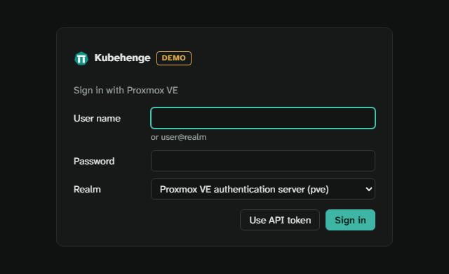

# Installing Kubehenge

Kubehenge runs on Proxmox VE as a small appliance, an unprivileged LXC container that serves Kubehenge's web interface. From the interface, an administrator creates the management cluster (one, three or five Talos Linux VMs running Cluster API and Kubehenge's controller). From then on, clusters are created from the interface or with kubectl. Those who keep their infrastructure as code can apply the management cluster with Terraform/OpenTofu instead ([below](#alternative-terraformopentofu)).

1. Check the [requirements](#requirements).
2. [Install the appliance](#install-the-appliance) with one line in the Proxmox VE shell.
3. [Sign in](#sign-in) and [set up the management cluster](#set-up-the-management-cluster).
4. [Create the VM templates](#create-the-vm-templates) clusters are cloned from.

Then [create clusters](clusters.md).

## Requirements

### Proxmox VE

- **Proxmox VE 9 on x86-64.** The installer refuses any other release.
  - Kubehenge has no build for other architectures.
  - A Proxmox VE cluster that runs two major versions at once needs [care](upgrading.md#upgrading-proxmox-ve).
- **Root in the shell of one node** to run the installer.
- **An administrator** to set up the management cluster, a user with the Administrator role on `/` ([what it needs](#who-may-set-it-up)).

### Storage

| For | Content type | Notes |
| --- | --- | --- |
| The appliance's disk, 8 GB, and a 1 GB volume for its keys | `rootdir` | The only enabled, active storage with 9 GiB free that allows it. Where several do, the installer asks, and `--storage` answers in advance. Backup jobs skip the key volume. |
| The container template | `vztmpl` | Debian's standard container template. The installer uses it where it already is, or downloads it to a storage chosen like the disk's (`--template-storage`). |
| The Talos disk image, and the images VM templates start from | `import` | Proxmox VE's `local` storage does not allow `import` until you add it (Datacenter, Storage, Edit, Content). |
| The management cluster's disks | `images` | 32 GB per node. |
| Cloud-init images | `iso` | Cluster API keeps each new cluster VM's cloud-init ISO here and gets full control of the storage. Give it a storage of its own with the content type `ISO image` alone. On one node that is a directory storage (Datacenter, Storage, Add, Directory), in the shell `pvesm add dir kubehenge-iso --path /var/lib/kubehenge-iso --content iso`. With several nodes or HA and the disks on shared storage, choose a shared storage instead, since a VM that restarts on another node cannot find its ISO. The setup warns about a node-local one. Choose it as **Cloud-init images** in the setup. |
| Clusters' disks and persistent volumes | `images` | One or more storages, chosen when the management cluster is set up. |
| VM templates | `images` | Shared storage in a Proxmox VE cluster, so that clones can start on any node. |

### Network and addresses

Kubehenge gives every node of every cluster a static address, with no DHCP server needed. Each cluster, the management cluster too, is IPv4, IPv6 or dual-stack. IPv6 and dual-stack are unsupported until an end-to-end test passes on them ([clusters.md](clusters.md#ipv6-and-dual-stack)).

- **The appliance** takes an IPv4 address, an IPv6 address or both on a bridge, each by DHCP or static (`--ip`, `--ip6`). IPv6 also takes one from the router's advertisements (`--ip6 auto`).
  - Its certificate and the redirect URLs registered with identity providers contain it. Give it a static `--ip`, a DHCP reservation or a `--name`.
  - After a change, [renew the certificate](upgrading.md#the-interfaces-certificate).
- **The Proxmox VE API** is reached on port 8006, at a name or address its certificate is valid for ([below](#the-proxmox-ve-api)). The appliance, the management cluster's nodes and every cluster's nodes must reach it.

#### Addresses for the management cluster

- **The management cluster** needs one free address per node (one, or three or five for high availability) and one for its Kubernetes API's virtual IP. All are in one subnet on one bridge, with a gateway and DNS servers.
  - Its VMs can run on several Proxmox VE nodes. Each of those needs that bridge, in the same layer-2 network.
  - The bridge can be an SDN VNet. Cluster API's token ([what it may do](architecture.md#what-cluster-apis-token-may-do)) gets `SDN.Use` (its network role) on `/sdn/zones/<zone>/<vnet>`, or on `/sdn/zones/localnetwork/<bridge>` for a node's bridge.
  - The appliance reaches its nodes on ports 50000 (Talos API) and 6443 (Kubernetes API).

#### Addresses for clusters

- **Each cluster** needs a range of free addresses for its nodes. Its control plane's virtual IP is one more, in the same subnet but outside the range.
  - Leave spare addresses in the range, because an upgrade or a node replacement creates the new node before it removes the old one.
  - The management cluster reaches the virtual IP on port 6443.
- **Pod and service ranges** must stay clear of the nodes' networks. Kubehenge refuses overlapping ranges and picks clear ones when given none.
- **The VM that prepares a template** takes an address by DHCP on its bridge, or a static one given when the template is built ([below](#create-the-vm-templates)).

### Internet access

Every part reaches hosts on the internet. [Hosts each part reaches](architecture.md#hosts-each-part-reaches) lists them for the firewall.

A site that blocks them sets up a [proxy](clusters.md#behind-a-proxy), registry mirrors ([setup](#network), Site), [chart mirrors](clusters.md#mirroring-the-charts) and, for RKE2 and k3s, a [release mirror](clusters.md#mirroring-the-releases).

### Sizes

| What | vCPUs | Memory | Disk |
| --- | --- | --- | --- |
| The appliance | 2 | 1 GiB, and 512 MiB swap | 8 GB |
| Each management cluster node (one, three or five) | 4 | 4 GiB | 32 GB |
| A cluster's control-plane node, by default | 2 | 4 GiB (kubeadm: 4800 MiB) | 30 GiB |
| A cluster's worker, by default | 2 | 6 GiB | 40 GiB |

The appliance, a one-node management cluster and a cluster at the create wizard's defaults (one control plane, one worker) take about 110 GB of disk. They take 10 vCPUs and 15 GiB of memory, beside the appliance's swap. Three management cluster nodes add 8 vCPUs, 8 GiB and 64 GB. Add-ons raise a cluster's machines to what they need ([clusters.md](clusters.md#machines)).

Each node OS template build takes 12 GiB on the template storage. The two newest builds of each stay. While one is made, the VM that prepares it takes 2 vCPUs, up to 4 GiB of memory and 20 GiB of disk more.

## Install the appliance

In the shell of the Proxmox VE node that should run it, as root:

```sh
curl -fsSLO https://github.com/kubehenge/kubehenge/releases/latest/download/install.sh && sh install.sh
```

The same with a static address:

```sh
sh install.sh --ip 192.0.2.40/24 --gateway 192.0.2.1
```

On a terminal, the installer is a full-screen guide. It says what it found on the node, and any answers restored from an unfinished run (never a secret).

### What it asks

First the network:

1. The IP version: IPv4, IPv6 or both. IPv4 only gives the container no IPv6.
2. The network the container attaches to, and its VLAN.
3. For each version, DHCP, router advertisements (IPv6) or a static address.
4. A static address, with or without `/prefix`, which the network's prefix fills in. A free address comes filled in, with how it was checked.
5. The gateway, where the network gives none within the address's subnet.

Then the interface:

1. The DNS name people open it at, or none to use the appliance's address. The summary says when the name has no record or points elsewhere.
2. Its certificate: one made here and signed by the Proxmox VE CA, files of your own, or one from ACME ([details](upgrading.md#the-interfaces-certificate)).

It then asks only what is ambiguous, such as the storage, and shows a summary to install, change or cancel.

### A failed step

A failed step keeps the installer open. The screen gives the cause and the fix, then offers to:

- change the setting at fault.
- try again.
- quit and keep the container (`pct enter <id>`).
- quit and remove the container.

Once the screen says the container is kept, only the last choice removes it. Before that, Ctrl+C or a lost session removes it unless `--keep-failed` is given.

A new network or Proxmox VE API setting reaches the existing container. Any other change creates it afresh without repeating the downloads.

### Without a terminal

Without a terminal, with `TERM` empty or `dumb`, or with `--plain`, the installer asks nothing. It prints the plan and a line as each step starts and ends. A failed step shows its cause beside it.

On a node whose own network is static, the installer needs `--ip`, or `--ip dhcp` where a DHCP server answers. A dropped SSH session or Ctrl+C removes the container it was making, unless `--keep-failed` is given. A run that stops with answers given ends on the `install.sh` command that repeats them, on a terminal too.

### How an address is checked

An address is checked against the node's neighbour table, then with an ARP probe on the container's network. The result is free, in use or not checked. No answer counts as free only where this node holds an address on that network or the gateway answers a probe. An address in use is refused.

### Downloads and checksums

- `install.sh` carries the version of its release and the checksums of the release archive and the OpenTofu release.
- It needs 1 GiB free in `/tmp` (or `TMPDIR`) for the unpacked release.
- The downloaded archive is kept in `~/.cache/kubehenge` (or `KUBEHENGE_CACHE_DIR`) and used again while it matches its checksum.
- The installer inside the archive carries the container template's checksum and checks every download before it is used.
- Once Proxmox's mirror drops that template, the installer takes the one Proxmox's signed template index lists, with the checksum the index gives.

To check the script itself before running it, see [Verifying a release](releasing.md#verifying-a-release).

### Options

`install.sh --help` lists the options without a node, root or download.

| Option | Default | What it does |
| --- | --- | --- |
| `--ctid <id>` | the next free ID | The container's ID. |
| `--storage <storage>` | the only storage that takes container disks, else asked | Where the container's disks go, 9 GiB. Storages with less free are left out. Without a terminal, the best by type (local block storage, then directories, NFS, CIFS, CephFS), then by free space. |
| `--template-storage <storage>` | where the template already is, else the only storage that takes it, else asked | Where the container template goes. Without a terminal, ranked like `--storage`. |
| `--bridge <bridge>` | the bridge of the node's default route, else `vmbr0` | A bridge, Open vSwitch bridge or SDN VNet of the node, which the container attaches to. A name the node lacks stops the installer before any download. |
| `--vlan <tag>` | none, or the tag of the VLAN device (such as `vmbr1.20`) the node's default route leaves by | The VLAN tag of the container's network, 1 to 4094. With `--bridge` given, no tag is taken from the route. The installer refuses the default when that bridge is not VLAN aware, since a tag there would cut the node's own VLAN network. |
| `--mtu <bytes>` | the bridge's | The MTU of the container's network, 576 to 65535. |
| `--ip dhcp`, `--ip none` or `--ip <address>/<prefix>` | asked | The container's IPv4 address, such as `192.0.2.40/24`. Without `/prefix` it takes the network's. `none` leaves IPv4 out, on an IPv6-only network, and needs `--ip6`. Without a terminal, `dhcp` where the node's own network uses DHCP, else the install stops. |
| `--gateway <address>` | none | The default gateway, an IPv4 address, with a static `--ip`. |
| `--ip6 auto`, `--ip6 dhcp` or `--ip6 <address>/<prefix>` | none | The container's IPv6 address, such as `2001:db8::40/64`. `auto` takes one from the router's advertisements. |
| `--gateway6 <address>` | none | The default IPv6 gateway, with a static `--ip6`. It may be link-local, such as `fe80::1`. |
| `--dns <address>,...` | this node's name servers | The name servers the container asks, such as `192.0.2.53,192.0.2.54`. Required where the node's `/etc/resolv.conf` names only loopback addresses, which the container cannot reach. |
| `--hostname <name>` | `kubehenge` | The container's host name, also written into its certificate. |
| `--name <DNS name>` | asked | A DNS name, such as `kubehenge.example.org`, people open the interface at. It goes into the certificate and the redirect URLs for identity providers. |
| `--cert <files>` | asked | Serves the certificate in these comma-separated files, in any format, instead of one signed by the cluster's CA ([details](upgrading.md#the-interfaces-certificate)). |
| `--key <file>` | | The key of `--cert`, where it is a file of its own. |
| `--cert-passphrase-file <file>` | | The passphrase of encrypted `--cert` files, on its first line. |
| `--acme <server>` | | Gets the certificate from an ACME server: `letsencrypt`, `letsencrypt-staging` or a directory's https address ([details](upgrading.md#acme)). Needs `--name`. Not with `--cert`. |
| `--acme-proof <proof>` | `tls-alpn-01` | `tls-alpn-01` on port 443, `http-01` on port 80, or `dns-01` through a DNS provider. |
| `--acme-email <address>` | none | The ACME account's contact address. |
| `--acme-dns-provider <name>`, `--acme-dns-credentials-file <file>`, `--acme-resolver <address>` | | The DNS provider of `dns-01`, its `NAME=value` credentials and the name servers that check the record. |
| `--acme-directory-ca-file <file>`, `--acme-eab-key-id <id>`, `--acme-eab-hmac-key-file <file>`, `--acme-profile <name>` | | For an ACME server of your own: the CA of its certificate, its account binding and a certificate profile. |
| `--proxmox-url <URL>` | chosen from the API's certificate ([below](#the-proxmox-ve-api)) | The Proxmox VE API as the appliance and the clusters' VMs reach it, such as `https://pve.example.org:8006`. The API's certificate must be valid for it. The installer stops unless the appliance gets an answer there. |
| `--proxmox-ca <file>` | found by the installer ([below](#the-ca)) | The CA that signed the API's certificate, such as your organisation's where it replaced Proxmox VE's own. The file may be a whole trust store, and the appliance gets only the certificates the API's rests on. The installer stops before it creates anything unless this CA signed the API's certificate for the URL. |
| `--proxmox-insecure` | off | Nothing checks the Proxmox VE API's certificate. That covers OpenTofu, Cluster API, Kubehenge's controller, the template builds and every cluster's cloud controller manager and CSI plugin. The Administration page shows that it is on. Not with `--proxmox-ca`. |
| `--trusted-proxy <address or CIDR>` | none | A reverse proxy in front of the interface, repeatable and also comma-separated ([details](architecture.md#behind-a-reverse-proxy)). It writes `KUBEHENGE_TRUSTED_PROXIES` into `/etc/kubehenge/appliance.env`. With `--upgrade` it replaces the list. |
| `--no-trusted-proxy` | | With `--upgrade`, removes the list of trusted proxies. |
| `--release <file> --sha256 <hex>` | the published release the script names | Installs a release archive from a file instead, checked against the given checksum. OpenTofu is still downloaded unless `--tofu` names it. |
| `--tofu <file>` | the published OpenTofu release | Installs OpenTofu from a release archive (`tofu_<version>_linux_amd64.tar.gz`) instead of downloading it. It is checked against the checksum in `install.sh`, so the version must be the one the script names. Together with `--release` and a template on a storage, the node needs no internet access. |
| `--plain` | off | Runs as without a terminal. |
| `--yes` | off | Skips the summary confirmation and accepts an address outside the network's subnet. |
| `--dry-run` | off | Prints what would be installed and changes nothing. |
| `--keep-failed` | off | Keeps a failed install's container for inspection. |
| `--pve-entry` or `--no-pve-entry` | asked | Whether to add the Proxmox VE interface entry to this node ([below](#the-proxmox-ve-interface-entry)). Run without a terminal, it leaves the entry out. |
| `--upgrade` | | Upgrades the cluster's appliance instead ([upgrading.md](upgrading.md#from-the-proxmox-ve-shell)). Run plain, `install.sh` upgrades an appliance that exists. |
| `--certificate` | | Replaces the interface's certificate of the cluster's appliance instead ([details](upgrading.md#the-interfaces-certificate)). |

### What it does

The installer checks the node, asks everything before it changes anything, creates the container and sets it up ([the steps](architecture.md#what-the-installer-does)). It then prints the address and the certificate's fingerprint:

```text
Kubehenge is running in container 105: https://kubehenge.example.org/
Certificate SHA-256 fingerprint: …
Valid until: …
Browsers warn until they trust the Proxmox VE CA. Compare the SHA-256 they show with the one above.
Point kubehenge.example.org at 192.0.2.40 in your DNS.
Also at https://192.0.2.40/
Sign in with a Proxmox VE administrator to create the management cluster.
Log: /var/log/kubehenge-install-20261119-134128-2706524411.log
```

Each run writes the commands' output to a log of its own, `/var/log/kubehenge-install-<UTC time>-<random>.log`. The newest ten are kept.

### The Proxmox VE API

The appliance, the management cluster and every cluster reach the Proxmox VE API at one URL and check the certificate it serves. Without `--proxmox-url`, the installer reads the names and addresses in this node's API certificate (`/etc/pve/local/pveproxy-ssl.pem`, else `pve-ssl.pem`). It keeps an address only if it belongs to one of this cluster's nodes. It keeps a name only if every address it resolves to belongs to one. A wildcard name counts for this node's own name (`hostname -f`) where it covers it.

Where the certificate is valid for none of the cluster's names and addresses, the installer asks for a URL it is valid for. Without a terminal it stops, and `--proxmox-url` gives that URL.

#### Choosing the address

Of the names and addresses that remain, the installer takes, in this order:

1. a name for several of the cluster's nodes, such as a DNS name with the address of each.
2. this node's own name.
3. another name of this node.
4. this node's address on the appliance's bridge, then its other addresses.
5. a name of this node without a domain, which resolves only where a search domain supplies one.
6. a name, then an address, of another node of the cluster.

A name counts as it resolves on this node. The appliance and the clusters' VMs must resolve it the same way. Where several tie, the installer asks which, with the first as the default. Without a terminal it takes the first and names it.

#### A name in the URL

The management cluster's nodes resolve a name in the API's URL with the setup's DNS servers, not with the appliance's resolver or hosts file. The setup refuses a name when a server says it does not know it and none resolves it. Put an address in the URL, or add a DNS record. The setup warns when every server stays silent, and when the servers and the appliance resolve the name differently.

#### An address the certificate lacks

Proxmox VE's own certificate (`pve-ssl.pem`) lists one address of a node. In a cluster that is the node's cluster address. A node on its own gets the first address its name resolves to, on a dual-stack node usually the IPv6 one.

- The installer then takes the node's name or its IPv6 address, and says in its summary that the IPv4 one is missing.
- The setup check refuses an IPv6 address for a management cluster without IPv6.
- A `--proxmox-url` the certificate lacks stops the installer, which names what it lists.

#### Adding the address to the certificate

On the node:

1. Make the node's name resolve to it first. glibc puts IPv6 first even from `/etc/hosts`, so list only the IPv4 address for the name there, or raise IPv4's precedence in `/etc/gai.conf`.
2. Run `pvecm updatecerts --force`, then `systemctl restart pveproxy`.

A certificate of your own that lists the address works as well (**System**, **Certificates** of the node). Then run `install.sh --upgrade --proxmox-url https://<address>:8006`.

#### The CA

Without `--proxmox-ca`, the certificate is checked against:

1. the Proxmox VE cluster's own CA, `/etc/pve/pve-root-ca.pem`, where it signed the certificate.
2. else the CA in this node's trust store (`/etc/ssl/certs/ca-certificates.crt`) the certificate rests on, such as your organisation's CA once it is installed there.
   - The installer names it. The appliance gets that CA alone, not the whole store.
3. else the CA the API serves with its certificate: its root where it serves one, else the topmost CA it serves, else the certificate itself.
   - The installer shows its subject, issuer and SHA-256 fingerprint and asks whether to trust it. Check the fingerprint against your CA before you say yes.
   - Without a terminal it stops and names the fingerprint.

Where none of them applies, or you do not trust the CA it shows, the installer stops before it creates anything. Then give the CA with `--proxmox-ca`, or check nothing with `--proxmox-insecure`.

### The Proxmox VE interface entry

The entry adds a **Kubernetes** button beside Create VM and Create CT, and a **Kubernetes** item under Datacenter. Both open the appliance in a new tab. Kubehenge works the same without it. Each node serves its own interface, and the appliance's installer adds the entry only on its own node. On every other node, run the entry's own installer from `share/kubehenge/pve-entry/` in the release archive:

```sh
sh install.sh --url https://192.0.2.40
```

After every package run, an apt hook puts back an entry that a `pve-manager` update removed, and logs it (`journalctl -t kubehenge-pve-entry`). Run the entry's installer again with another `--url` to change the address it opens, or with `--remove` to take it out of a node. More in [its README](https://github.com/kubehenge/kubehenge/blob/main/appliance/pve-entry/README.md).

## Sign in



Open the address the installer printed. Browsers warn about the certificate the installer made until they [trust the Proxmox VE CA](upgrading.md#trusting-a-ca). Until then, compare the fingerprint the browser shows with the one the installer printed. A certificate from Let's Encrypt or another CA that browsers trust needs neither.

Sign in with a Proxmox VE account of any realm: Proxmox VE, PAM, LDAP, Active Directory or OpenID. There is no second user directory. Every user sees and changes only what their Proxmox VE privileges allow ([clusters.md](clusters.md#who-may-do-what)).

### Realms and second factors

- **Realm and password.** Choose the realm, or type `user@realm` as the user name.
- **Second factor.** An account with TOTP, Yubico OTP or recovery keys is asked for one.
  - WebAuthn keys are bound to Proxmox VE's own address and do not work here. Their users choose **Use API token** and give a Proxmox VE API token (`user@realm!name` and its secret).
- **OpenID realms** return from the identity provider to `https://<appliance>/api/openid/callback`, which the provider needs as a redirect URL. Install with `--name`, since many providers refuse a bare IP.

Session lengths and sign-in limits are under [Sessions](architecture.md#sessions). A reverse proxy in front of the interface needs the settings under [Behind a reverse proxy](architecture.md#behind-a-reverse-proxy).

## Set up the management cluster

On first sign-in, an administrator sees the setup page. It creates the management cluster with the `management-cluster/` module and OpenTofu, inside the appliance.

The page goes through four steps: **Placement**, **Network**, **Clusters** and **Services**. A **Passphrase** step follows only where the state needs [one](#requiring-a-passphrase). Administration shows the same settings on one page, with one section per step.

### What the page fills in

The page preselects up to three Proxmox VE nodes that answer, so that the management cluster survives the loss of one. It then fills in what the first chosen node reports about itself, all of which can be changed:

- A shared storage for the VM disks, or else the one with the most free space.
- The bridge the node reaches its gateway through, with that gateway.
- The node's own DNS servers.
- The network the node addresses go in, with free addresses in it as **Node addresses** and **API address**. With a VLAN tag, the page fills in no addresses.

For clusters, it offers the same storage and bridge to start with.

### Who may set it up

The signed-in user needs these privileges on `/`, which the Administrator role holds:

`Sys.Modify`, `Permissions.Modify`, `User.Modify`, `Group.Allocate`, `Realm.AllocateUser`, `Pool.Allocate`, `Pool.Audit`, `VM.Allocate`, `VM.Audit`, `VM.PowerMgmt`, `VM.Config.CPU`, `VM.Config.Cloudinit`, `VM.Config.Disk`, `VM.Config.HWType`, `VM.Config.Memory`, `VM.Config.Network`, `VM.Config.Options`, `Datastore.Allocate`, `Datastore.AllocateSpace`, `Datastore.AllocateTemplate`, `SDN.Audit`, `SDN.Use`, `Sys.AccessNetwork`

Proxmox VE checks the privileges of every call the run makes. Anyone without them sees that Kubehenge is not set up yet. Without `VM.GuestAgent.Audit` the log holds one warning that Proxmox VE refused the management VMs' network addresses. The run does not need them.

The run acts with your own Proxmox VE session, with no administrator token created. The interface renews your ticket and hands it to OpenTofu through its environment only, never storing it. A ticket lasts two hours, and the run has to finish within them.

The one exception is automatic upgrades of the management cluster, off by default. With them on, the appliance keeps an Administrator token of a user of its own ([upgrading.md](upgrading.md#automatically-after-kubehenge)).

#### Administration

The same privileges open Administration later, in seven pages:

- **Management cluster**, its settings (applying them again or changing them) and its removal.
- **Appliance**, Kubehenge's upgrades and repair access.
- **Backups**, the [management cluster's etcd snapshots](install-settings.md#back-up-the-management-clusters-etcd).
- **Templates**, the VM templates and their weekly build.
- **Certificates**, the interface's certificate and the DNS-01 credential for every cluster.
- **Notifications**, the [targets that are told](install-settings.md#notifications).
- **Activity**, [who did what](architecture.md#activity).

They also bring the warnings about the [backup](install-settings.md#back-up-the-appliance) and the [certificate](upgrading.md#the-interfaces-certificate).

### The settings

#### Placement

| Field | What it is |
| --- | --- |
| Proxmox VE nodes | The nodes the management cluster's VMs run on, taken in turn, no more than there are node addresses. With three nodes for three VMs, the management cluster keeps running when one node fails. An offline node cannot be newly chosen. The storages and bridge below are offered only when every chosen node has them. |
| VM disks | Storage for the management cluster's disks. |
| Talos image | Storage the Talos disk image is downloaded to on each chosen node, with the `import` content type. |
| Cloud-init images | Storage for the clusters' cloud-init ISOs, with the `iso` content type ([above](#storage)). |

#### Network

| Field | What it is |
| --- | --- |
| Bridge | Bridge the management cluster's VMs attach to. A node's bridge, or an SDN VNet listed with its zone. |
| VLAN tag | Optional, 1 to 4094. Refused on a VNet of a VLAN zone, which tags its traffic already. A VLAN-aware VNet takes one. |
| MTU | Optional, 1280 to 65520 ([details](install-settings.md#management-network-mtu)). |
| Address families | IPv4, IPv6, or both, the first one primary. Fixed once the management cluster exists. |
| Node addresses | One address, or three or five for high availability, each with its prefix length: `192.0.2.11/24` or `2001:db8::11/64`. All in one network, the gateway's, and none of them the network's own address or an IPv4 broadcast address. With both families, the page asks for IPv4 and IPv6 node addresses. It takes as many of each. Each node takes the one at its place in both lists. |
| API address | The virtual IP of the management cluster's Kubernetes API. An unused address of the primary family in the nodes' network, neither a node address nor the gateway. It moves to a healthy node when one fails. |
| Gateway | The nodes' default gateway, one per family with both. An IPv6 one may be link-local. |
| DNS servers | Addresses of the cluster's families, one per line or separated by commas. A dual-stack cluster needs one of each. |
| Search domains | Domains the nodes append to a name without dots, at most six, separated by commas. Empty derives one from each node's host name. |
| Time servers | NTP servers the nodes keep their clocks with, as host names or addresses separated by commas. Empty keeps Talos's default public servers. |
| Site: Registry mirrors | `registry=endpoint`, one per line, such as `ghcr.io=https://mirror.example.org:5000`. The management cluster's nodes try them before the registry itself. They cover images, not charts. |
| Site: Chart mirrors, Chart mirror certificate | `host=address`, one per line, such as `ghcr.io=oci://registry.example.org/ghcr`. Clusters fetch that host's charts from the address, and trust the certificate authority (PEM) for it. See [Mirroring the charts](clusters.md#mirroring-the-charts). |
| Site: Site CA | PEM certificates. The management cluster's nodes and downloads (OpenTofu, providers, charts, template builds) trust it, with or without a proxy. Other clusters' nodes, the release mirror, backup targets and identity providers trust it unless they name another. Proxmox VE downloads the Talos image and the templates' base images with each node's own trust store. Add the CA to every Proxmox VE node. Paste the root of an inspection device. Setup and save read the chain each host presents and name any certificate that breaks it. A chain counts as public only when one of the public roots Talos ships signs it. The appliance container's own trust store does not count, so a root your organisation installed there still has to be in the Site CA. The message names the root the chain ends at with its SHA-256 fingerprint, and Setup adds a presented root to the field on one click. The hosts are the Talos image factory, the registries (or their https mirrors), Sigstore's TUF repository and an https release mirror with no CA of its own. The nodes also get a copy of the root under the name a certificate gives it, and of an intermediate a certificate names in other bytes, since Go-based clients refuse a chain that curl accepts when the name is encoded differently. A copy of an intermediate expires with the root. The saved Site CA stays as pasted. The proxy's certificate gets the same check. |
| Site: Time zone | An IANA time zone, such as `Europe/Berlin`. Schedules and upgrade windows that name none use it. Empty leaves them in UTC. |
| Site: VM ID range | Such as `100000-100999`. New clusters' VMs and the VM templates take their IDs from it. Empty takes Proxmox VE's next free ID. Keep it clear of the management VMs' IDs ([details](install-settings.md#management-cluster-vm-ids)). |
| Site: Release mirror, Release mirror certificate | An `https://` or `http://` address, such as `https://mirror.example.org/github`. RKE2 and k3s nodes download their release from it in place of GitHub, and trust the certificate authority (PEM) for it. See [Mirroring the releases](clusters.md#mirroring-the-releases). |
| Site: Proxy address, Proxy user, Proxy password, Proxy exceptions, Proxy certificate | The proxy every download goes through. The address has no credentials, so write `http://proxy.example:3128` and put the user and password in their fields. A saved password shows as set, and the page can replace or remove it but never shows it. See [Behind a proxy](clusters.md#behind-a-proxy). |
| Advanced: Pod ranges, Service ranges | The management cluster's own, one per family. When empty, `10.244.0.0/16` and `10.96.0.0/12`, and `fd5e:4b1c:9a20::/56` and `fd5e:4b1c:9a21::/112` for IPv6. Where those overlap the nodes' network, the API address or the gateway, the first clear one of a few other private ranges. |

#### Clusters

| Field | What it is |
| --- | --- |
| Available to clusters | The storages and bridges clusters may put their disks on and attach to, from any node. At least one of each. The page says which nodes have each, or that a storage is shared. Cluster API's token gets rights on these alone. The ClusterClasses refuse any others, from the interface or kubectl. |
| Proxmox VE HA | Off by default. When on, Proxmox VE HA keeps each cluster's control-plane VMs on separate nodes and restarts them elsewhere after a node fails. This holds for every cluster on shared storage that does not opt out ([clusters.md](clusters.md#machines)). Read [the details](install-settings.md#proxmox-ve-ha) first. |
| HA rule placements | Off by default. When on, everyone who may create or change a cluster can place it on the nodes of a Proxmox VE HA node-affinity rule, without `Sys.Audit` on `/` of their own ([clusters.md](clusters.md#machines), [details](install-settings.md#ha-rule-placements)). |
| CSI plugin | Off by default. When on, clusters may choose the CSI plugin's newest release ([details](install-settings.md#csi-plugin)). |
| Template refresh | On by default. The node OS VM templates are built again every week with their node OS's updates. Clusters' nodes move to each build in their upgrade windows once it is a day old ([templates.md](templates.md#the-weekly-build), [details](install-settings.md#what-the-template-builds-may-do)). |
| Day, Time, Time zone | When the build runs. Sunday at 01:00 UTC unless changed. |
| Template disks | The storage for clusters the builds go to. The first one by default. |
| Build address, Build gateway, Build DNS servers | A static address for the VM that prepares an image. Empty, that VM takes DHCP on the first bridge for clusters. |
| Let creators request builds | Off by default, recommended. When on, anyone with `VM.Allocate` on the workload pool may ask the create wizard for a missing RKE2, k3s or kubeadm template of their node OS. The build runs with the refresh's token, never theirs. |
| HA rule labels | On by default. Each cluster's nodes are labelled with Proxmox VE's HA groups or node-affinity rules unless the cluster switches them off. Its token then reads the Proxmox VE cluster's configuration. Untick it to give no cluster that read ([details](install-settings.md#ha-rule-labels)). |
| Nodes' boot logs | On by default. The controller reads kubeadm, RKE2 and k3s nodes' boot logs through their guest agents (files only). A node that never joins then shows why. Untick it to take that privilege away ([details](install-settings.md#nodes-boot-logs)). |
| kubectl changes | Off by default. When on, Activity also lists each change people make to the management cluster with kubectl or its API, with their user ([details](install-settings.md#kubectl-changes)). |
| Cluster namespaces | Off by default. The interface creates and manages clusters in `clusters` only. When on, cluster creators choose among `clusters` and the namespaces named here, separated by commas, such as one per team ([clusters.md](clusters.md#more-namespaces-for-clusters)). A namespace that does not exist yet is created. One taken off the list keeps its clusters. |

#### Services

| Field | What it is |
| --- | --- |
| Headlamp sign-in | Off by default, recommended. When on, the shared Headlamp opens each cluster signed in as cluster-admin for those who may download its admin kubeconfig ([clusters.md](clusters.md#open-a-cluster-in-headlamp)). Read [the details](install-settings.md#headlamp-sign-in) first. |
| Headlamp actions | Off by default. When on, the shared Headlamp offers the Helm app catalogue and the Prometheus charts it ships with. Both act with each user's own credentials in the cluster ([clusters.md](clusters.md#open-a-cluster-in-headlamp), [details](install-settings.md#headlamp-actions)). |
| Identity providers | OpenID Connect providers every new cluster trusts unless it names its own ([clusters.md](clusters.md#signing-in-with-openid-connect)). A change applies to clusters created afterwards. |
| Backup targets | S3 stores for the clusters' Velero backups and etcd snapshots, for clusters that switch either on ([details](install-settings.md#backup-targets)). A changed target reaches the clusters that back up to it within ten minutes. One taken away leaves their Velero as it is. |
| etcd restores | Off by default. The interface then shows the steps to restore a cluster's etcd by hand. When on, Kubehenge restores it itself through the VMs' guest agents ([details](install-settings.md#etcd-restores)). |

The setup asks for no passphrase. The appliance makes the [key](#the-states-key) that encrypts the management cluster's state itself.

Once the management cluster runs, these stay as they are ([upgrading.md](upgrading.md#in-the-appliance)):

- its node addresses (more can only be added after them)
- its API address and gateway
- its pod and service ranges
- its VM disks

What each opt-in setting grants and risks, and the fields of a backup target, are in [Setup settings in depth](install-settings.md).

The appliance keeps the module's other settings at their defaults:

- The management cluster is named `kubehenge`.
- Its nodes have 4 vCPUs, 4 GiB of memory and a 32 GB disk.
- It creates the pools `kubehenge` (clusters), `kubehenge-templates` (VM templates) and `kubehenge-management` (its own VMs).

### The state's key

The management cluster's state holds its secrets, among them its admin kubeconfig and talosconfig. The appliance encrypts it with a random key it makes at setup. It keeps the key beside the state, readable by root alone, so the appliance's own backups hold it too. Every apply, repair access and removal opens the state with it, and Proxmox VE privileges are the only check.

An appliance set up with a state passphrase keeps its key from the next action given that passphrase.

#### Requiring a passphrase

Under **Administration**, **Appliance**, **Require a passphrase to open the management cluster's state** seals the key with a passphrase of at least 16 printable characters and deletes the kept copy. In the appliance's shell, run `kubehenge appliance state-passphrase --require`. Every apply, repair access, restore and removal then asks for the passphrase, and a wrong one is refused. Automatic upgrades of the management cluster then store it. An export holds the sealed key. Switching it off asks for the passphrase once and keeps the key again.

#### Losing the passphrase

A lost passphrase cannot be recovered. The management cluster and every cluster keep running. The interface still creates, changes and deletes clusters. What is lost is applying the management cluster again (it stays at the versions it has), repair access, and removal from the page. [Starting over](uninstalling.md#starting-over) lists what to delete.

### The management cluster's credentials

The management cluster's admin kubeconfig and talosconfig hold client certificates that last a year. Only an apply in their last month renews them. The interface warns administrators 30 days before they run out. Apply the settings in **Administration** to renew them.

### While it runs

Applying takes ten to twenty minutes. The page shows the step the run is at and follows its log. Closing it does not stop the run.

If it fails, the page shows the error and the log, with the settings still filled in for another try. When it succeeds, the interface switches to the cluster list. Administrators get an **Administration** link in the top bar. [What the run creates](architecture.md#what-the-run-creates) lists the Proxmox VE objects and charts.

### After setup

Back up the [appliance](install-settings.md#back-up-the-appliance) and the [management cluster's etcd](install-settings.md#back-up-the-management-clusters-etcd), and set up [notifications](install-settings.md#notifications). Patch nodes with [`ready-for-reboot`](upgrading.md#patching-proxmox-ve-nodes).

## Create the VM templates

Every cluster's nodes are clones of a VM template that `kubehenge template create` makes through the Proxmox VE API ([templates.md](templates.md)):

| Distribution | Template |
| --- | --- |
| RKE2, k3s | one each per node OS: `kubehenge template create rke2 --node pve1`, `kubehenge template create k3s --node-os rocky-10 --node pve1` |
| kubeadm | one per node OS and Kubernetes version: `kubehenge template create kubeadm --kubernetes-version v1.36.5 --node pve1` |
| Talos | one per Talos release, Talos being its own OS: `kubehenge template create talos --talos-version v1.14.5 --node pve1` |

Create them after the management cluster, which makes their pool, `kubehenge-templates`. A kubeadm cluster can only be created at, or upgraded to, a version that has a template on its node OS. A Talos cluster can only be created on a Talos release that has one.

### Building from the interface

Under **Administration**, **Templates**, **VM templates** lists them, each with a cluster that clones from it. **Build template** makes one with your own Proxmox VE session, as the setup does:

| Field | What it is |
| --- | --- |
| Distribution | RKE2, k3s, kubeadm with its Kubernetes version, such as `v1.36.5`, or Talos with its release, such as `v1.14.5`. A Talos template is baked by a build VM from Sidero's pinned images. The node OS field does not apply to it. |
| Node OS | The operating system of the nodes, AlmaLinux 10 unless chosen otherwise ([templates.md](templates.md#node-oses)). |
| Proxmox VE node | The node the image is prepared on. For a node OS above `x86-64-v2`, one whose CPU reaches its level. |
| Template disk | Where the template's disk goes. Shared storage, listed first, lets clones start on any node of a Proxmox VE cluster. |
| Downloaded image | A storage with the `import` content type, for the node OS's downloaded cloud image, or Talos's. |
| Cloud-init image | A storage with the `iso` content type, used while the image is prepared. The node's first one when left empty. |
| Bridge, VLAN tag | Where the VM that prepares the image attaches. It needs to reach the package repositories ([hosts](architecture.md#hosts-each-part-reaches)). |
| Static address | Optional: an address with prefix length, a gateway and DNS servers for that VM, instead of DHCP. |

A build takes about twenty minutes, most of it composing the node image from the node OS's packages. The page follows its log. Only one runs at a time, never during a run of the management cluster or an upgrade of the appliance.

Each node OS template keeps several builds, newest first with the time each was made. Building one that exists adds a build beside it. A build a cluster still clones from cannot be deleted. That is the one its nodes run for RKE2 and k3s, and the one a cluster or machine runs at its version for kubeadm.

### Automatic builds

Below the list, **Automatic builds** shows when the weekly build next runs and how its last run went, with its log. **Build now** has the management cluster run it at once ([templates.md](templates.md#the-weekly-build)). After the first templates exist, the weekly build keeps them current. Only a kubeadm version no cluster runs yet needs a build by hand.

### Building from the command line

The same is possible from any Linux machine that reaches the Proxmox VE API, with `kubehenge template create` and an API token ([templates.md](templates.md#requirements) lists its privileges). `--node`, the Proxmox VE node the template is built on, is required. Keep the default of `--pool` there, because Cluster API may clone only from the template pool.

## Alternative: Terraform/OpenTofu

The management cluster can be applied with Terraform/OpenTofu instead of from the appliance. It is the same module, `management-cluster/`, with every variable settable ([variables](install-settings.md#module-variables)). The web interface comes with the appliance only, so clusters are then created and looked after with kubectl ([clusters.md](clusters.md#with-kubectl)).

Take the module from the release archive, `kubehenge_<version>_linux_amd64.tar.gz`. Its `share/kubehenge/` holds `management-cluster/` with the `charts/` it installs beside it. Its chart runs the release's controller image by digest. `bin/kubehenge` in the same archive is the command for the VM templates.

### Before you apply

- **Proxmox VE 9**, and the `import` content type on the storage named in `image_datastore`.
- **An API token with administrator rights**, since the module creates users, roles, pools and VMs.
  - For example `pveum user token add root@pam kubehenge --privsep 0`.
  - Or use an administrator's session. Leave `proxmox_api_token` unset and put a ticket and its CSRF token from `POST /access/ticket` in `PROXMOX_VE_AUTH_TICKET` and `PROXMOX_VE_CSRF_PREVENTION_TOKEN`.
  - The apply must then finish within the ticket's two hours.
- **The Proxmox VE CA certificate**, `/etc/pve/pve-root-ca.pem` on any node unless you replaced the API's certificate. The machine running Terraform/OpenTofu must trust it too (add it to the system's trust store).
- **The addresses and network access** [above](#network-and-addresses). The machine running Terraform/OpenTofu takes the appliance's place and must reach the nodes on ports 50000 and 6443.

### Apply

```sh
cd share/kubehenge/management-cluster
cp terraform.tfvars.example terraform.tfvars   # then fill it in
export TF_VAR_proxmox_api_token='root@pam!kubehenge=...'
export TF_VAR_proxmox_ca_certificate="$(cat pve-root-ca.pem)"
tofu init -lockfile=readonly
tofu apply
tofu output -raw kubeconfig > kubeconfig
tofu output -raw talosconfig > talosconfig
```

`-lockfile=readonly` holds the providers to the checksums in the module's `.terraform.lock.hcl`, as the appliance does. The module is tested with OpenTofu and also declares Terraform 1.11 or newer. The state holds the cluster's secrets and its administrator credentials. Keep it in an encrypted backend, or use OpenTofu's state encryption.

Then create the [VM templates](#create-the-vm-templates) with `bin/kubehenge` from the archive, on any Linux machine that reaches the Proxmox VE API:

```sh
export KUBEHENGE_PROXMOX_URL=https://pve.example.org:8006
export KUBEHENGE_PROXMOX_CA=pve-root-ca.pem
export KUBEHENGE_PROXMOX_TOKEN='root@pam!kubehenge=...'
bin/kubehenge template create rke2 --node pve1 --storage shared-storage
```
