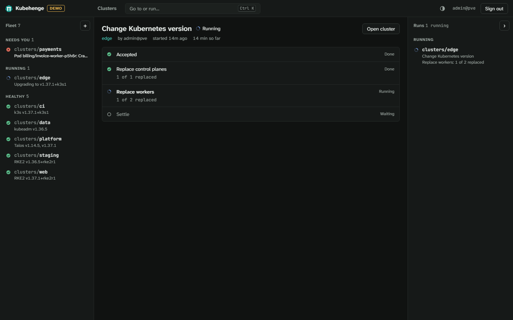

# Upgrading

Kubehenge itself, the management cluster and the workload clusters are upgraded separately, in this order.

1. **Kubehenge itself** is the appliance's software, upgraded from the Administration page or the Proxmox VE shell.
2. **The management cluster** is Talos, Kubernetes, Cluster API and its providers, and Kubehenge's ClusterClasses and controller. Applying it again moves them to the versions the new release carries.
3. **Workload clusters** upgrade Kubernetes by hand or automatically inside an upgrade window. Their nodes' operating system moves to each week's build of the VM templates inside the same window.

Before 1.0.0, a minor release may change behaviour. Read its entry in the [changelog](changelog.md) first.

## Kubehenge

### From the Administration page

**Administration** in the top bar opens the Administration page, for those with the [setup privileges](install.md#who-may-set-it-up) on `/`. Its **Kubehenge** box shows:

- **Installed** is the running release.
- **Newer releases** lists those published since, or why they are unknown (the release index could not be fetched or checked).
- **Last upgrade** gives from which release to which, with the time. It also says when the installed release is already the newest allowed, when one is in progress, or why it failed.

**Upgrade to `<version>`** installs the newest release, once confirmed. The interface restarts and is unavailable for about a minute. The restart signs everyone out. No upgrade starts while the management cluster is being applied or removed or a VM template is being built. A page left open across an upgrade says so and offers to reload.

### Automatically

**Automatic upgrades** in the same box:

| Setting | Upgrades to |
| --- | --- |
| off | nothing (the default) |
| patch releases | the newest release of the installed minor version, such as 0.1.x |
| minor releases | the newest release of the installed major version, such as 0.x |

**Hour** picks the hour of the day (03:00 by default), in the **Time zone** below it. The zone starts out as the browser's when automatic upgrades are switched on. The interface checks once a day in that hour, never during a run of the management cluster or a template build.

Only Kubehenge's own software is upgraded, never the workload clusters. The management cluster follows only where its own automatic upgrades are on ([below](#automatically-after-kubehenge)).

### The release index

The updater accepts the release index, `https://kubehenge.dev/releases/index.json`, only if one of Kubehenge's release keys signed it and it has not expired.

- The public keys are built into each release and cannot be configured.
- The index expires two weeks after it was signed and is signed again every week ([releasing.md](releasing.md#the-index-appliances-read)).
- A mirror of the index and its signatures can be named with `KUBEHENGE_RELEASE_INDEX=<URL>` in the appliance's `/etc/kubehenge/appliance.env`. The same checks apply to it, so a mirror has to copy the index at least weekly.

### What is installed

The interface writes a request that `kubehenge-update`, a service running as root, carries out:

- It installs only a release named in that index, newer than the installed one, and only an archive matching the checksum in the index. It also installs the OpenTofu release that release names, checked the same way.
- It swaps the files by rename and restarts the interface. It holds the lock the management cluster's runs take, so an upgrade never cuts a run off and no run starts during an upgrade.
- It keeps the installed release aside until the new one answers on its own certificate within 2 minutes. The new one must then run 20 seconds without a restart.
  - Otherwise, or if the restart fails, the updater restores the previous release and restarts it. The upgrade's error then reads `release … did not start: …; rolled back to …`.

### From the Proxmox VE shell

`install.sh` upgrades an installed appliance too. In the shell of the node the appliance runs on, as root:

```sh
curl -fsSLO https://github.com/kubehenge/kubehenge/releases/latest/download/install.sh && sh install.sh --upgrade --ctid <ctid>
```

- It checks every download against the checksums it carries, as when installing ([install.md](install.md#install-the-appliance)). `--release <file> --sha256 <hex>` installs a local archive instead.
- It refuses a container that is not Kubehenge's appliance (tagged `kubehenge`) and a release older than the installed one. The same release may be installed again.
- It keeps the appliance's state, settings and certificate. It also keeps a newer OpenTofu that the appliance's own upgrades brought.
- It stops, changing nothing, while the management cluster is applied or removed, a VM template is built, or the appliance is upgraded.
- Like the updater, it keeps the installed release aside until the new one serves. Otherwise it rolls back with the same error.

#### API address, CA and certificate options

- `--proxmox-url <URL>` moves the appliance to another address of the Proxmox VE API, such as once the node it names is removed. It checks the URL as an install does and stops, changing nothing, unless the container reaches it with a certificate it trusts.
- `--proxmox-ca <file>` replaces the CA the appliance checks the Proxmox VE API against. Use it after the API's certificate was replaced with one from another CA ([install.md](install.md#options)).
  - It stops, changing nothing, unless the API's certificate is one that CA signed.
  - A file holding several certificates is reduced to those the API's certificate rests on.
  - It also turns certificate verification back on where `--proxmox-insecure` turned it off.
- `--proxmox-insecure` has the appliance stop verifying the Proxmox VE API's certificate.
- Without these options the appliance keeps what it had.

After any of them, apply the management cluster again to carry the change to it and the clusters.

### From the appliance's shell

`kubehenge appliance` inside the appliance does what the Administration page does, as a client of its interface. It signs in with a Proxmox VE user, so the same privileges and refusals apply. `--user` names the user (or `KUBEHENGE_USER`), and `--password-file` a file holding the password (or `KUBEHENGE_PASSWORD`). `--totp` gives a second factor's code.

```sh
pct exec <ctid> -- kubehenge appliance upgrades --user root@pam --password-file /root/password
pct exec <ctid> -- kubehenge appliance upgrade 0.2.0 --user root@pam --password-file /root/password
```

`upgrades` shows the installed release, the newer ones and the last upgrade, with the reason when it failed or was rolled back. `--json` prints the interface's answer as it is. `upgrade` asks the updater for a release, as **Upgrade to** does. `kubehenge appliance health` runs the check the updater and `install.sh` use, without signing in.

## The management cluster

Each Kubehenge release pins the versions of Talos, Kubernetes, Cluster API, every provider and cert-manager together, as the set it has tested. Upgrading Kubehenge does not change the running management cluster. Applying it again does.

### In the appliance

On the Administration page, the **Management cluster** section shows the settings of the last run. **Apply again…** asks for the state passphrase given when the management cluster was created and applies them as they are. **Edit settings** opens them for changes first, applied with the same passphrase. Applying again:

- upgrades Talos node by node, each drained first when there are several
- upgrades Kubernetes component by component
- upgrades each Cluster API provider through the Cluster API Operator, and Kubehenge's ClusterClasses and controller
- puts back anything that drifted from the settings

The same page can move the management cluster to other Proxmox VE nodes or add nodes to it. A VM given another node is migrated there.

#### Duration and failures

Applying again runs with your Proxmox VE session like the first run and takes about as long. The page follows the log. If it fails, the page shows the error and the log. Fix the cause and apply again.

#### When it is behind

The section's **Version** is the Kubehenge release of the last apply. Once Kubehenge has been upgraded past it, the top of the Administration page says `Management cluster upgrade: 0.1.0 to 0.2.0`.

**Upgrade…** beside it lists the components whose versions change, from the old to the new (Kubehenge's ClusterClasses and controller by its chart's version). It then applies the settings as they are with the state passphrase, as **Apply again…** does.

#### What a running management cluster keeps

Node addresses can only be added, after the existing ones. A single node grows to three by adding two addresses after its own. A node given another address is cut off from Talos and etcd. A removed node leaves its etcd member behind.

The API address, gateway, pod and service ranges and the VM disks' storage cannot change. The interface shows them read-only and refuses such changes. With Terraform/OpenTofu nothing refuses them. Only append to `node_addresses`, and leave `api_address`, `gateway`, `pod_subnets`, `service_subnets` and `vm_datastore` as they are.

Anything else can change, such as the nodes the VMs run on, the bridge, DNS servers, registry mirrors, identity providers and what clusters may use.

#### When a release changes a ClusterClass

Applying such a release replaces the nodes of every cluster of that class, one at a time as for an upgrade. Each cluster therefore needs [spare addresses](install.md#network-and-addresses).

The [changelog](changelog.md) says which classes a release changes. Apply such a release when the rollouts suit you.

### Automatically after Kubehenge

**Management cluster**, under the automatic upgrades in the Kubehenge box, is **Upgrade by hand** by default. Set to **Upgrade automatically**, the appliance applies the management cluster again once it runs a newer Kubehenge release than the one that last applied it. The run happens:

- in the hour Kubehenge's own upgrades use (**Hour**, **Time zone**), whether or not those are on
- at most once a day, never during another run or a template build
- only after any Kubehenge upgrade asked for in the same hour has begun, so the run applies the newer release
- as an ordinary run, marked on the page as started automatically

A run that fails stays on the page with its error and log. It is tried again in the next day's hour, not before. **Upgrade…** runs it at once.

#### What the appliance keeps

Nobody is signed in when the run starts. Switching it on has the appliance keep what an apply needs, which it keeps at no other time:

- **the state passphrase**, asked for and checked against the state when switching it on.
- **an API token of a Proxmox VE user of its own**, `kubehenge-upgrader@pve`, with the Administrator role on `/`.
  - An apply creates users, roles, ACLs, pools and VMs, as the first run does.
  - Switching it on creates the user and its token with your session. Because the token holds `Sys.Console` on `/`, you need it too, besides the [setup privileges](install.md#who-may-set-it-up).

#### Where they are kept

Both are kept sealed (AES-256-GCM) in a file in the appliance's state directory that only the interface's own user and root can read. The key that opens them is made anew each time it is switched on. It is kept on a volume of its own (`/var/lib/kubehenge-keys`), which Proxmox VE's backups of the container leave out (`backup=0`).

An appliance restored from a backup shows the setting as on. Its next automatic run fails saying the key is gone. Switch it off and on again.

#### What that risks

Anyone with root on the running appliance, or control of its interface, can still read the management cluster's state, with its admin kubeconfig and talosconfig. With the token they can also act as an administrator of the whole Proxmox VE cluster. Switching it off deletes the file and the key first, then the user with its token. Removing the management cluster does the same.

### With Terraform/OpenTofu

Take the module from the new release's archive and apply it with the same variables and the same state:

```sh
tofu init -upgrade
tofu apply
```

`version_overrides` holds a component back below the tested set, by the keys in `versions.tf`. Lowering a version on a running cluster is not supported. Changing `node_cores` or `node_memory_mb` updates the VMs without rebooting them. Each node takes the new size at its next reboot. A Talos upgrade reboots one node at a time.

## Workload clusters

### By hand

**Upgrade** on a cluster's page offers the newest release of its own minor version when that is newer than the one running. It also offers the newest of the next minor version. Both come in the distribution's own form (`v1.37.1`, `v1.37.1+rke2r1`, `v1.37.1+k3s1`). They come from the [same sources](#where-the-versions-come-from) as automatic upgrades.

When there is neither, the version can be typed in. For kubeadm, the dialog asks for a template of a newer version first. The interface refuses skipping a minor version or going back.

#### The rollout

Cluster API replaces the control-plane nodes one by one, then the workers. Each new node is created before an old one is removed. The upgrade shows as a run, with each step and how many nodes it has replaced so far.



With kubectl, set `spec.topology.version` ([clusters.md](clusters.md#day-two)). The change prints the same findings as warnings, from what the controller read within the last hour, and goes through either way.

#### Warnings before an upgrade

The dialog warns of two things inside the cluster. A warning does not stop the upgrade. `kubehenge cluster upgrade web --version v1.37.1` prints the same list and asks first, and `--yes` skips the question.

- **Removed APIs.** Deprecated APIs that the target version or an earlier one removes and a client requested in the last 7 days, counted hourly from first sight. Without request counts, the API server's gauge of all use since it started decides, and the dialog says so.
- **Fail-closed webhooks.** Webhooks with `failurePolicy: Fail` (the default) whose Service has under two ready endpoints, or all of them on one node. Kubehenge's own add-ons and URL webhooks are left out.

Kubehenge reads both as the cluster's health identity, which may read `/metrics`, webhook configurations and endpoint slices. What cannot be read shows as **Not checked**.

#### Per distribution

- **kubeadm** nodes boot from a template built for their exact Kubernetes version. Create the template of the new version first ([templates.md](templates.md)).
- **RKE2 and k3s** install the requested version when a node boots, from the same template.
- **Talos** nodes run the Kubernetes version Talos is told to, from the template of the cluster's Talos release.
  - The new nodes move to that template with the upgrade once it is in the pool.
  - A Kubernetes version the Talos release does not run needs a Talos upgrade first ([clusters.md](clusters.md#talos-upgrades)).

### Automatically inside a window

**Edit** beside Automatic upgrades, in a cluster's **Options**, sets its `upgrades` variable. The create wizard can switch it on from the start.

| Field | Variable | What it is |
| --- | --- | --- |
| Upgrade automatically | `mode` | `off` (the default). `patch` takes patch releases, the newest release of the cluster's minor version. `minor` takes patch and minor releases, so also the next minor version. |
| Update node images | `nodeImages` | kubeadm, RKE2 and k3s. On by default. Replaces the nodes with clones of each new template build once it is a day old, whatever `mode` says ([below](#the-nodes-operating-system)). |
| Apply Talos patch releases | `nodeImages` | Talos. On by default. Upgrades the nodes in place to the newest patch release of their Talos minor version ([clusters.md](clusters.md#talos-upgrades)). |
| Days | `window.weekdays` | Days of the week the window opens on. |
| Days of the month | `window.monthDays` | Such as `1, 15`. A day listed here or in Days counts. Every day when both are empty. |
| From | `window.start` | When the window opens, `HH:MM`. `02:00` by default. |
| Duration (hours) | `window.durationMinutes` | How long it stays open, 30 minutes to 24 hours in half hours. Four hours by default. A window may run past midnight. |
| Time zone | `window.timeZone` | An IANA time zone, such as `Europe/Berlin`. The variable defaults to `UTC`. Switching automatic upgrades on in the dialog, or in the create wizard, starts from the browser's zone. |

#### When it starts

Kubehenge's controller looks at every cluster every five minutes. It starts an upgrade only:

- inside the cluster's window
- with no removed API in use and no fail-closed webhook at risk ([below](#what-holds-an-upgrade-back))
- while the cluster is available, with every node at the same version and no rollout running
- one step at a time, the next once the cluster is settled again.
  - `patch` mode steps to the newest release of the cluster's minor version.
  - `minor` mode steps to the newest release of the next minor version once the distribution's stable release has reached it, otherwise as `patch` does.

Cluster API then rolls the nodes as for any upgrade. A rollout that has started finishes even if the window closes. The last automatic upgrade shows in the cluster's **Summary** as **Last automatic upgrade**, recorded on the Cluster in the annotation `kubehenge.dev/auto-upgraded`.

#### Where the versions come from

| Distribution | Newest releases and stable minor version |
| --- | --- |
| RKE2, k3s | the distribution's own release channels. The management cluster's nodes need to reach them. |
| kubeadm | the newest version a kubeadm template on Proxmox VE exists for. Building a template of a newer version offers it. |
| Talos | Kubernetes' own newest release of each minor version (`dl.k8s.io`). The stable one is what the Talos release Kubehenge carries installs by default. Never one the cluster's Talos release does not run, and never while its nodes are being upgraded. |

#### Releases Kubehenge does not pin

RKE2 and k3s nodes install only releases whose checksum file and install script Kubehenge pins, and the API server refuses any other. The newest releases are in the build. For a release that is not, an administrator adds a pin from **Administration**, **Release pins**, or with `kubehenge release pin <version>`.

Both fetch the release's checksum file from the distribution's release page and show its SHA-256 digests before saving. A version that does not exist or has no checksum file is refused. Each pin records who added it. A pin is removed with **Unpin** or `kubehenge release unpin <version>`, and only while no cluster runs that release. The pins built into Kubehenge stay.

Talos has no pin. Any release of Talos's Image Factory can be built into a template, so a Talos cluster needs no pin to run it.

#### Pinning with kubectl

The pins are one key of the ConfigMap `kubehenge-release-pins` in the namespace of the ClusterClasses. The admission check and the release channels read it beside the built-in list. Only administrators may write it.

```yaml
apiVersion: v1
kind: ConfigMap
metadata:
  name: kubehenge-release-pins
  namespace: kubehenge-system
data:
  pins: |
    v1.37.1+rke2r1 <SHA-256 of the checksum file> <SHA-256 of the install script> # added by alice at 2026-11-07T09:00:00Z
```

Each line is a version, the checksum file's digest and the install script's digest. The comment is optional.

### The nodes' operating system

The management cluster builds the node OS VM templates again every week, with the updates each node OS published since ([templates.md](templates.md#the-weekly-build)). The controller moves the nodes of each cluster with `nodeImages` on to the newest build that is at least a day old. It does so inside the cluster's window, under the same conditions as an upgrade.

It sets the cluster's node image time (the annotation `kubehenge.dev/node-image`) to now. Every machine template then selects that build. Cluster API replaces the nodes one at a time. A Kubernetes upgrade due at the same time comes first. The nodes it creates are already clones of the newest build.

Changing a cluster's node OS (its `nodeOS` variable, under **Options**) replaces its nodes the same way. It happens at once rather than in the window, once the new node OS's template is built.

#### Last and next refresh

The last move shows in the cluster's **Summary** as **Last node refresh**, recorded in the annotation `kubehenge.dev/node-image-refreshed`.

While a newer build waits for the window, the annotation `kubehenge.dev/node-image-held` names the build and when the window opens, such as `build-202610180100 at 2026-10-24T00:00:00Z`. The **Summary** shows it as **Next node refresh**. It is gone once the move starts.

#### Holding and deleting builds

To hold a cluster on its build, switch `nodeImages` off. Deleting a broken build keeps the clusters that have not moved to it yet from moving. A build that clusters already run is deleted only with `--roll-clusters`, which replaces their nodes at once, outside their windows ([templates.md](templates.md#list-and-delete)).

### Add-on changes

A new Kubehenge release changes the charts it installs and the values it gives them. A cluster with an upgrade window gets those changes inside the window and not before. That covers every add-on, from the CNI and the CSI plugin to Traefik and Kyverno.

A cluster has a window once its `upgrades` variable has automatic upgrades or node image refreshes on. A cluster without one gets the changes at once.

#### What applies at once

Three things apply at once, window or not:

- a new cluster
- an add-on you switch on
- a change you make to the cluster's own settings. It takes the waiting changes with it.

While changes wait, the cluster has the condition `AddonChangesPending`. The annotation `kubehenge.dev/addon-changes` lists each add-on with its chart, the version it runs and the version it moves to. The cluster's page and the Upgrade dialog show the same list.

A security fix to an add-on waits for the window like a Kubernetes patch does. **Apply now** in the dialog or on the cluster's page, and `kubehenge cluster apply-addon-changes`, apply the waiting changes at once. So does the annotation:

```sh
kubehenge cluster apply-addon-changes <name>
kubectl -n <namespace> annotate cluster <name> kubehenge.dev/apply-addon-changes="$(date -u +%FT%TZ)"
```

The controller takes the annotation off once it has applied the changes.

### What holds an upgrade back

- **Removed APIs and fail-closed webhooks.** An automatic upgrade makes the [same checks](#by-hand) and waits when they find something. The Cluster gets the condition `AutoUpgradeSkipped`, and accepting the findings goes past it ([troubleshooting.md](troubleshooting.md#automatic-upgrade-skipped)).
- **Rancher.** The cluster that runs Rancher stays within the Kubernetes versions Rancher's release runs on.
  - An upgrade beyond them, by hand or automatic, waits (the cluster's conditions say why) until a Kubehenge release brings a Rancher that runs there.
- **A missing kubeadm template.** New kubeadm nodes cannot be created without the template of their version ([troubleshooting.md](troubleshooting.md#template-missing)).
- **No spare addresses.** Each rollout creates a node before removing one ([troubleshooting.md](troubleshooting.md#node-addresses-run-out)).
- **A node that will not let go.** The machine being removed waits for its node until the [deletion timeouts](#machine-deletion-timeouts) run out.

#### Machine deletion timeouts

A rollout, a node image refresh and the replacement of an unhealthy node each remove a machine. The machine first waits for its node, and three timeouts bound that wait:

- **Drain** (60 minutes by default) is how long the node's pods get to leave. After that the machine is removed with the pods a PodDisruptionBudget still protects, and with pods that ignore their stop signal.
- **Volume detach** (10 minutes) is how long the node's volumes get to detach, though Proxmox VE refuses while a backup or snapshot holds the VM. Once the time runs out the machine is deleted anyway.
- **Node removal** (1 minute) is how long the controller retries deleting the node's Node object.

#### Setting the timeouts

A timeout of 0 keeps waiting for ever, for single-replica workloads that must not go down. The rollout then stays on that machine until the pod or the volume lets go.

Set them per cluster and per pool with **Timeouts…** under **Machines**, with `kubehenge cluster timeouts`, or as `deletion` in the Cluster ([clusters.md](clusters.md#pools)). Talos nodes upgraded in place use the drain timeout too, before their reboot. At the timeout the node reboots with the pods left, as a removed machine is deleted ([clusters.md](clusters.md#talos-upgrades)).
